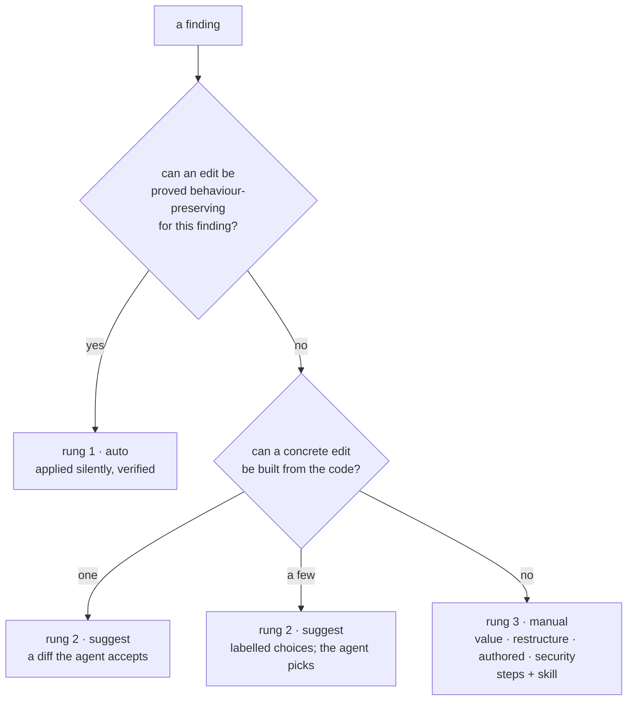

# SR-LAW-4 — L4 — every rule has a fix, automatic first

## §1 — For humans

**The law (L4).**

> **Every rule fixes what it finds, on the highest rung it can reach.** First
> **automatic**: the edit is applied with no one asked, because it can't change
> behaviour. Second **suggested**: a concrete diff, written so an AI agent (or
> a person) can accept it, because it might change behaviour. Last **manual**:
> written steps and a skill, **only by exception**, when no edit can be built
> from the code alone. "The tool we ported from had no fix" is never a reason.

**Ruled by Arpit, 2026-10-18; the ladder and the exceptions ruled 2026-10-30:**
*"Whenever a rule gets created, there has to be a fix for it. The first
priority is fixing it automatically. The second priority is suggesting it so
that AI agent can fix it. The last one is manual, and only in exceptional cases
we go with manual."*

**Why it exists.** An error without a fix is a chore handed to whoever reads
it; for an agent it's an invitation to guess, and guessing produces new errors.
On 2026-10-30, 577 of the 810 first-party rules (71%) were `manual`, and the
port plan (W-139) marked 1,499 more `manual` only because the upstream tool
had no fix. A review of every non-`auto` rule found most of them can climb.

**The ladder:**

| rung | class | applied by | use when | carries |
|---|---|---|---|---|
| 1 | `auto` | `codelaw fix`, save, agent hooks — silently | the edit can't change behaviour, for every finding or for a stated subset | the edit |
| 2 | `suggest` | an agent or person accepting a diff; `fix --unsafe` | the edit is mechanical but might change behaviour | one diff, or labelled **choices** when the right edit is one of a few |
| 3 | `manual` | an agent or person following steps, with a skill | **only** for one of four exceptions: `value`, `restructure`, `authored`, `security` | `fix_exception`, `## How to fix` steps, a skill |



<details>
<summary><b>ASCII twin</b></summary>

```text
  finding --> edit provably safe for THIS finding? --yes--> 1 auto    (applied, verified)
                  | no
                  v
              concrete edit from the code? --one----> 2 suggest (one diff for the agent)
                  |                         --a few--> 2 suggest (labelled choices)
                  | no
                  v
              3 manual — only: value | restructure | authored | security  (steps + skill)
```

</details>

---

## §2 — For agents

### Context

L4 required a fix class on every rule and preferred `auto`, but set no order
between `suggest` and `manual` and no bar for `manual`. Rules drifted to
`manual`: 577 of 810 first-party rules on 2026-10-30, and the port plan copied
"upstream has no fix" into 1,499 planned `manual` rules. A `manual` finding is
the worst case for an agent, which is codelaw's main user: it gets prose, not
a diff.

### Decision

1. **`fix:` is required** in every rule's frontmatter and is `auto`, `suggest`
   or `manual`. A missing or other value refuses the rule at load (exit 2).
2. **The ladder, per finding.** A rule declares the highest rung any of its
   findings reaches. **Each finding takes the highest rung its own edit can
   prove**, and never a higher one than the rule's:
   - a finding of an `auto` rule whose edit is not safe for that instance is
     reported as `suggest` with its diff, or `manual`;
   - a finding of a `suggest` rule for which no edit can be built is `manual`.

   A rule whose findings can drop says when in `fix_reason:` — the condition,
   not a generality ("auto when another specifier of the same import is used,
   so the module still loads; otherwise suggest").
3. **Rung 1 — `auto` first.** A rule is `auto` when its edit preserves
   behaviour for every finding, or for a subset the rule states (decision 2).
   Whether the tool a rule was ported from fixes it is evidence, never a
   reason: "upstream has no fix" does not justify `suggest` or `manual`, and an
   upstream fix that can change behaviour is not `auto` here.
4. **Rung 2 — `suggest`, written for the agent.** When the edit may change
   behaviour, the finding carries a concrete diff for an agent or a person to
   accept.
   - **Choices.** When the right edit is one of a few that the code itself
     determines — keep the first or the last duplicate key; `return` or
     `raise`; the closest valid names — the finding carries each as a
     **labelled alternative**. Every surface shows all of them (LSP quick
     fixes, MCP, JSON, SARIF, the agent hook). `fix --unsafe` applies a choice
     only when the rule marks one `default`.
   - **No placeholders.** A suggested edit never writes `TODO`, `...`, an empty
     string standing in for a value, or any text the author must replace. An
     edit that would need one is `manual` with exception `value`.
5. **Rung 3 — `manual`, only by a named exception.** A `manual` rule carries
   `fix_exception:`, one of:

   | exception | when | example |
   |---|---|---|
   | `value` | the fix needs a name, value or text the code does not contain | the exception class a test expects; a secret's env-var name |
   | `restructure` | the fix moves code across files or changes architecture | splitting a 900-line module; promisifying a callback API's callers |
   | `authored` | the finding is missing human-authored content | alt text; a docstring; a test's expected value |
   | `security` | any automatic or suggested edit would create false safety | "sanitising" input to silence an injection finding |

   `fix_reason:` says why in one line. A missing or other `fix_exception` on a
   `manual` rule refuses the rule at load (exit 2). A finding that drops to
   `manual` (decision 2) reports the rule's `fix_exception`, or `value` when the
   rule has none.
6. **The manual ceiling — first-party packs.** `packs/fix-ladder.toml` holds,
   for each first-party pack, the most `manual` rules it may ship. CI fails a
   change that takes a pack over its ceiling.
   - A change may lower a ceiling freely; **raising one needs the decider's
     ruling**, named in the commit message. As [L8](0010_LAW-8-performance-budgets.md)
     for budgets: never loosened silently.
   - The ceilings start at each pack's count on 2026-10-30 and only fall.
     Ported rules (W-139) count against them, so every port is judged against
     decisions 3–5, never inherited from its upstream.
   - Project rules (`.codelaw/rules`) and team packs follow decisions 1–5; the
     ceiling binds first-party packs only.
7. **The ladder is visible.** `codelaw rules --fix-stats` prints each pack's
   rules per rung and per exception, as text and JSON; each pack's README
   carries the same table, regenerated by `scripts/rule-docs.py`.
8. **Every diagnostic carries its fix**, in every output format (text, JSON,
   SARIF, agent, MCP, LSP code actions): the rule id; the location; what's
   wrong; the rung; the diff for `auto` and `suggest`, or every labelled
   choice; the steps and the `fix_exception` for `manual`.
9. **Fixes never corrupt a file.** Each `auto` or `suggest` edit, and each
   choice, is verified before it's written: the file still parses; a second
   run makes no further change (idempotent); the same rule no longer fires on
   the edited range. A failed verification drops that finding a rung
   (decision 2) and leaves the file untouched.
10. **Fixes touch only their own range.** Comments, formatting and code
    outside the edit are byte-identical before and after.
11. **Fixes are proven by the rule's own examples.** `codelaw test` applies
    each `auto` and `suggest` fix, and each choice, to every `Don't` example.
    The result must pass the rule, equal the paired `Do` example (or a `Fixed`
    block, one per choice: `Fixed (<label>)`), and be a fixpoint. Under
    [L3](0005_LAW-3-languages.md), for every language the rule declares. A rule
    that states a subset (decision 2) has a `Don't` example on each side of it.
12. **Agents get the same rungs.** Hooks apply `auto` silently and return what
    is left; `suggest` goes back as a diff, or as its choices, to accept or
    reject; `manual` goes back with its steps, its exception and its skill. An
    agent may never "fix" a finding by suppressing it; suppression is its own
    path ([SR-AGENT-SURFACES](0102_agent-surfaces.md), `codelaw-suppress`).
13. **A skill serves every `manual` fix.** `codelaw-fix`
    ([SR-AGENT-SURFACES](0102_agent-surfaces.md)) reads the rule's
    `## How to fix` steps and walks the person or agent through them; a rule
    may name a specialised skill in `fix_skill:`, and one that ships in no
    codelaw package refuses the rule at load. The skill guides; the engine
    decides ([L5](0007_LAW-5-no-model-in-the-engine.md)).
14. **Adapter findings** (oxlint, Ruff, stylelint, html-validate) take the
    tool's own fix: its safe autofix is `auto`, its unsafe one `suggest`, and
    anything else `manual` with the tool's rule docs as the steps. They carry
    no `fix_exception` and count against no ceiling: codelaw does not own them.
15. **The engine's own rules** (`codelaw/*`, `graph/*`, `format/*`) are bound
    like a pack's: each `manual` one carries its `fix_exception` in
    `ENGINE_RULES`.

16. **A project may lower a rule's fix, never raise it** (the decider,
    2026-10-30: *"Only down switching be allowed"*). `fix` in a rule's entry —
    `[rules]`, a `[scope.<name>]`'s `rules` or a `[profile.<name>.rules]` —
    takes a rung at or below the rule's own: `"py/unused-import" = { severity
    = "error", fix = "suggest" }`.
    - **Lowered to `suggest`:** the edit is no longer applied by `codelaw fix`,
      save or the agent hook; it is shown as a diff to accept, as decision 4.
    - **Lowered to `manual`:** no surface applies the edit; the finding shows
      it as the step to make by hand.
    - **Raising** (`fix = "auto"` on a `suggest` rule, anything above `manual`
      on a `manual` one) is a config error: exit 2, naming the rule and its own
      rung. Nothing forces an edit the rule's author did not prove safe.
    - `codelaw config --print` and `rules --why` show the lowered rung and the
      line that lowered it. A lowered rule counts against no ceiling (decision
      6 counts what a pack ships).

#### How L4 is enforced

- Rule loader: decisions 1, 5 and 13; the config loader: decision 16.
- `codelaw test`: decisions 11 and 13's steps, in CI over every first-party
  and project rule.
- The fix verifier: decisions 9 and 10, on every fix, not only in tests.
- `crates/codelaw-cli/tests/laws.rs`: decision 8's fields over the L3 fixture
  matrix, the loader refusals, and decision 6's ceilings against
  `packs/fix-ladder.toml`.

### Consequences

- **Built: partly.** Decisions 1, 3, 9–14 were built under the 2026-10-18 law.
  W-156 built (2026-10-31) the per-finding rung (2: `auto_when:`, `NativeRule::rung_of`),
  choices (4: `fix: { choices }`, `NativeRule::choices_of`, `Fixed (<label>)`),
  `fix_exception` (5, refused at load; `fix_pending:` stands in on a rule
  waiting to move up), the ceiling (6: `packs/fix-ladder.toml`), `--fix-stats`
  (7) and the engine rules' exceptions (15). The project's lowering (16)
  was built 2026-11-05 ([SR-CONFIG](0110_config.md) decision 11d).
- **The review of 2026-10-30** proposed a rung for each of the 717 non-`auto`
  rules ([`work/proposals/fix-ladder.md`](../work/proposals/fix-ladder.md)):
  `manual` would fall from 577 to 147, and `auto` (always or for a stated
  subset) would rise from 93 to 254. W-156 moves the rules; each move is its
  own small change with its examples.
- **Rule authors carry more cost:** a subset condition, choices with their own
  `Fixed` examples, an exception. That is the point: the cost moves from every
  reader of a finding to the one author of the rule.
- **The engine gains choices:** a diagnostic holds several labelled edit sets.
  LSP and SARIF already model several fixes per finding.
- **The port plan changes:** W-139's 1,499 ports marked `manual` because their
  upstream has no fix are re-judged under decisions 3–5 before they are built.

### Alternatives considered

- **A new law, L12, beside L4:** rejected. A law restated in two places is two
  laws the moment one is edited ([SR-LAWS](0001_LAWS.md)); the ladder is L4's
  subject, so L4 is rewritten.
- **Fixes optional, as in ESLint:** rejected (2026-10-18). Most rules would
  ship without one.
- **Auto-fix everything that's mechanical:** rejected (2026-10-18). A fix that
  can change behaviour needs someone to accept a diff.
- **A ledger the decider signs for every `manual` rule:** rejected. Several
  hundred entries; the exception key plus a ceiling that only falls gives the
  same control with one ruling per increase.
- **Suggestions with placeholders, so nothing is `manual`:** rejected. A diff
  that writes `TODO` is a manual fix wearing a suggestion's label, and an agent
  that accepts it ships the placeholder.

### Reference (required)

- [`docs/DESIGN.md`](../docs/DESIGN.md) §3.3: the fix model this law binds.
- [`work/proposals/fix-ladder.md`](../work/proposals/fix-ladder.md): the
  2026-10-30 inventory and per-rule review.
- [`work/proposals/rule-parity/`](../work/proposals/rule-parity/): each
  upstream tool's fix ability, per rule.
- `crates/codelaw-core/src/diagnostic.rs` `FixClass`, `Diagnostic`.

### Veto condition

**Reopen this decision if:** a first-party pack ships more `manual` rules than
its ceiling in `packs/fix-ladder.toml`, or a `manual` rule anywhere carries no
`fix_exception` once W-156 has landed.

**How to check it:** `codelaw rules --fix-stats --check` (W-156). Until then:
`grep -rL '^fix_exception:' $(grep -rl '^fix: manual' packs --include=*.md | grep -v cases)`
lists the `manual` rules still without one.

---

## References

*Every source this record cites, gathered in one place. An archived document is never listed here.*

**Records** — [SR-LAWS](0001_LAWS.md) · [SR-AGENT-SURFACES](0102_agent-surfaces.md) · [SR-LAW-3](0005_LAW-3-languages.md) · [SR-LAW-5](0007_LAW-5-no-model-in-the-engine.md) · [SR-LAW-8](0010_LAW-8-performance-budgets.md)

**Code** — `crates/codelaw-core/src/diagnostic.rs` · `crates/codelaw-rules/src/rule.rs` · `crates/codelaw-cli/tests/laws.rs`

**Project docs** — [`docs/DESIGN.md`](../docs/DESIGN.md) · [`work/proposals/fix-ladder.md`](../work/proposals/fix-ladder.md) · [`work/proposals/rule-parity/`](../work/proposals/rule-parity/)
