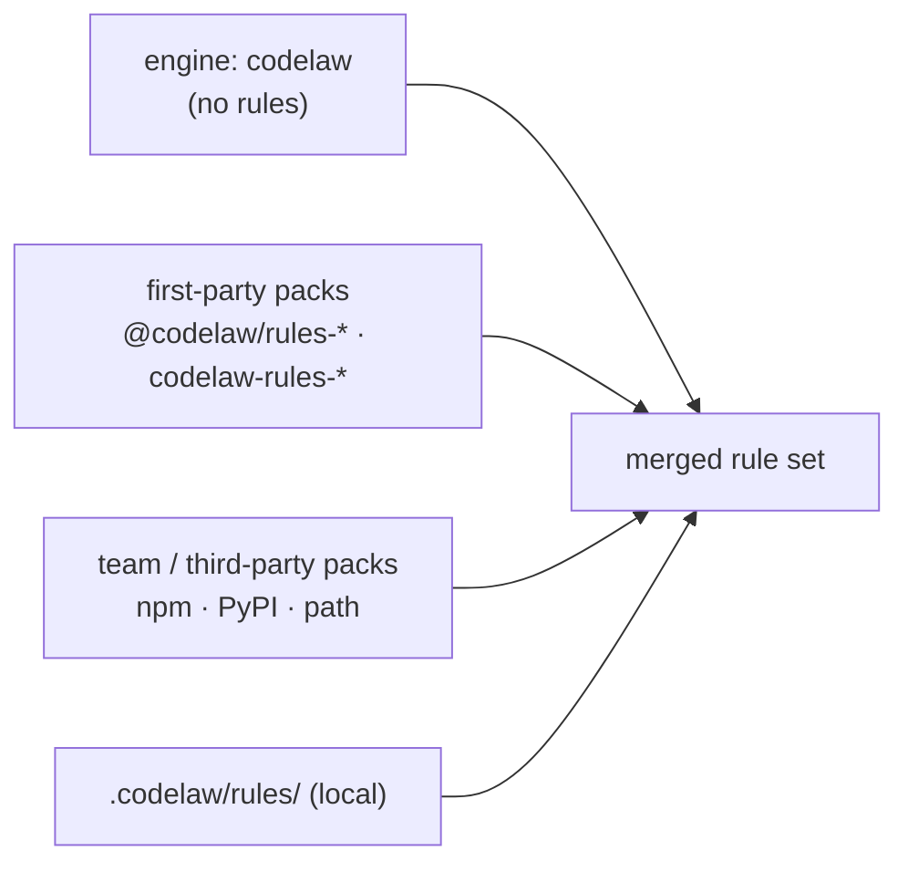

# SR-RULE-PACKS — twenty-seven first-party rule packs published apart from the engine, twenty on npm and eighteen on PyPI; team packs and local rules on the same footing

## §1 — For humans

**The decision in one line.** The engine package, `codelaw`, carries **no rules**. codelaw's own rules ship as **twenty-seven rule packs**. A pack is published on **npm as `@codelaw/rules-<name>`**, on **PyPI as `codelaw-rules-<name>`**, or on both, as §1's table says, in the same release and at the same version as the engine. `codelaw init` installs the packs for the languages it finds. Teams publish their own packs the same way, and project rules stay in `.codelaw/rules/`.

**Ruled by Arpit, 2026-10-19:**
- the packs are separately published, not just separate in the source tree;
- every pack is mirrored on both registries;
- a fifth pack, `rules-data`, covers JSON, YAML, TOML and Markdown;
- `init` installs the packs it detects a need for.

This record was rewritten to that ruling and then accepted ("go with the recommendations").

**Ruled by Arpit, 2026-10-24** (W-31), superseding "every pack is mirrored on both registries": *"The ones that are going to be used in npm and the ones that are going to be used in PyPI should only be published."*
- `rules-js` splits into `js`, `ts`, `react`, `node` and `stencil`;
- **npm** carries `js`, `ts`, `react`, `node`, `stencil`, `html`, `css` and `data` (eight);
- **PyPI** carries `js`, `react`, `html`, `css`, `python` and `data` (six);
- `rules-python` leaves npm, and `ts`, `node` and `stencil` are not on PyPI.

**Ruled by Arpit, 2026-10-24** (W-32): *"i want a redux tool kit and react query pack as well in npm"*; names and source ruled the same day at the docket, the query pack renamed `tanstack-query` on 2026-10-25.
- two npm-only library packs: `tanstack-query` (@tanstack/eslint-plugin-query's `recommended`, reimplemented) and `redux-toolkit` (codelaw's own rules, written from the Redux Style Guide's Priority A and B rules: there is no official Redux Toolkit ESLint plugin);
- **npm** carries ten packs; PyPI is unchanged.

**Ruled by Arpit, 2026-10-25** (W-52): *"I want latest versions of any dependencies that are present in Node or Python to be highlighted as well."* On the design, the same day: *"Let's go with it. I like the suggestion."* — a separate, explicit network command writes a committed snapshot, and two `data/*` rules read it offline (decision 15; [L5](0007_LAW-5-no-model-in-the-engine.md) decision 3).

**Ruled by Arpit, 2026-10-25** (W-53): *"I want to create a pack for security issues. Security issues like Veracode, Black Duck, X-Ray, OWASP. … So create … one for JavaScript, one for TypeScript, one for HTML, one for Python."*
- four security packs, `security-js`, `security-ts`, `security-html` and `security-python` (namespaces `sec-js`, `sec-ts`, `sec-html`, `sec-py`), on the existing split: npm carries js, ts and html, PyPI js, html and python;
- every rule in them carries `security:` metadata — CWE, OWASP Top 10:2025 category, severity ([SR-RULE-FORMAT](0112_rule-format.md) decision 2a);
- each has a `recommended` preset (high-confidence rules, `error`) and a `strict` one (adds the heuristic rules, `warn`);
- `security-ts` **extends** `security-js` (the `sec-js` rules already run on TypeScript), and `security-html` turns on the html pack's own security rules through `html/security` instead of copying them (decision 3);
- **npm** carries thirteen packs and **PyPI** nine. `security-js` has its 66 rules since W-54 (2026-10-26, [archived](../archive/open/W-54-security-js-pack.md)): 55 in `sec-js/recommended` at `error`, 11 more in `strict` at `warn`, a `data/sources/` table per request-source family for `from_source:`, counts in `packs/security-js/corpus.toml` from the three pinned repositories. `security-ts` has its 16 rules since W-55 (2026-10-26, [archived](../archive/open/W-55-security-ts-pack.md)): 10 in `sec-ts/recommended` at `error` (on top of `sec-js/recommended`), 6 more in `strict` at `warn`, syntax-only. `security-html` is still a scaffold until [W-56](../work/open/W-56-security-html-pack.md). `security-python` has its 61 rules since W-57 (2026-10-26, [archived](../archive/open/W-57-security-python-pack.md)): `match:` rules only, from Bandit and Ruff `S`, Django, Flask, FastAPI, ML loaders and LLM sinks, in `packs/security-python/README.md`.

**Ruled by Arpit, 2026-10-26** (W-62): *"The CSS pack should work with SCSS, and CSS modules as well"* and *"Create separate packages for SCSS and CSS modules."* SCSS joins [L3](0005_LAW-3-languages.md) as a CSS dialect:
- the `css` pack's rules declare `scss` and run on `.scss` files (the Sass at-rules and `//` comments are read, not reported);
- a new `scss` pack, on **both registries**, holds the `scss/*` rules (stylelint-scss ports and Dart Sass's module-system migrations) with `scss/recommended` and `scss/strict`; **npm** carries fourteen packs and **PyPI** ten.

**Ruled by Arpit, 2026-10-26** (W-63): *"Create separate packages for SCSS and CSS modules."* A `css-modules` pack, **npm only** (CSS Modules are a JavaScript-bundler feature), holds the `css-modules/*` rules (no-unused-class, no-undefined-class, composes-valid, class-naming, no-global) with `css-modules/recommended` and `css-modules/strict`. The `css` pack's rules read a module stylesheet without reporting its syntax; **npm** carries fifteen packs and **PyPI** ten.

**Ruled by Arpit, 2026-10-27** (W-103, Cowork, by voice, on the CSpell research): *"want it as a separate package."* A `spell` pack, on **both registries**, holds the `spell/*` rules — codelaw's own spell checker, with its word data in the pack's `data/spell/`, generated from SCOWL ([SR-SPELL](0116_spell.md)); `spell/recommended` and `spell/strict`. `init` never adds it (decision 6); **npm** carries sixteen packs and **PyPI** eleven.

**Ruled by Arpit, 2026-10-29** (W-128, Cowork, by voice): *"I like the first one, that is deps."* — a `deps` pack, on **both registries**, for everything about dependencies: `data/outdated-dependency` and `data/stale-deps-snapshot` move into it as `deps/outdated` and `deps/stale-snapshot`, and it gains `deps/vulnerable` and `deps/incomplete-scan` (decision 15). On the advisory sources: *"I want the URLs configurable … multiple sources … I can mark them as true or false … find a URL that will definitely not be blocked and keep it as the first one."* · *"Merge all the enabled ones."* · *"We build everything in single shot."* One pack only — the security packs do not re-export it. **npm** carries seventeen packs and **PyPI** twelve ([the proposal](../work/proposals/deps-flags-markers-reviews.md) §2).

**Ruled by Arpit, 2026-10-30** (W-144, Cowork, by voice): *"The next JS pack. Let's create it."* — a `nextjs` pack, **npm only** (Next.js is a Node framework), holding @next/eslint-plugin-next's 22 rules under the namespace `next`, with `next/recommended` on when it is installed; `codelaw init` adds it when `package.json` depends on `next`. **npm** carries eighteen packs and **PyPI** twelve. Its registry name is confirmed under W-142 before the release that first carries it.

**Ruled by Arpit, 2026-10-30** (W-138, Cowork, by voice): *"Let's build the 39 ones."* and *"Give each framework its own pack."* — Ruff's framework rules as five packs, **PyPI only** (as `python` is): `django` (flake8-django's `DJ`), `fastapi` (`FAST`), `airflow` (`AIR`), `numpy` (`NPY`) and `pandas` (pandas-vet's `PD`), each namespace its pack's name. **npm** carries eighteen packs and **PyPI** seventeen. `init` does not add them: installing one is the opt-in. Their names are confirmed under W-142.

**Ruled by Arpit, 2026-10-30** (W-145, Cowork, by voice): *"I want the class sorting in the formatter."* — a `tailwind` pack on **both registries** (Tailwind classes live in JSX, HTML and Python templates) holding the bug-catching rules W-144 picked, and Tailwind class sorting in the formatter ([SR-FORMATTER](0105_formatter.md) decision 9). On where Tailwind's order comes from: *"We shouldn't be looking into Tailwind or Prettier. As a package and generating a copy of the list in the package. It should be a peer dependency … So it should be based on whatever is present in node modules"* → *"Let's call it a provider."* → *"So provider is going to be a separate package, right? So that it does not get built bundled inside the engine."* → on the pack depending on its provider or naming it in its manifest: *"Why not both?"* → on a missing provider: *"So I want it configurable … whether to skip it or to throw a hard error"*, *"Default to be skip."* — decision 19.
**Ruled by Arpit, 2026-10-30** (W-144, Cowork, by voice): *"Let's create it."* — a `testing` pack, **npm only**, holding the 182 Jest, Vitest, Testing Library and Playwright rules W-144's CSVs mark `port`, with one opt-in preset per framework — `testing/jest`, `testing/vitest`, `testing/testing-library`, `testing/playwright` — so a project switches on the ones it uses; Python's test rules stay in `python`. `codelaw init` adds the pack, and each framework's preset, when `package.json` depends on `jest`, `vitest`, any `@testing-library/*` or `@playwright/test`. The namespace `testing` is W-139's coordinator's call under the decider's *"don't wait"* direction (the proposal wrote `test/`), reversible by rename under W-142. **npm** carries nineteen packs and **PyPI** seventeen.

| Pack | npm | PyPI | Languages | Presets |
|---|---|---|---|---|
| engine | `codelaw` | `codelaw` | none: this is the engine. It ships only the `codelaw/*` meta diagnostics, the formatter's `format/unformatted` and `format/failed`, and `graph/no-deprecated-usage` | — |
| `js` | `@codelaw/rules-js` | `codelaw-rules-js` | JS, JSX; its core rules also run on TS and TSX | `js/recommended`, `js/typescript`, `js/conventions`, `js/project`, `js/size`, `js/markers`, `js/jsdoc`, `js/strict`, `js/taste`, `js/sonarjs`, `js/regexp` (decision 18, W-139; `js/recommended` extends it) |
| `ts` | `@codelaw/rules-ts` | — | TS, TSX | `ts/recommended`, `ts/conventions`, `ts/type-checked` (the type-aware rules — nine `preview` rules and `ts/type-error` as of W-105, 2026-10-30 — [SR-TYPES](0117_types.md)) |
| `react` | `@codelaw/rules-react` | `codelaw-rules-react` | JSX, TSX, and React in JS and TS | `react/recommended`, `react/a11y` (decision 18, W-139), `react/conventions`, `react/size` (decision 15, W-132) |
| `node` | `@codelaw/rules-node` | — | JS, JSX, TS, TSX run on Node.js | `node/recommended` |
| `stencil` | `@codelaw/rules-stencil` | — | TS, TSX Stencil components | `stencil/recommended`, `stencil/conventions` |
| `html` | `@codelaw/rules-html` | `codelaw-rules-html` | HTML, incl. HTML embedded in Markdown and templates | `html/recommended`, `html/a11y`, `html/document`, `html/conventions`, `html/security`, `html/size`, `html/markers` |
| `css` | `@codelaw/rules-css` | `codelaw-rules-css` | CSS, and SCSS for the rules that declare it | `css/recommended`, `css/standard`, `css/conventions`, `css/project`, `css/size`, `css/markers` |
| `scss` | `@codelaw/rules-scss` | `codelaw-rules-scss` | SCSS | `scss/recommended`, `scss/strict` (extends `scss/recommended`), `scss/markers` |
| `css-modules` | `@codelaw/rules-css-modules` | — | `*.module.css`, `*.module.scss` and the JS and TS that import them | `css-modules/recommended`, `css-modules/strict` (extends `css-modules/recommended`) |
| `python` | — | `codelaw-rules-python` | Python | `py/recommended`, `py/conventions`, `py/project`, `py/size`, `py/markers` · *later:* `py/strict` |
| `data` | `@codelaw/rules-data` | `codelaw-rules-data` | JSON, YAML, TOML, Markdown | `data/recommended`, `md/recommended`, `data/package-json`, `data/tsconfig`, `data/pyproject`, `data/github-actions`, `data/conventions`, `data/markers`, `data/codeowners` (decision 16) |
| `tanstack-query` | `@codelaw/rules-tanstack-query` | — | JS, JSX, TS, TSX using TanStack Query | `tanstack-query/recommended` |
| `redux-toolkit` | `@codelaw/rules-redux-toolkit` | — | JS, JSX, TS, TSX using Redux | `redux-toolkit/recommended` |
| `security-js` | `@codelaw/rules-security-js` | `codelaw-rules-security-js` | JS, JSX, and the TS and TSX that run them | `sec-js/recommended`, `sec-js/strict` |
| `security-ts` | `@codelaw/rules-security-ts` | — | TS, TSX (TypeScript-only security rules) | `sec-ts/recommended`, `sec-ts/strict` (extend `sec-js/*`) |
| `security-html` | `@codelaw/rules-security-html` | `codelaw-rules-security-html` | HTML | `sec-html/recommended` (14 rules at `error`), `sec-html/strict` (5 more at `warn`); both extend `html/security`; 19 native rules, each with `security:` (W-56, 2026-10-26) |
| `security-python` | — | `codelaw-rules-security-python` | Python (61 rules, W-57) | `sec-py/recommended`, `sec-py/strict` |
| `spell` | `@codelaw/rules-spell` | `codelaw-rules-spell` | all nine L3 languages: their comments, docs, prose strings, Markdown and HTML text (W-103) | `spell/recommended`, `spell/strict` (extends `spell/recommended`) |
| `deps` | `@codelaw/rules-deps` | `codelaw-rules-deps` | the dependencies of `package.json` and `pyproject.toml` and what their lockfiles install (decision 15, W-128) | `deps/recommended` |
| `nextjs` | `@codelaw/rules-nextjs` | — | Next.js apps in JS, JSX, TS and TSX (namespace `next`; decision 18, W-139) | `next/recommended` |
| `testing` | `@codelaw/rules-testing` | — | test files in JS, JSX, TS and TSX: Jest, Vitest, Testing Library, Playwright (namespace `testing`; decision 18, W-139) | `testing/jest`, `testing/vitest`, `testing/testing-library`, `testing/playwright` |
| `django` | — | `codelaw-rules-django` | Python using Django (decision 18, W-139) | `django/recommended` |
| `fastapi` | — | `codelaw-rules-fastapi` | Python using FastAPI | `fastapi/recommended` |
| `airflow` | — | `codelaw-rules-airflow` | Python Airflow DAGs | `airflow/recommended` |
| `numpy` | — | `codelaw-rules-numpy` | Python using NumPy | `numpy/recommended` |
| `pandas` | — | `codelaw-rules-pandas` | Python using pandas | `pandas/recommended` |
| `tailwind` | `@codelaw/rules-tailwind` | `codelaw-rules-tailwind` | the class lists of JS, JSX, TS, TSX and HTML in a project that uses Tailwind CSS; three of its eight rules read a provider's class table (decision 19, W-145) | `tailwind/recommended` |

`FIRST_PARTY_PACKS` in `crates/codelaw-rules/src/pack.rs` is this table in code, and `scripts/package.py` reads it, so the engine and the release name the same packs on the same registries.

*Later* marks a preset the ruling names that no pack ships yet: `py/strict` is planned as B-048 in [`work/BACKLOG.md`](../work/BACKLOG.md) and is not in `packs/` (checked 2026-10-20; `js/strict` shipped 2026-11-05, W-139). Every other preset in the table is in its pack's `codelaw-pack.toml` and `presets/`. Each `<namespace>/project` preset is opt-in and turns on only that pack's `graph/*` rule, the one that reads the whole repository (W-26, 2026-10-24); `init` does not write it.

**What you install depends on your repo.** A Python-only repo installs `codelaw` and `codelaw-rules-python`, plus `codelaw-rules-data` if it wants `pyproject.toml`, YAML and Markdown checked, all from PyPI, and never touches npm. A React and TypeScript repo installs `codelaw`, `@codelaw/rules-js`, `@codelaw/rules-ts`, `@codelaw/rules-react` and, likely, `@codelaw/rules-data` from npm. **What each registry leaves out:** a repo that installs only from npm gets no Python rules (`py/*`, `sec-py/*`), and one that installs only from PyPI gets no `ts/*`, `node/*`, `stencil/*`, `tanstack-query/*`, `redux-toolkit/*` or `sec-ts/*` rules (its TypeScript still gets the `js` rules that declare it, and `js/typescript`).



<details>
<summary><b>ASCII twin</b></summary>

```text
   engine codelaw (no rules) ------------------+
   first-party packs (rules-js, -ts, -react,   |
     -node, -stencil, -html, -css, -python,    |
     -data, -tanstack-query, -redux-toolkit,   |
     -security-js/-ts/-html/-python) ----------+--> merged rule set   (local wins, then packs in extends order)
   team / third-party packs (npm, PyPI, path) -+
   local .codelaw/rules/ ----------------------+
```

</details>

---

## §2 — For agents

### Context

The first version of this record (2026-10-18) embedded codelaw's predefined rules in the binary, because the decider had left the choice open. On 2026-10-19 he asked for the presets of ESLint, typescript-eslint, TSLint, Ruff, Prettier, stylelint and the HTML linters to be researched. He also asked for the rules to ship as separate packages, one per ecosystem, with the engine on its own. He then ruled on the shape (§1).

The research ([W-03](../archive/open/W-03-rule-packs.md)) found that porting the correctness core of those presets yields several hundred rules. Some of those rules need per-ecosystem data tables (CSS properties, HTML elements, JSON Schemas). Embedding all of that in the binary would make every user carry every ecosystem's rules and data.

### Decision

1. **The engine carries no rules except its own:**
   - the `codelaw/*` meta diagnostics, such as `codelaw/not-utf8`, `codelaw/internal-error` and `codelaw/no-rules` ([SR-ARCHITECTURE](0108_architecture.md));
   - `format/unformatted` and `format/failed`, the formatter's findings in `check` ([SR-FORMATTER](0105_formatter.md) decisions 1 and 4);
   - `graph/no-deprecated-usage`, which reads the consumer's deprecations registry and belongs to no language, and runs only when the project declares deprecations; and `codelaw/stale-baseline`, a baseline entry its file has outgrown ([SR-BASELINE](0104_baseline-and-deprecations.md) decisions 2 and 6); and the dated-exception rules `codelaw/expiring-exception`, `codelaw/expired-exception`, `codelaw/exception-without-expiry` and `codelaw/exception-author` (SR-BASELINE decision 9).
   - the test rules of new code, `graph/untested-function` and `graph/function-coverage`, with `codelaw/stale-coverage` ([SR-PROJECT-GRAPH](0103_project-graph.md) decision 9). They belong to no pack and are off until the project turns them on: the engine's own preset `codelaw:tests` (`extends = ["codelaw:tests"]`, no namespace, resolved by no pack and in no `recommended`), a `[coverage]` table, or the rule named in `[rules]`. `.codelawignore`'s `codelaw/incomplete-ignore` and `codelaw/stale-ignore` (SR-BASELINE decision 12) run whenever the project has the file, since it exempts from any rule (W-158). `codelaw/off-without-reason` runs when `[rules] require_reason` is on: a rule turned `"off"` in the project's config with no `reason` ([SR-CONFIG](0110_config.md) decision 11c, W-158).
   - the pull-request hygiene rules `git/commit-message`, `git/branch-name`, `git/pr-size` and `git/pr-description` (W-146): they judge commits, a branch and a pull request, not a file of any L3 language, read `[commits]`, `[branches]` and `[pr]` ([SR-CONFIG](0110_config.md) decision 11b), and run only under `--changed-since`, in the `commit-msg` hook and in the agent hook ([SR-ARCHITECTURE](0108_architecture.md) decision 14). A preset's `[rules]` may set them though no pack holds them — the one exception to a preset naming only its own pack's rules, checked when the pack loads — so a preset shares those tables (SR-CONFIG decision 11b; `RuleSet::engine_settings`).

   Every other rule codelaw publishes lives in a pack.
2. **The twenty-seven first-party packs, their registries and their presets** are §1's table. A library pack (`tanstack-query`, `redux-toolkit`) checks one library's API in the JS-family languages; its rules that follow a hook or a constructor check that it is imported from that library, so the same name from elsewhere is left alone.
   - Graph rules live with their language: `graph/no-unused-exports` in `js` and `python`, and `graph/no-unused-css-classes` in `css`. A graph rule two packs ship loads as one rule over both packs' languages with the later pack's body, so **the copies' `codelaw` blocks are identical** (a `codelaw-graph` test holds them so): when the `python` copy listed fewer kinds, a TypeScript repo lost its `interface` and `enum` findings whenever `python` loaded last (W-11 corpus run, 2026-10-22). A pack rule may also be `scope: project` under its own prefix: `node/recommended`'s six import rules (`node/no-{missing,extraneous,unpublished}-{import,require}`) run on the graph's `import:` query ([SR-PROJECT-GRAPH](0103_project-graph.md) decision 6). A file-scope native rule that reads the files around it stays file-scope: `node/hashbang` reads the nearest `package.json`'s `bin`, `md/relative-links` checks each relative link's target, and `html/no-utf8-bom` reads the file's bytes (SR-ARCHITECTURE decision 15b; W-21, 2026-10-22).
   - **A rule's fix class follows what the grammar can verify.** The engine refuses a fix whose output parses worse than its input (SR-ARCHITECTURE decision 5), so a rule whose fix writes syntax the grammar rejects ships `manual`. `css/media-feature-range-notation` is `auto` because codelaw's CSS grammar fork parses the range syntax it writes (SR-ARCHITECTURE decision 3; W-21, 2026-10-22).
   - There's **no umbrella preset that spans packs**, because it would require packs the repo hasn't installed.
3. **Pack layout.** A pack is the same folder in the source tree (`packs/<name>/` in the codelaw repo) and in each published form it has:

   ```text
   packs/js/
   ├─ codelaw-pack.toml               name, version, min_codelaw, languages, presets, providers (decision 19)
   ├─ presets/<preset>.toml           the rules a preset turns on, with severity and options
   ├─ rules/<namespace>/<name>.md     rule files (SR-RULE-FORMAT), + <name>.cases.md
   ├─ data/                           tables rules read: CSS properties, HTML elements, JSON Schemas
   ├─ README.md                       rule count per preset; ported / not-ported table; upstream versions
   └─ LICENSE · NOTICE
   ```

   - **On npm,** the package *is* this folder.
   - **On PyPI,** it is one pure `py3-none-any` wheel whose `codelaw_rules_<name>` package holds this folder as package data.
   - **Every published form holds the folder's files, byte for byte**, so a pack on both registries is the same on both. A pack has no code to execute and no dependencies.
   - **A preset** is `presets/<namespace>/<name>.toml`: an optional `description`, an optional `extends`, and a `[rules]` table, a severity or `{ severity, options }` per rule. Every rule its `[rules]` names is in the pack: the four core rules typescript-eslint switches on for TypeScript are `js/typescript` in `js`, not part of `ts/recommended` (2026-10-24), and each pack's starter conventions are its own `<namespace>/conventions`.
   - **A preset may ship scopes** (W-59, 2026-10-26): `[scope.<name>]` tables with `files`, `exclude`, `rules` and `remap`, the shapes of [SR-CONFIG](0110_config.md) decision 3a, each naming rules of its own pack and always with `files`. They are laid in front of the project's scopes in `extends` order, and a project scope of the same name extends them. `js/recommended` ships `tests` (`**/*.test.*`, `**/*.spec.*`), `stories` (`**/*.stories.*`) and `config` (`**/*.config.*`); `py/recommended` ships `tests` (`**/tests/**`, `**/test_*.py`, `**/*_test.py`). A scope sets no rule by itself: it is a name for the files, which a project fills in.
   - **A preset may extend first-party presets** (W-53, 2026-10-25): `extends = ["codelaw:<namespace>/<preset>", …]`, only `codelaw:` entries, never itself. They are resolved as `extends` entries are (decision 4) **before** the preset's own `[rules]`, so its settings win, and `rules --why` names the chain (`codelaw:html/security (extended by codelaw:sec-html/recommended)`). A pack it needs that is not installed stops the run with decision 4's error, naming the preset that needed it; presets that extend each other in a cycle are a load error (`crates/codelaw-rules/src/ruleset.rs`).
     - **A first-party preset extends only a pack published on every registry its own pack is** (a test in `pack.rs` holds it), so neither registry's users need the other: `sec-ts/*` (npm) extends `sec-js/*` (npm and PyPI); `sec-html/*` (both) extends `html/security` (both); each `strict` extends its `recommended`.
     - **`html/security`** gathers the html pack's five security rules — `html/require-sri`, `html/target-blank-rel`, `html/no-inline-script`, `html/autocomplete-password`, `html/meta-refresh` — so `sec-html/recommended` turns them on without a copy.
     - **`size` presets** (W-61, 2026-10-26): `html/size` holds `html/max-lines` and `css/size` holds `css/max-lines`, each opt-in and in no `recommended`. Both count lines of a whole file only (`.html`/`.htm`; `.css`, and `.scss` once it is a language) and do nothing on a `<style>` region or a fenced block. Options: `max` (HTML 400, CSS 300), `skip_blank_lines` and `skip_comments` (true), `skip_imports` (CSS, false), `skip_embedded` (HTML, false: lines wholly inside `<script>` and `<style>`). `fix: manual`.
     - **`markers` presets** (W-131, 2026-10-30; [SR-CONFIG](0110_config.md) decision 11a): `js/markers`, `py/markers`, `css/markers`, `scss/markers`, `html/markers` and `data/markers`, each opt-in and in no `recommended`, since a repo with bare TODOs gets them all at once. The rules, each `native:` in the pack of its language: `js/todo-marker` (JS, JSX, TS, TSX), `py/todo-marker`, `css/todo-marker`, `scss/todo-marker`, `html/todo-marker`, `yaml/todo-marker`, `toml/todo-marker` and `md/todo-marker` (`manual`); `js/no-focused-tests` (`suggest`: the fix drops the focus), `js/skipped-test` and `py/skipped-test` (`manual`). They read `[todo]` and `[tests.skip]`; a date is judged on the as-of date, never the clock ([L5](0007_LAW-5-no-model-in-the-engine.md)).
     - **Complexity and nesting** (W-132, ruled 2026-10-29): `js/complexity` and `py/complexity` (cyclomatic: one plus each `if`/`elif`, loop, `case`, `catch`/`except`, conditional expression and `&&`/`||`/`??` or `and`/`or`; a nested function is counted on its own; default `max` 20; JS `count_optional_chain`) and `js/max-depth` and `py/max-depth` (nested `if`, `switch`/`match`, `try`, loops, `with`; `else if` and `elif` add none; a function starts again at zero; default `max` 4) join the `js/size` and `py/size` presets, opt in. They are further measures of the `Size` native rule (the six W-58 rules' mechanism), `fix: manual`, with the measured value in `data` (`complexity` or `depth`, and `max`).
     - **Component size** (W-132, ruled 2026-10-29): `react/size`, a new opt-in preset of the `react` pack, holds `react/component-max-lines` (200 lines; a component is a capitalised function that holds JSX, also inside `memo` and `forwardRef`, or a class extending `Component`), `react/max-props` (8; the keys the first parameter destructures or the members of its declared type in the same file, whichever is more) and `react/max-jsx-depth` (6; nesting counts through `{…}` and a callback does not reset it). Measures of the same `Size` native rule; `fix: manual`; `ignore_names` exempts a component.
   - **A data table** is `data/**/*.json`, named by its path under `data/` without `.json` (`data/globals/browser.json` is `globals/browser`).
4. **Resolution.** First-party presets are named `codelaw:<namespace>/<preset>` in `extends`, for example `codelaw:js/recommended`.
   - **A pack is first-party** when its manifest `name` is one of §1's: the npm name when the pack is on npm, else its PyPI name (`codelaw-rules-python`).
   - **Namespace to pack** is a fixed map in the engine:
     - `js` → `rules-js`; `ts` → `rules-ts`; `react` → `rules-react`; `node` → `rules-node`; `stencil` → `rules-stencil`;
     - `html` → `rules-html`;
     - `css` → `rules-css`;
     - `py` → `rules-python`;
     - `data`, `md`, `json`, `yaml`, `toml` → `rules-data`;
     - `tanstack-query` → `rules-tanstack-query`; `redux-toolkit` → `rules-redux-toolkit`;
     - `sec-js` → `rules-security-js`; `sec-ts` → `rules-security-ts`; `sec-html` → `rules-security-html`; `sec-py` → `rules-security-python`.
     - `spell` → `rules-spell` (W-103).
     - `next` → `rules-nextjs`; `django`, `fastapi`, `airflow`, `numpy`, `pandas`, `testing` → `rules-<the same name>` (W-139).
     - `tailwind` → `rules-tailwind` (W-145).
   - **Where the pack is found** — the folders, their order, the project `.venv` fallback and the `[packs]` keys that replace them — is [SR-PACK-LOOKUP](0118_pack-lookup.md), built in `crates/codelaw-rules/src/search.rs` (W-155). The first folder holding the pack wins; both copies of one version are identical (decision 3). The language server completes a `codelaw.toml`'s rule ids, presets and options from the packs that same search finds, and names each first-party pack it does not find with its install command, never guessing its ids (W-157, [SR-EDITOR](0114_editor.md) decision 9).
   - **A missing pack stops the run:** exit 2, with an error naming every install command the pack has and every folder searched (SR-PACK-LOOKUP decision 8), for example `npm i -D @codelaw/rules-js` and `pip install codelaw-rules-js`; a pack on one registry is named as that registry's only (`@codelaw/rules-ts, which is published on npm only`).
5. **One version, released together.** The engine, the twenty-seven packs and their providers (decision 19) carry one version and are published by one release job ([L6](0008_LAW-6-python-and-node-packages.md) decision 9).
   - Each pack's manifest declares `min_codelaw`. An engine older than that refuses the pack, with an error naming the upgrade.
   - `codelaw rules --why <id>` and the JSON output name the pack and version each rule came from.
6. **`codelaw init` installs what it detects.**
   - **Languages to packs:** JS/JSX → `js`; TS/TSX → `js` and `ts`; HTML → `html`; CSS → `css`; SCSS → `scss` and `css` (also `sass`, `sass-embedded` or `node-sass` in `package.json`; W-62); a `*.module.css` or `*.module.scss` file → `css-modules`, which is npm only (W-63); Python → `python`; JSON/YAML/TOML/Markdown → `data`. With JS or TS, `react` when `package.json` depends on `react`, `stencil` when it depends on `@stencil/core`, `tanstack-query` when it depends on `@tanstack/react-query` or `react-query`, and `redux-toolkit` when it depends on `@reduxjs/toolkit` or `redux`, and `nextjs` when it depends on `next`, and `testing` when it depends on `jest`, `vitest`, any `@testing-library/*` or `@playwright/test`, with the preset of each one it names (W-139). A root `package.json` or `pyproject.toml` adds `deps`, with `codelaw:deps/recommended` (W-128). Every repo gets `spell` (with `codelaw:spell/recommended`), unless `--no-spell` ([SR-SPELL](0116_spell.md) decision 1; reversed by the decider 2026-10-28, W-112: *"Let it be part of code law init itself."*). `node` and the four security packs are never added by `init`: a security pack is chosen, not detected.
   - **Tailwind CSS** (W-145): `tailwind` when `package.json` depends on `tailwindcss`, `@tailwindcss/vite`, `@tailwindcss/postcss` or `@tailwindcss/cli`, or the repo holds a `tailwind.config.*` or a `.css` file that imports "tailwindcss"; from npm it installs `@codelaw/provider-tailwind` beside it (decision 19), and from PyPI it prints a `note:` that the provider is npm only.
   - **The schema line:** `codelaw.toml` opens with `#:schema`, pointing at npm `codelaw`'s schema or at the PyPI release's ([SR-CONFIG](0110_config.md) decisions 6 and 8; W-157).
   - **How it installs:** it adds those packs as dev dependencies with the package manager the repo already uses: npm, pnpm, yarn or bun for a `package.json` repo; uv, pip or poetry for a `pyproject.toml` repo. A repo with both uses both — `rules-python` from PyPI, the other packs from npm — unless `--registry npm|pypi` picks one.
   - **A pack the chosen registry does not publish** (§1) comes from the other registry when the repo uses that one too, or uses neither; otherwise — and always under `--registry` — it is left out, its presets are not written, and `init` prints a `note:` naming the registry it is on. An npm repo with a few Python files gets no `codelaw:py/recommended` until `codelaw-rules-python` is installed from PyPI.
   - **What it writes** (its text is `templates/init/`, [L10](0012_LAW-10-consumer-templates.md)): `extends` with each installed pack's `recommended` presets, and `js/typescript` when the repo has TypeScript ([SR-CONFIG](0110_config.md) decision 8).
   - **The optional Fux index package is never installed (W-34; [L6](0008_LAW-6-python-and-node-packages.md) decision 12).** Each pack has a companion, `<pack's name>-fux-index` on the pack's registry, holding a Fux index of its rules. `init` installs none, with or without a flag. **When the repo has a `.fux/` folder** it prints, after the install step and under every flag, the install command for the index package of each pack it chose and the `fux setup --index` line that pins it; **with no `.fux/` it prints nothing about Fux.** `init` only prints it, never runs it, and writes nothing about Fux to `codelaw.toml` (`crates/codelaw-cli/tests/fux_index.rs`).
   - **`--no-install`** prints the install commands instead of running them.
   - **`--agents`** writes the agent files after the packs are installed, so the per-language instructions list the packs' rules; under `--no-install` they wait for `codelaw sync-agents` ([SR-AGENT-SURFACES](0102_agent-surfaces.md) decision 7).
   - **`--agents` also installs the skills package** (W-77, 2026-10-27): `@codelaw/skills` or `codelaw-skills` at the binary's exact version, from the registry the repo uses, beside the packs; the agent files come from it ([SR-AGENT-SURFACES](0102_agent-surfaces.md) decision 8). Under `--no-install` it must already be installed, or `init` refuses (exit 2) before writing anything.
   - **`--git-hooks`** installs the git hooks after everything above, and alone in a repo that already has a `codelaw.toml`; it picks and installs no pack ([SR-CLI-MCP](0115_cli-and-mcp.md) decision 11).
   - **`--ci github`** (the check workflow, codelaw's GitHub Action) and **`--ci github|gitlab --autofix …`** (the scheduled auto-fix PR) write their workflow the same way: after everything above, or alone in a configured repo, with no pack picked ([SR-CLI-MCP](0115_cli-and-mcp.md) decisions 12 and 12a).
   - **With no pack and no local rule,** `codelaw check` reports one `codelaw/no-rules` info diagnostic naming `codelaw init`. The formatter works regardless ([L7](0009_LAW-7-linter-and-formatter.md)).
7. **Ported rules are reimplemented, never vendored.**
   - A rule ported from another linter is written fresh in codelaw's format, and its `ported_from:` names the source rule or rules ([SR-RULE-FORMAT](0112_rule-format.md) decision 2).
   - Only ideas are taken from GPL-licensed tools (Pylint, yamllint), never their text or code ([L2](0004_LAW-2-foss-dependencies.md)). A rule name that describes the same check may coincide with theirs (`yaml/document-start`, yamllint's `document-start`); the pack's NOTICE names each such coincidence instead of claiming no names were shared (W-17).
   - **Not ported:** rules that need type information or the React Compiler's analysis. Each pack's README lists them under "not ported, and why".
     - **A React Compiler rule whose core case is visible in one file's syntax and scopes is ported for that case,** and its "Differences from the source" says what the compiler's data flow finds that the port does not. `react/recommended` holds 8 of the 14 compiler rules eslint-plugin-react-hooks 7.1.1's `recommended` turns on (`no-set-state-in-render`, `no-set-state-in-effect`, `no-ref-in-render`, `purity`, `no-nested-components`, `use-memo`, `globals`, `error-boundaries`), and two of @eslint-react 5.28.8's hooks rules (`no-unnecessary-use-prefix`, `prefer-lazy-state-init`) at `warn`, as @eslint-react sets them; `immutability` and `preserve-manual-memoization` need the compiler's alias analysis, and `config`, `gating`, `incompatible-library` and `unsupported-syntax` are about the compiler itself. None of the ten has a false positive on the pinned corpus (W-43, 2026-10-25).
     - **A preset ported from a source config accounts for every rule that config turns on:** each is in the preset or in the README's "not ported" table, and the README's preset row counts against the source. `stencil/recommended` holds 16 of the 23 rules @stencil/eslint-plugin 1.4.0's `recommended` turns on, and the 7 left out are each named with a reason; `ban-side-effects` and `enforce-slot-jsdoc` need no type information and were ported (W-33, 2026-10-25).
   - **A library pack may also hold rules written from the library's own documentation,** where the docs state a rule a matcher can decide without types; such a rule has no `ported_from:`, its **Why** quotes the docs, and its "Differences from the source" says what the matcher leaves out. `tanstack-query` holds six from TanStack Query v5's guides — `no-renamed-v4-options`, `no-removed-v4-options`, `object-syntax`, `array-query-key`, `no-mutating-set-query-data`, `no-unsupported-suspense-options` — and the pack README lists the candidate dropped because the guide describes a choice, not a rule (W-42, 2026-10-25).
     - **A preset may add to its source, and its README says so.** `js/recommended` is ESLint's 64 plus `js/no-console` at `warn`, which ESLint leaves out: the ask was a `console.log` that warns on a laptop and fails in CI, which a team gets by setting it to `error` in `[profile.ci]` ([SR-CONFIG](0110_config.md) decision 10; W-39, 2026-10-25).
   - **Never ported:** layout-only rules, which the formatter owns ([L7](0009_LAW-7-linter-and-formatter.md), [SR-FORMATTER](0105_formatter.md) decision 3).
     - A source rule that is only partly layout is ported for the part the formatter leaves, and its "Differences from the source" says what was cut: `js/no-irregular-whitespace` reports templates, regular expressions, JSX text and comments, not whitespace between tokens (the decider, 2026-10-22, W-23).
   - **Data tables** in `data/` come only from sources under a permissive OSI-approved licence ([L2](0004_LAW-2-foss-dependencies.md)), each named in the pack's NOTICE with its version — for example `globals` and `known-css-properties` (MIT), html-validate's element metadata (MIT), SchemaStore (Apache-2.0).
     - CC0-1.0 is not OSI-approved, so MDN's `browser-compat-data` and `mdn-data` are not used; a table written for a pack from the specifications says so in its NOTICE.
8. **The v0 starter catalogue is kept** (below). Each starter rule goes to the pack named by its namespace.
   - A starter rule that matches a ported source rule carries it in `ported_from:` and sits in `recommended`.
   - The rest are house conventions (`js/exports-at-end`, `py/no-print`, …) and form each pack's opt-in `conventions` preset.
   - **A rule that is a team's policy, not a defect, is in no preset:** the team turns it on under `[rules]`. `react/no-context` (no `createContext` or `useContext` from `react`) is the first; its page carries the adoption recipe — a baseline with `--warn-from` and `--on-touch keep` and no deadline, so today's uses warn and new ones fail with no engine code of its own ([SR-BASELINE](0104_baseline-and-deprecations.md) decisions 1–2). `fixtures/react-no-context/` is that recipe as a repo, run by `crates/codelaw-cli/tests/react_no_context.rs` (W-41, 2026-10-25).
9. **Stability.** Each rule is `stable` or `preview`. Preview pack rules run only with `preview = true`; a local rule runs whatever its stability. A stable rule that starts finding new violations, or changes its fix, is a minor release and is listed in the changelog.
10. **Eject to customise.** `codelaw rules eject <id>` copies a pack rule into `.codelaw/rules/`, and a local rule with the same id shadows it. `codelaw rules --why <id>` shows which copy is active.
    - An ejected `native:` rule keeps its `native:` id: the copy can change the docs, severity, options and examples, but the matcher stays in the engine.
    - **`native:` is accepted only in first-party packs and in an ejected copy of one of their rules** ([SR-ARCHITECTURE](0108_architecture.md) decision 15b).
    - **A pack is first-party by where it was found, not only by its name:** its manifest names a first-party pack *and* it was reached through `codelaw:` or an `npm:`/`pypi:` spec naming that package. A `path:` pack that copies a first-party name is third-party.
11. **Team and third-party packs** use the same layout and manifest (decision 3) and are resolved through `extends`:
    ```toml
    extends = [
      "codelaw:js/recommended",       # first-party, from @codelaw/rules-js or codelaw-rules-js
      "npm:@acme/codelaw-rules",      # from node_modules
      "pypi:acme-codelaw-rules",      # from the active Python environment
      "path:../shared/codelaw-rules"  # monorepo or vendored
    ]
    ```
    A team pack may publish to npm, PyPI or both. The first-party namespaces are reserved ([SR-RULE-FORMAT](0112_rule-format.md) decision 1). An `npm:`, `pypi:` or `path:` entry enables every rule its pack holds, at the rule's own severity.
12. **Packs contain no code by default.** A pack's external fixers (any `fix: { external: … }`) are disabled unless the consumer sets `allow_pack_fixers = ["@acme/codelaw-rules"]`. Installing a rule pack must never mean running someone else's code by surprise. First-party packs ship no external fixers.
13. **Every rule, in any pack, obeys [L4](0006_LAW-4-every-rule-has-a-fix.md).** Every rule goes through the same load-time checks and `codelaw test`. A pack whose rules fail to load is refused as a whole, with the failing rule named.

13a. **Retired 2026-11-05 — no manual ceiling** ([L4](0006_LAW-4-every-rule-has-a-fix.md) decision 6, Arpit: *"There shouldn't be an upper ceiling to it. If there is a rule, add it."*). `packs/fix-ladder.toml`, its `[ceiling]`, `--fix-stats --check`'s ceiling test and the README column were removed by W-139 on 2026-11-05 (built by W-156, 2026-10-31). `codelaw rules --fix-stats` still counts each pack's rules per rung, exception and pending (L4 decision 7), and a `manual` rule still names its `fix_exception`, or a `fix_pending:` naming an open item (L4 decision 5). W-162 (2026-11-05) moves the rules whose `fix_pending:` names it as each capability lands: 19 `js/*` rules with computed edits first ([SR-RULE-FORMAT](0112_rule-format.md) decision 3b), then eight `js/jsdoc-*` rules with `edit-text` and three with `unwrap-block`, `move` and a template (decision 3c). 33 rules filed under computed-edit whose `fix_reason:` names an author's decision with no closed set of edits to offer were re-judged `manual` with their exception (L4 decision 5; W-162 change 4): 12 security rules `security`, 4 `restructure`, 16 `value`, 1 `authored`. Each rule's own frontmatter carries the exception (`fix_exception:` in place of `fix_pending:`).
14. **Precedence, highest first:**
    1. local `.codelaw/rules/`;
    2. packs, in `extends` order (later wins), first-party and third-party alike.

    A pack can't loosen a rule the consumer set locally.
15. **The `deps` pack: dependencies, their latest versions and their advisories** (W-52, the decider's ruling of 2026-10-25; W-128, his rulings of 2026-10-29 — §1; W-129, his picks of 2026-10-29). Eight native rules in the `deps` pack, all in `deps/recommended`, compare what a project installs and declares with **`.codelaw/deps-snapshot.json`**, a committed file of registry and advisory facts, and with each other. They read only that file, the manifests, the lockfiles and the runtime pins, never the network ([L5](0007_LAW-5-no-model-in-the-engine.md) decision 3). `deps/outdated` and `deps/stale-snapshot` were `data/outdated-dependency` and `data/stale-deps-snapshot` until W-128; a config naming an old id loads with a warning naming the new one, its setting applied to the new id, for one minor release (`RENAMED_RULES`, [SR-CONFIG](0110_config.md) decision 5). `data/package-json` and `data/pyproject` no longer list them.
    - **The snapshot** is written only by `codelaw deps refresh` ([SR-CLI-MCP](0115_cli-and-mcp.md) decision 1), the one command that uses the network. It holds `fetched` (the day, `--as-of` or today in UTC), `registries` (each ecosystem's or npm scope's URL, without credentials), `sources` (each enabled advisory source by name: `kind`, `state` `ok` or `unavailable`, `on`, and the first `error`, without credentials) and `packages`: per `npm:<name>` or `pypi:<normalised name>`, `latest` (the highest stable version that is not deprecated or yanked), `versions` (each version from the lowest one in use up, with its publish day; prereleases only under `[deps] prerelease`), `deprecated` (npm) or `yanked` (PyPI) with the registry's message, `advisories` (below), `scanned` (per source, the versions it covered, `*` for every version) and `licence` (per version in use, the licence the registry names: npm's `license`, PyPI's `license_expression`, else a `license` of one short line, else the `License ::` classifiers; [W-129](../work/open/W-129-deps-hygiene-rules.md) reads it). A transitive package is in it when it has a licence or an advisory; its versions are fetched only when it is vulnerable. Every map is sorted and the file is two-space JSON, so a refresh with no change writes the same bytes. A failed version request writes nothing; a package the registry does not have is left out with a warning.
    - **What `deps refresh` reads:** every `package.json` and `pyproject.toml` the project's discovery finds (each workspace of a monorepo; one snapshot at the root) and the lockfile each one uses — every package version that lockfile installs is in use, transitive ones included. npm comes from `registry` and `@scope:registry` in the user's and the project's `.npmrc` (the project's wins, `NPM_CONFIG_REGISTRY` over both), with `//host/path/:_authToken` values whose `${VAR}` is read from the environment; Python from `PIP_INDEX_URL`, `UV_DEFAULT_INDEX` or `UV_INDEX_URL`, else the root `[[tool.uv.index]]` marked `default = true`, else `https://pypi.org/simple/`, through PEP 691's JSON simple API with PEP 700's `versions` and `upload-time`; its JSON API is the index's URL with `simple/` replaced by `pypi/`. Requests go through `curl` on the PATH, as the as-of date goes through `git`: the binary carries no HTTP or TLS stack ([L2](0004_LAW-2-foss-dependencies.md)); the URL, headers, token and any request body go to curl on its standard input, never on its command line, and no token goes into the snapshot.
    - **Advisory sources** (`[deps] advisory_sources`, a list read in order): `{ name, kind, enabled }` — `enabled` defaults to `true`; unset, the list is `registry` then `osv` at `https://api.osv.dev`. A `kind` names the wire shape, so a mirror is one more entry:
      - `registry` — the registry the project already installs from (the closest a host comes to "never blocked": an org that installs packages reaches it or its mirror). npm: `POST <registry>/-/npm/v1/security/advisories/bulk` with every version in use; it gives a GHSA URL, `vulnerable_versions` and a severity, and the fixed versions are the `<X` bounds of that range. PyPI: `GET <index>/pypi/<name>/<version>/json` for each version in use, whose `vulnerabilities[]` give ids, aliases and `fixed_in` — the queried version is affected from itself up to the lowest `fixed_in` above it. Optional `npm_url` and `pypi_url` replace the project's registry and index for this source.
      - `osv` — `POST <url>/v1/query` by package (no version): every advisory with `affected[].ranges[].events` (`SEMVER` and `ECOSYSTEM` ranges; `GIT` ones are not read) and its explicit `versions`, aliases, and `database_specific.severity`. `url` defaults to `https://api.osv.dev`.
      - **Coverage is what a source was asked.** OSV covers every version (`*`). The registry source covers the versions it was sent: after the first pass, each vulnerable npm package is sent again with every version the snapshot keeps for it, and each vulnerable PyPI package's fixed versions and latest are queried, three rounds at most (a fixed version can name another advisory).
      - **A source that cannot be read is `unavailable`, never silent:** its first failed request is the error (a 403 from a proxy, a mirror that does not pass the audit endpoint through, a refused connection), a `warning:` line says so, and what it did answer is kept. The refresh exits 2 and writes nothing only when **every** enabled source failed. A source turned off is never read.
    - **The merge, the safer answer winning:** a package's records are one advisory when their ids or aliases meet. The merged advisory keeps every id (its own `id` a GHSA one when known, else PYSEC, else CVE; the rest `aliases`), every affected range — a version is affected if any source says so — every fixed version, the worst severity (`critical`, `high`, `moderate`, `low`; npm's `info` is `low`; none given is `""`, graded `high`), a URL and every source's name. Withdrawn records are dropped. **Only ids, ranges, versions, a severity, a URL and source names are kept** — never an advisory's title or text, which OSV and GHSA license under CC-BY 4.0.
    - **`deps/vulnerable`** (`suggest`; JSON and TOML: `package.json` and `pyproject.toml`) reports each version in use that a merged advisory affects, unless `[deps] ignore` holds it. The version in use is the lockfile's, else the one the range starts from. **The target** is the lowest version above it that is **known-clean** — no merged advisory of the package affects it and a source's `scanned` covers it — is not deprecated or yanked, and is at least `[deps] min_release_age` old on `fetched`; inside the major in use first (the first release component, the epoch too for PyPI), else the lowest above it, said to be a new major. A fixed version no source covered is named ("not verified clean") but never offered; with none, the finding has no edit and says to replace, remove or ignore the package. The message names the worst advisory, its severity and CVE, how many more, the target and the install to run, then the snapshot's day and `incomplete` while an enabled source was unavailable. Its severity is the worst advisory's grade through `[deps] severity`: `critical` and `high` `error`, `moderate` `warn`, `low` `info`; `off` drops it. Where it sits:
      - a **direct** dependency: on its manifest line; the edit moves the range's version to the target and keeps the operator (`^`, `~`, `>=`, `=` or none; `==`, `===`, `>=`, `~=` — the full target version, so a vulnerable version is never inside the new range), and no edit when another clause would exclude it or the range already starts at the target (the lockfile is behind: the message names the install);
      - a **transitive** one: on the first line of the manifest in the lockfile's own folder, where the override that fixes it is written, whose edit adds that override at the exact target — npm `overrides`, `pnpm.overrides`, yarn `resolutions`, uv `[tool.uv] override-dependencies` (`name==target`) — and the message says an override changes the install of the whole tree. **A lockfile is never edited and carries no finding** (W-128-fix, 2026-10-30: a `suggest` fix must reach a fixpoint, L4 decision 7, and an edit can only be in the finding's own file — the first build put npm and pnpm findings on the lockfile entry with no edit, which `codelaw test` refused). An override already in the manifest is the version the next install takes: a clean one settles the finding, a vulnerable one is reported with no edit and the version to change it to. A yarn classic finding has a copy on its `yarn.lock` entry, a plain-text config file ([SR-LAW-3](0005_LAW-3-languages.md) decision 10, W-136), with no edit there;
      - in `poetry.lock`: on the manifest, manual — Poetry has no override, so the message says to add a direct constraint.
    - **`deps/incomplete-scan`** (`warn`, `manual`) reports once per project, on the root `package.json` or else the root `pyproject.toml`, while an advisory source that `[deps] advisory_sources` still enables was `unavailable` in the snapshot — naming each, its day and its error — and when a snapshot holds packages but no source at all.
    - **`deps/outdated`** (`suggest`) reads `dependencies`, `devDependencies`, `peerDependencies` and `optionalDependencies`, and `[project] dependencies`, `[project.optional-dependencies]` and `[dependency-groups]`. The version in use is the nearest lockfile's — `package-lock.json`, `pnpm-lock.yaml`, `yarn.lock`, `uv.lock` or `poetry.lock`, beside the manifest or above it — else the one the range starts from. Versions compare by semver for npm and by PEP 440 for Python (`crates/codelaw-native/src/deps/`, no new dependency). The latest is the highest stable version in the snapshot that is not deprecated or yanked and is at least `[deps] min_release_age` old on `fetched`. Each finding ends with its grade, and **the grade sets its severity**, not the rule's (`[deps] severity`; the rule's own severity only turns it on or off): `major` `warn`, `minor` `info`, `patch` `info`, `deprecated` and `yanked` (the version in use) `error`, `lockfile` (the range allows the latest, the lockfile is behind) `info`; `off` drops a grade. A package both outdated and vulnerable gets both findings.
    - **Its fix** moves the range's version to the latest and keeps the operator: `^`, `~`, `>=`, `=` or none for npm, at the written precision except for a full exact version; `==` (the full version), `>=` and `~=` (the written precision, at least two parts for `~=`) for Python. A range with `||`, a hyphen, a space, `x`, a tag, or another clause the latest falls outside is reported without an edit.
    - **`deps/stale-snapshot`** (`info`, `manual`) reports, once per project, on the root `package.json` or else the root `pyproject.toml`: a snapshot that cannot be read, or one fetched more than `[deps] max_snapshot_age` days before the as-of date. It never reads the clock.
    - **`deps/licence`** (`manual`; JSON and TOML: `package.json`, `pyproject.toml`; W-129) judges the licence the snapshot keeps for each version in use — direct ones on their manifest line; the transitive ones (the lockfile in the manifest's own folder, as `deps/vulnerable`'s) as **one** finding on the manifest's first line, naming up to ten packages, their licences and grades, and how many more, graded by the worst — the engine keeps one finding per rule and place — with a copy on each named package's `yarn.lock` entry for yarn classic. A version a manifest names directly is never counted again as transitive. A licence is an **SPDX expression**, parsed by codelaw (L11: `crates/codelaw-native/src/deps/spdx.rs`): `AND` binds tighter than `OR`, parentheses group, `WITH` keeps its exception with its id, ids compare without case; `OR` takes its best alternative (one allowed is enough), `AND` its worst (all must be). Free text is never guessed at: it is `unknown` — except a closed table of exact texts that name one id without doubt (PyPI's trove classifiers such as `MIT License`, `Apache 2.0`; `spdx::ALIASES`). Each id is judged by `[deps] licence`'s lists first — `deny`, then `allow`, globs over ids (`*` any run; `GPL-2.0-only WITH Classpath-exception-2.0` matches a `WITH` id before its id) — then the defaults: denied `GPL-*`, `AGPL-*`, `LGPL-*`, `SSPL-*`, `BUSL-*`, `EUPL-*`; allowed `MIT`, `Apache-2.0`, `BSD-2-Clause`, `BSD-3-Clause`, `ISC`, `0BSD`, `Unlicense`, `CC0-1.0`, `PSF-2.0`, `Python-2.0`, `BlueOak-1.0.0`; anything else `unknown`. So a configured `allow` lifts a default denial. A denied licence is the rule's severity (`error`); an unknown one — not on either list, free text, or a direct package the registry named no licence for — is `[deps] licence`'s `unknown` (`warn`; `off` drops them). A transitive package with no licence is not in the snapshot, so it is not reported; a snapshot with no licence at all (before W-128) is not judged. `[deps] ignore`'s whole-package entries and `[deps.licence] ignore` (the same shapes, dated) hold it. The message says to replace the package, or to add an ignore with a reason.
    - **`deps/lockfile-sync`** (`manual`, `error`; W-129) reports a manifest its lockfile no longer matches, from what each lockfile records of the manifest it was made from: `package-lock.json`'s `packages[""]` (a workspace's `packages["<dir>"]`; lockfileVersion 1: the names only) and `pnpm-lock.yaml`'s `importers` (v5: `specifiers`) hold each range as written, so a dependency missing there, or with another range, is reported on its line, and a name the lockfile still holds that the manifest dropped on the first line; `yarn.lock` has an entry per `name@range` (berry `name@npm:range`), so a dependency with none is reported (a `workspace:`, `file:` or URL range is not compared, nor are names yarn still holds); `uv.lock`'s project entry (`source` editable or virtual, by `[project] name`) has `[package.metadata] requires-dist` and `requires-dev`, compared by normalised name and clause set (`>=2.31, <3` = `<3.0,>=2.31.0`); `poetry.lock`'s `[metadata] content-hash` is recomputed — SHA-256 (`deps/sha256.rs`, L11) of the pyproject's dependency tables as Python's `json.dumps(sort_keys=True)` writes them, as Poetry 1.x (the `[tool.poetry]` tables, missing legacy keys `null`), 2.x (with `[project]`'s `requires-python`, `dependencies`, `optional-dependencies`) and 2.x with `[dependency-groups]` would; a hash none of them gives is reported. `pnpm` records no `peerDependencies`, so they are not compared there. A lockfile above the manifest with no entry for its folder is not this project's (no finding); one beside it is reported. The message names the lock command (`npm install`, `pnpm install`, `yarn install`, `uv lock`, `poetry lock`). A lockfile is never edited.
    - **`deps/version-drift`** (`suggest`, `warn`; W-129) finds a monorepo's workspaces — the nearest folder at or above a manifest whose `package.json` `workspaces` (array or `{ packages }`), `pnpm-workspace.yaml` `packages` or `pyproject.toml` `[tool.uv.workspace] members` (and `exclude`; `!` patterns) include it — and compares each dependency's range across the root and every member (`dependencies`, `devDependencies`, `optionalDependencies` — never `peerDependencies`; `[project] dependencies`, `optional-dependencies`, `[dependency-groups]`, PyPI ranges by clause set). A range with a protocol, or a name declared twice in one manifest, is not compared. Where they disagree, each manifest whose range is not the target gets a finding with an edit to it: under `[deps] drift`'s `policy = "highest"` (the default) the range whose floor is highest (ties: the most common, then the root's, then the first by text), under `"root"` the root manifest's when it declares one. `[deps.drift] ignore` lists packages never compared. Members come from the engine's file list, else by listing folders for plain and `*` segments.
    - **`deps/runtime-agreement`** (`suggest`, `warn`; JSON, TOML and YAML; W-129) reads, at the project root, every place that names the Node or the Python version: `engines.node` (a range) and `volta.node` in `package.json`, `.nvmrc`, `.node-version`, `.tool-versions` (`nodejs` / `node`), `mise.toml` / `.mise.toml` `[tools] node`, each `.github/workflows/*.yml` `actions/setup-node` step's `node-version`, `Dockerfile`'s `FROM node:<tag>` (any registry; read only); and `requires-python`, `.python-version`, `.tool-versions` `python`, `mise.toml` `python`, `actions/setup-python`'s `python-version`, `FROM python:<tag>`. A pin is its leading release numbers (`v20.11.1`, `20-alpine`, `20.x`); an alias (`lts/*`, `latest`), an expression (`${{ matrix.node }}`) or a list is not read. **Pins must be inside the range and agree with each other**: `20` agrees with `20.11.1`, `20.10` does not; a partial pin is inside a range when its lowest or highest version is. `[deps] runtime`'s `source` (`{ node, python }`) names the truth (default `engines.node`, `requires-python`); the pin the others are compared with is the truth when it is a pin, else the first pin, in the order above, the range allows. A pin outside the range or not agreeing is reported; a range that does not allow the configured truth is reported on the range, with no edit. Where:
      - a pin in an L3 file (`volta.node`, `mise.toml`, a workflow) on its value, with an edit to the agreed version at the pin's written precision (a bare YAML value with a dot is quoted; `volta.node` only to a full version);
      - a pin in a plain-text config file (`.nvmrc`, `.node-version`, `.python-version`, `.tool-versions`, `Dockerfile`) on the root `package.json` (Node) or `pyproject.toml` (Python) — on the range when it names one, else its first line — with a copy on the text file's line ([SR-LAW-3](0005_LAW-3-languages.md) decision 10) and no edit: the message says to change it by hand. With neither manifest, it is not reported.
    - **`[deps]`** is the root config's ([SR-CONFIG](0110_config.md) decision 2): `[deps] severity` (a table of ten grades — the six above and the four advisory severities — each `error`, `warn`, `info` or `off`), `[deps] min_release_age` (days, default 0), `[deps] prerelease` (default `false`), `[deps] ignore` (`npm:<name>` / `pypi:<name>`, or `{ package, advisory, expires, added_by, reason }`, which holds until its `expires` on the as-of date, as a dated exception: [SR-BASELINE](0104_baseline-and-deprecations.md) decision 9; with `advisory`, an id or alias, it holds that advisory only), `[deps] max_snapshot_age` (days, default 14), `[deps] advisory_sources` (above; `kind` one of `registry`, `osv`; names unique; `url` only on `osv`, `npm_url` and `pypi_url` only on `registry`) `[deps] agent` (a table of the four advisory severities, each `inform` — the default — or `block`; what the agent hooks do, [SR-AGENT-SURFACES](0102_agent-surfaces.md); it never changes `check`'s or CI's verdict), and W-129's three tables: `[deps] licence` (`[deps.licence]`: `allow`, `deny` — globs over SPDX ids — `unknown` — `error`, `warn` (default), `info` or `off` — and `ignore`, shaped as `[deps] ignore`), `[deps] drift` (`[deps.drift]`: `policy`, `highest` or `root`, and `ignore`, a list of `npm:<name>` / `pypi:<name>`) and `[deps] runtime` (`[deps.runtime]`: `source`, a table of `node` — one of `engines.node`, `volta.node`, `.nvmrc`, `.node-version`, `.tool-versions`, `mise.toml` — and `python` — one of `requires-python`, `.python-version`, `.tool-versions`, `mise.toml`). The rules receive it as their options: a native rule may name one config section to read so ([SR-ARCHITECTURE](0108_architecture.md) decision 15b).
    - **`codelaw deps check <npm|pypi> <name> [version]`** and MCP `check_dependency` read the snapshot for one package, offline: its advisories, the target, latest, licence, the snapshot's day and whether the scan was complete ([SR-CLI-MCP](0115_cli-and-mcp.md) decisions 1 and 5).
    - **Not read:** `requirements*.txt` — a text file is not one of [L3](0005_LAW-3-languages.md)'s nine languages, so no rule can report on its lines.

16. **CODEOWNERS coverage** (W-132, ruled 2026-10-29: *"Then code owners coverage. I want that as well."*). One native rule in `data`, **`data/codeowners-coverage`** (`manual`, in the opt-in preset `data/codeowners`), reads the project's CODEOWNERS file and its file list, never a network (L5). The pack is `data` because the rule reads a repo-level file, not a language; this is the agent's choice (the item left it open).
    - **The file** is `[codeowners] path`, else the first that exists of `.github/CODEOWNERS`, `CODEOWNERS`, `docs/CODEOWNERS` and `.gitlab/CODEOWNERS`. GitHub's and GitLab's syntax: gitignore-style patterns (`*`, `**`, `?`, a leading `/` anchors, a trailing `/` names a folder), the last match wins, and GitLab's `[Section]`, `^[Optional]` and `[Section][2]` lines start a section whose default owners fill a pattern with none; a file is owned when any section owns it. A project with no CODEOWNERS file and no `[codeowners] path` gets no finding (the rule does not demand the file); a `[codeowners] path` that cannot be read is a finding.
    - **The files** are those the engine's walk finds — every type, not only the nine languages — minus the ignore files and the default excludes (`FileContext::project_files`, whose answer is part of the cache key).
    - **Three findings:** a file no pattern owns (one finding per project, naming up to ten paths and the count); a pattern that matches no file (stale); a pattern that names no owner, unless `[codeowners] allow_unowned = true` (the line then takes its paths out of ownership on purpose and neither it nor they are reported). Each is a message on the project's **root manifest** — `package.json`, else `pyproject.toml`, else `codelaw.toml` — once per project, naming the CODEOWNERS line. The mirror finding on the CODEOWNERS line itself waits for [W-136](../work/open/W-136-l3-findings-on-plain-text-config.md) (L3 amended so a listed plain-text file may carry findings; ruled Q-A → B, 2026-10-30). Fix `manual`: add a pattern, delete the stale line, name an owner; the skill carries the steps.
    - **`[codeowners]`** is the root config's ([SR-CONFIG](0110_config.md) decision 2): `[codeowners] path`, `[codeowners] allow_unowned` (default `false`) and `[codeowners] ignore` (gitignore-style patterns of paths that need no owner, such as `*.lock`). The rule receives them as its options.
17. **Feature-flag expiry** (W-130, 2026-10-30; Arpit asked for it 2026-10-29). Five project rules, placed by the agent as the item allowed — **no new pack, and [L6](0008_LAW-6-python-and-node-packages.md)'s eighteen are unchanged**: the reads in the existing language packs, `js/flag-expiry` (JS, JSX, TS, TSX; `suggest`) and `py/flag-expiry` (`suggest`); the inline markers beside them, `js/flag-marker` and `py/flag-marker` (`auto`) — a rule of its own because its fix is `auto` and a read's is `suggest`, and a rule has one fix class ([L4](0006_LAW-4-every-rule-has-a-fix.md)); and the registry in `data`, `data/flag-registry` (TOML, `.codelaw/flags.toml`; `auto`). Each is `graph: { flags: reads | markers | registry }`: what they read, find and fix, and `[flags]`, are [SR-PROJECT-GRAPH](0103_project-graph.md) decision 11. They are in no preset: a `[flags]` table turns them on. A manual fix is carried by the default `codelaw-fix` skill and the rules' steps; no flag-specific skill ships.

18. **Rule parity ports** (W-139; Arpit's rulings of 2026-10-30 on W-138 and W-144, [the proposal](../work/proposals/rule-parity.md)). The rules the proposal's CSVs mark `port` are written fresh into the pack the CSV names, under the id it proposes, each `stability: preview` (SR-RULE-AUTHORING decision 6) with its cases and its corpus count. **Tranche A** — the rules the source's own recommended config turns on — joins the pack's `recommended` at the source's severity; every other port is in no preset until its `strict` or opt-in preset is built. They land in slices, one source at a time. **eslint-plugin-promise 7.3.0** (slice 1): 17 `js/promise-*` rules, the plugin's 10 recommended in `js/recommended` (its `warn` rules at `warn`); `js/promise-prefer-catch` is `suggest`, not the plugin's `auto`, since `.catch(b).then(a)` passes the handler's result on to `a` ([L4](0006_LAW-4-every-rule-has-a-fix.md)). **eslint-plugin-jsx-a11y 6.10.2** (slice 2): 31 `react/a11y-*` rules in a new preset **`react/a11y`** — B-048's — at the plugin's `error`, which `react/recommended` extends, so they are on with it and usable alone; DOM elements are read by name, ARIA's attribute, role and value lists are written into the matchers from the W3C specifications (no data table, no dependency). **Biome 2.6.4's own recommended rules** (slice 3): 21 rules — 16 in `js`, 3 in `ts`, 2 in `react` — each in its pack's `recommended` (the two unused-name rules at `warn`); `noDuplicateAttributes` and `noUselessEscapeInString` are what `html/no-dup-attr` and `js/no-useless-escape` already do, so those name them in `ported_from:` instead of a second rule; `noConstantMathMinMaxClamp` waits for a native rule (it compares two numbers). Three ports are `manual` where Biome's fix computes a literal or picks an operator, which a fix template cannot. The same slice adds the 22 `ported_from:` lines of the proposal's equivalents (`*` in the CSVs). **ESLint core, tranche C** (slice 4): 45 of its 117 `port` rows as `js/<eslint name>` rules, `preview` and in no preset, since ESLint's own recommended does not turn them on. jsx-a11y's 5 rules outside its recommended (slice 5) are `preview` in no preset, which completes that plugin. **@next/eslint-plugin-next 16.4.3** (slice 6): the new `nextjs` pack's 22 `next/*` rules, all in `next/recommended` at the plugin's severities (its `error` rules at `error`, the rest `warn`); rules about `pages/_document` or a page carry `files:`/`exclude:` globs for those paths; it has no corpus repository yet, so it is not in `scripts/corpus.py`'s list, as `redux-toolkit` is not. **Ruff's framework rules** (slice 7): the five PyPI-only packs, seeded with 29 of the 39 — `django` 7/7, `fastapi` 2/3, `airflow` 4/13, `numpy` 4/4, `pandas` 12/12. Each pack's `recommended` holds the rules Ruff calls stable, at `warn` — the agent's choice: Ruff's default turns none of them on, and installing the pack is already the opt-in — and Ruff's preview ones are in no preset. The `pandas`, `numpy` and `airflow` rules match only in a file that imports that library, as Ruff's do. Not built yet: `FAST003` (it matches a path's `{param}` against the parameters), `AIR001` (a variable name against a string), and the Airflow 3 migration tables (`AIR301`–`AIR321`), which want a data table. `django` and `fastapi` have corpus counts (`djangoproject.com`, `full-stack-fastapi-template`); the other three have no corpus repository yet. **typescript-eslint's last non-type rows and TSLint's one `ts` row** (slice 9): `ts/adjacent-overload-signatures`, `class-literal-property-style`, `explicit-member-accessibility` (`auto`: it writes `public`, which an unmarked member already is), `no-import-type-side-effects` (one specifier for now) and `prefer-for-of`, and TSLint's `ts/no-mergeable-namespace` (W-144's R8), `preview` in no preset; `member-ordering`, `unified-signatures` and `no-restricted-types` wait for a native rule. **eslint-plugin-jsdoc 65.4.2, eslint-plugin-import 2.32.0, eslint-plugin-n 18.5.0, and rules only Oxlint or TSLint had** (slice 10, strand W-139-js): `js/jsdoc-*`, `js/import-*` and `node/*` rules, `preview`; the jsdoc rules the plugin recommends form the opt-in preset **`js/jsdoc`** at its `warn` (the decider's ruling on W-144, R7: off by default, the preset mirrors the source's recommended set); rules that would need a JSDoc type parser or a cross-branch comparison are listed in W-139 for native rules. **eslint-plugin-react 7.37.5 and eslint-plugin-react-hooks 7.1.1** (slice 11): 53 `react/*` rules from eslint-plugin-react (54 of its 78 rows with `no-unstable-nested-components`, which `react/no-nested-components` already does and now names) and 7 from react-hooks' compiler rules (11 of 15 with `hooks`, `exhaustive-effect-dependencies`, `memo-dependencies` and `preserve-manual-memoization`, which `react/rules-of-hooks` and `react/exhaustive-deps` already do and now name); the tranche A rows — `react/prop-types`, `react/immutability`, `react/unsupported-syntax` at `error` and `react/incompatible-library` at `warn` — are in `react/recommended`, the rest `preview` in no preset. A fix acts on one shape per rule (a step naming a capture its match did not bind fails the whole fix), so a few ports report only the shape their fix covers (`react/button-has-type`: a missing `type`; `react/self-closing-comp`: nothing at all between the tags). Thirteen of eslint-plugin-react's rows change only layout (`jsx-indent`, `jsx-tag-spacing`, `jsx-curly-spacing`, …): SR-FORMATTER decision 3 refuses a rule like that, and the formatter owns them. react-hooks' `fbt`, `invariant`, `syntax` and `todo` report the React Compiler's own internal states and have no source behaviour to port. **eslint-plugin-unicorn 79.0.0 and more ESLint core** (slice 13, strand W-139-js): `js/*` rules, `preview`; the unicorn rules its recommended config turns on form the opt-in preset **`js/strict`** at `error` (B-048's name; the decider's R2 made unicorn its own opt-in preset), and ESLint's style-only rules (tranche E) with TSLint's two the opt-in **`js/taste`** at `warn` (R1); where unicorn reimplements a rule codelaw already has, the existing rule names both sources in `ported_from:` instead of a second rule. **eslint-plugin-sonarjs 4.2.2** (slice 16, strand W-139-js): behaviour only (LGPL-3.0, [L2](0004_LAW-2-foss-dependencies.md)); the rules doing the job of a rule its recommended config turns on, new or existing, form the opt-in preset **`js/sonarjs`** at `error` (the decider's R7: off by default); its `manual` ports, held at `js`'s manual ceiling until the ceiling was retired ([L4](0006_LAW-4-every-rule-has-a-fix.md) decision 6), landed 2026-11-05 with the rest of the 231 held ports — the sonarjs-recommended ones in `js/sonarjs`, unicorn-recommended ones in `js/strict`, regexp's in `js/regexp`, markdownlint's MD043 and MD054 in `md/recommended` at `warn`, stylelint-scss's `declaration-nested-properties-no-divided-groups` in `scss/recommended`, every other `preview` in no preset. **The js strand's second pass** (slices 18 on, 2026-11-07): more unicorn, SonarJS and ESLint rows the same way — a rule unicorn recommends joins `js/strict`, one SonarJS recommends joins `js/sonarjs`, every other `preview` in no preset; a row is written in the narrowest form whose fix is certain, its page naming what upstream covers beyond it. **Ruff's and Pylint's tail, second pass** (slice 19, strand W-139-py, 2026-11-07): 53 `py/*` rules from pep8-naming, flake8-builtins, flake8-pytest-style, flake8-blind-except, flake8-self, flake8-boolean-trap, tryceratops, flake8-errmsg, flake8-tidy-imports, flake8-import-conventions, flake8-logging, flake8-logging-format, Perflint, flake8-pie and flake8-simplify, `preview` in no preset; a rename fix is offered only for a private or local name, so a public one's finding is `manual` (L4 decision 2), and a rule whose edit the engine cannot make yet carries `fix_pending:` naming W-162. **pydocstyle, flake8-async, flake8-annotations, refurb and two pyupgrade rows** (slice 20, strand W-139-py, 2026-11-07): 48 `py/*` rules, `preview` in no preset; D212 and D213 are opposite conventions, both built, neither on; a docstring rule whose edit only re-spaces text the formatter already rewrites (D210) is the formatter's (SR-FORMATTER decision 3).
19. **Providers: a pack's data table built from the project** (W-145; the decider's ruling of 2026-10-30, above). A **provider** is an npm package that builds a pack's data table from a package installed in the consumer's project, so the pack carries no copy of that package's data. The rules read the table as they read any data table; packs stay pure data (decision 3); the provider is the only part that runs code, and nothing about the package it reads is in the engine ([SR-ARCHITECTURE](0108_architecture.md) decision 28a says how it is run and cached).
   - **The first is `@codelaw/provider-tailwind`** (source `packaging/npm/provider-tailwind/`, [SR-PACKAGES](0107_packages.md) decision 3c), with a **peer dependency on `tailwindcss`** — the project's own ([L11](0013_LAW-11-dependencies.md) D-50). It asks the installed Tailwind's design system (v4's `__unstable__loadDesignSystem`) for each class's place in Tailwind's order, the properties it sets, its variants and, when `tailwind/enforces-canonical-classname` is on, its canonical spelling. **Tailwind v4 only:** a Tailwind without the design-system API (v3) gives no table, with the note `tailwindcss <version> has no design-system API`; a v3 path is not built, because no v3 Tailwind is ratified to measure it on (W-145).
   - **The pack names its provider both ways:** `providers = ["@codelaw/provider-tailwind"]` in `codelaw-pack.toml` (decision 3's manifest gains the key), and an npm dependency of `@codelaw/rules-tailwind` on it, pinned to the release's exact version, so one install gets both ([L6](0008_LAW-6-python-and-node-packages.md) decision 4's exception). The PyPI copy declares nothing and holds the same files. `crates/codelaw-rules/src/pack.rs`'s `FIRST_PARTY_PROVIDERS` is the list of first-party providers; `scripts/package.py` reads it.
   - **`[providers]`, root config only:** `[providers] on_missing` — `skip` (the default) or `error` — says what a run does when a pack's provider gives no table: it is not installed, there is no Node, the package it reads is missing, or it fails. `skip` leaves out the rules and the class sorting that need the table, with one note naming the package and why; `error` stops the run with exit 2, as a missing pack does (decision 4). `[providers] tailwind` is `@codelaw/provider-tailwind`'s table: its own `on_missing` overrides the section's, and `stylesheet` names the project's Tailwind stylesheet, relative to the root config's folder (unset: the first `.css` file under the root that imports "tailwindcss", else Tailwind's own `theme.css`, what prettier-plugin-tailwindcss uses when given none).
   - **The `tailwind` pack's eight rules** are W-144's eight `tailwind` rows: `important-modifier-suffix`, `enforces-negative-arbitrary-values` and `enforces-canonical-classname` (`auto`), `no-concatenated-classes`, `no-restricted-classes`, `no-unknown-classes` and `no-conflicting-classes` (`suggest`), and `no-arbitrary-value` (`manual`, the right theme value is the author's: L4's `value`). They look at the class lists the formatter sorts. `no-unknown-classes`, `no-conflicting-classes` and `enforces-canonical-classname` read the provider's table and find nothing without it; the rule tester reports their examples `not checked` then, and checks them against the fixture Tailwind when `CODELAW_PROVIDER_ROOT` names `fixtures/tailwind`. `no-conflicting-classes` is `suggest`, not the source's `auto`: the losing class does nothing in Tailwind's CSS, but a selector of the project's own could still read it ([L4](0006_LAW-4-every-rule-has-a-fix.md)). `tailwind/recommended` holds five — all but `no-arbitrary-value` and `no-restricted-classes`, which a project opts into, and `enforces-canonical-classname`, opt-in because asking Tailwind for canonical spellings makes every provider run seconds slower (Tailwind indexes them on first use: 3 s idle, 19 s on a loaded machine, measured 2026-11-05) — with `no-conflicting-classes` at `error`. Every rule is `preview`.
   - **No `node_modules/tailwindcss`** — a Python project on Tailwind's standalone CLI, a CI image with no Node — is `on_missing`: by default the PyPI pack runs its five word-only rules and sorts nothing there.

### Starter catalogue (v0)

The fix class follows [L4](0006_LAW-4-every-rule-has-a-fix.md). The aim is `auto` wherever an edit can't change behaviour. The pack is the one the namespace maps to (decision 4).

| Id | Languages | Checks | Fix |
|---|---|---|---|
| `js/exports-at-end` | js jsx ts tsx | Exports declared inline instead of in one block at the end | **auto** |
| `js/import-groups` | js jsx ts tsx | Imports in builtin → external → internal → relative order, one blank line between groups | **auto** |
| `js/no-default-export` | js jsx ts tsx | `export default` | manual (importers in other files must change) |
| `ts/type-only-imports` | ts tsx | `import { T }` used only as a type (syntactic check within the file) | suggest |
| `react/hook-prefix` | jsx tsx | Custom hook not named `use*` | manual (callers rename) |
| `react/props-type-name` | tsx | Component props type not named `<Component>Props` | suggest (local rename) |
| `stencil/tag-prefix` | tsx | `@Component({ tag })` without the configured prefix | manual (HTML usages change) |
| `stencil/prop-readonly` | tsx | `@Prop()` not `readonly` and not `mutable: true` | **auto** |
| `py/all-sorted` | python | `__all__` not sorted | **auto** |
| `py/no-mutable-default` | python | `def f(x=[])` / `{}` / `set()` | suggest (`None` + initialise in body) |
| `py/no-bare-except` | python | `except:` | suggest (`except Exception:`) |
| `py/no-print` | python | `print()` under `src/` | suggest (`logging`) |
| `py/no-tunable-literals` | python | A threshold, timeout or limit hard-coded in code instead of config | manual (pick the config key) |
| `json/package-scripts-sorted` | json | `package.json` `scripts` not sorted | **auto** |
| `json/package-engines` | json | `package.json` missing `engines.node` | suggest (value from config) |
| `json/tsconfig-strict` | json | `tsconfig.json` without `"strict": true` | suggest (may surface type errors) |
| `json/no-duplicate-keys` | json | Same key twice in one object | manual (which value wins?) |
| `yaml/no-duplicate-keys` | yaml | Same key twice in one mapping | manual |
| `yaml/gha-pin-sha` | yaml | GitHub Action pinned to a tag, not a commit SHA | manual (needs the network, so [L5](0007_LAW-5-no-model-in-the-engine.md) forbids auto) |
| `yaml/document-start` | yaml | Missing or inconsistent `---` | **auto** |
| `toml/pyproject-requires-python` | toml | `pyproject.toml` missing `requires-python` | suggest (value from config) |
| `toml/deps-sorted` | toml | `[project].dependencies` not sorted | **auto** |
| `md/single-h1` | markdown | More than one `#` heading | manual |
| `md/heading-increment` | markdown | Heading level jumps (`#` → `###`) | suggest |
| `md/fence-language` | markdown | Fenced code block without a language | manual (which language?) |
| `md/relative-links` | markdown | Relative link to a file that doesn't exist (a native rule on the file's neighbours, [SR-ARCHITECTURE](0108_architecture.md) decision 15b; in `md/recommended`) | manual |
| `css/no-empty-block` | css | Empty rule block `a {}` | **auto** (remove it) |
| `css/no-duplicate-selector` | css | The same selector declared twice in one file | manual (merging depends on cascade order) |
| `css/no-important` | css | `!important` | manual |
| `css/no-unknown-property` | css | A property not in the pack's CSS property table | suggest (closest known name) |
| `html/img-alt` | html | `` without `alt` | manual (the text needs a human) |
| `html/target-blank-rel` | html | `target="_blank"` without `rel="noopener"` | **auto** |
| `html/no-duplicate-id` | html | The same `id` twice in one document | manual |
| `html/button-type` | html | `<button>` without `type` | suggest (`type="button"`; changes form behaviour) |

That's 34 rules: 9 auto, 11 suggest and 14 manual. **33 ship today** (all but `md/relative-links`; 13 manual). Every `manual` rule carries `fix_reason:` and `## How to fix` ([L4](0006_LAW-4-every-rule-has-a-fix.md) decisions 2–3).

### Consequences

- **Eight CSS rules are target-gated** (W-166, 2026-11-05): the four vendor-prefix rules, `css/property-no-deprecated` and the three colour-notation rules are `fix: auto` with `fix_target: { browsers: … }`, read against codelaw's browser-support table ([L6](0008_LAW-6-python-and-node-packages.md) decision 15); without a browser target, the table or its row, their findings are `suggest` as before.
- **Two `auto` Python rules are target-gated** (W-166, 2026-11-05): `py/lru-cache-with-maxsize-none` (`fix_target: { python: "3.9" }`) and `py/lru-cache-without-parameters` (`"3.8"`) are `auto` only where the file's Python target meets it, `suggest` elsewhere ([SR-RULE-FORMAT](0112_rule-format.md) decision 2c).
- **Fourteen `auto` rules wait for `codelaw fix`** (W-166, 2026-11-05): `js/no-unused-labels`, `js/regexp-no-unused-capturing-group`, `js/no-debugger`, `js/no-empty-static-block`, `py/unused-annotation`, `py/format-unused-named-argument`, `py/format-unused-positional-argument`, `py/percent-format-unused-named-argument`, `py/empty-type-checking-block`, `py/f-string-missing-placeholders`, `py/empty-comment`, `css/no-empty-block`, `css/comment-no-empty` and `scss/double-slash-comment-empty` carry `on_edit: false` ([SR-RULE-FORMAT](0112_rule-format.md) decision 2b), each with its `fix_reason:`.
- **`codelaw` installed alone lints nothing.** It formats every language and reports `codelaw/no-rules`. `codelaw init` is the documented path, and `codelaw-setup` follows it ([SR-AGENT-SURFACES](0102_agent-surfaces.md)).
- **Each release publishes forty-nine packages:** on npm, `codelaw`, the eight `@codelaw/cli-*` binary packages, twenty packs and the provider (thirty); on PyPI, `codelaw` and eighteen packs (nineteen). That is 56 files — 30 npm tarballs and 26 wheels — because PyPI's `codelaw` is eight platform wheels. One failed publish fails the release ([L6](0008_LAW-6-python-and-node-packages.md) decision 9).
- **`@codelaw/rules-python@0.1.0` and `@codelaw/rules-js@0.1.0` predate the split** (the first npm publish, 2026-10-24, W-29): `rules-python` is unpublished from npm by hand, and 0.2.0 is the first release in this layout ([W-31](../archive/open/W-31-registry-pack-split.md)).
- **A repo carries only its ecosystems' rules and data tables.** A Python-only repo stays on PyPI ([L3](0005_LAW-3-languages.md) decision 2).
- **Rules still update with engine releases** (one version). Engine and rules can't drift, which was the reason for embedding them in the first version: `min_codelaw` and the native-id check keep that guarantee.
- **The engine work this needs:** the semantic model, `native:` rules and pack loading, in [W-02](../archive/open/W-02-engine-p0.md) ([SR-ARCHITECTURE](0108_architecture.md) decisions 15a–15c).
- **The packs' content** is [W-03](../archive/open/W-03-rule-packs.md).

### Alternatives considered

- **Built-in rules embedded in the binary** (this record's 2026-10-18 version): superseded by the decider's ruling of 2026-10-19. Its argument, that rules and engine can't drift apart, is kept by one version and `min_codelaw`.
- **One `codelaw-rules` package for every language:** rejected. A Python-only repo would install JS, HTML and CSS rules and their data tables.
- **Security rules inside each language pack** (`js/no-eval` beside `js/no-var`): not chosen. The decider asked for security packs of their own (2026-10-25), so a team opts into security findings, with their CWE and OWASP mapping, on its own schedule.
- **A package per language (eleven):** rejected. JS, JSX, TS and TSX share most rules, and the JSON, YAML, TOML and Markdown rules are small and share schema data. The JS family splits by framework instead (2026-10-24).
- **Every pack mirrored on both registries** (the 2026-10-19 ruling, five packs): superseded by the decider's ruling of 2026-10-24. Each registry carries only the packs its users install.
- **Packs on npm only, with a Python shim:** rejected. It breaks [L3](0005_LAW-3-languages.md) and [L6](0008_LAW-6-python-and-node-packages.md).
- **Rules written as Rust code:** still rejected as the face of a rule, because people and agents can't read them. `native:` keeps the Markdown file as the rule while the engine runs the check.

### Reference (required)

- [W-03](../archive/open/W-03-rule-packs.md): the preset research behind §1's table.
- [ESLint recommended](https://cdn.jsdelivr.net/npm/@eslint/js/src/configs/eslint-recommended.js) · [typescript-eslint configs](https://typescript-eslint.io/users/configs/) · [Ruff rules](https://docs.astral.sh/ruff/rules/) · [stylelint-config-recommended](https://cdn.jsdelivr.net/npm/stylelint-config-recommended/index.js) · [html-validate presets](https://html-validate.org/rules/presets.html) · [markdownlint](https://github.com/DavidAnson/markdownlint).
- [SR-LAW-6](0008_LAW-6-python-and-node-packages.md): the pack package names and the joint release.
- [`docs/DESIGN.md`](../docs/DESIGN.md) §3.2: the rule-file format.

### Veto condition

**Reopen this decision if:**
- a first-party pack needs code executed at load;
- a pack on both registries holds different files on npm and on PyPI;
- a Python-only or Node-only repo needs the other registry to get its rules;
- `packs/`, `FIRST_PARTY_PACKS` and the published names disagree.

**How to check it:** `python3 scripts/package.py check dist` compares every published copy of each pack with `packs/<name>/`, file by file, and the names with `FIRST_PARTY_PACKS`; `cargo test -p codelaw-rules` loads every `packs/` folder as its first-party pack. Decision 15: `cargo test -p codelaw-native --lib deps`, `cargo test -p codelaw-cli --test deps` and `--test network_fence`.

---

## References

*Every source this record cites, gathered in one place. An archived document is never listed here.*

**Records** — [SR-LAW-2](0004_LAW-2-foss-dependencies.md) · [SR-LAW-3](0005_LAW-3-languages.md) · [SR-LAW-4](0006_LAW-4-every-rule-has-a-fix.md) · [SR-LAW-5](0007_LAW-5-no-model-in-the-engine.md) · [SR-LAW-6](0008_LAW-6-python-and-node-packages.md) · [SR-LAW-7](0009_LAW-7-linter-and-formatter.md) · [SR-AGENT-SURFACES](0102_agent-surfaces.md) · [SR-BASELINE](0104_baseline-and-deprecations.md) · [SR-FORMATTER](0105_formatter.md) · [SR-ARCHITECTURE](0108_architecture.md) · [SR-CONFIG](0110_config.md) · [SR-RULE-FORMAT](0112_rule-format.md)

**Project docs** — [`docs/DESIGN.md`](../docs/DESIGN.md) · [W-02](../archive/open/W-02-engine-p0.md) · [W-03](../archive/open/W-03-rule-packs.md) · [W-31](../archive/open/W-31-registry-pack-split.md) · [W-32](../archive/open/W-32-redux-and-query-packs.md) · [W-53](../work/open/W-53-security-packs-groundwork.md)
