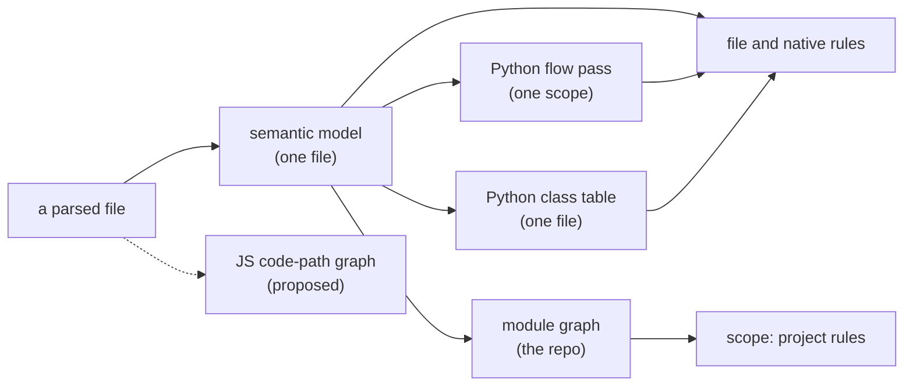

# SR-PROJECT-GRAPH — the overview of every graph codelaw builds: what each answers, how far it reaches, which record owns it

## §1 — For humans

**The decision in one line.** A rule that asks a question one syntax node cannot answer reads a **graph**. codelaw builds five, each answering a different question over a different extent — one scope, one file, the whole repo — and **each has a record of its own**. This record lists them; it decides nothing a listed record owns.

**Read the table before you add a graph:** the question you have may already have an answer one row up or down.

| graph | the question it answers | reaches | its record |
|---|---|---|---|
| **module graph** | who exports and imports what, across files and packages; what nothing uses; which packages depend on which | the whole repo | [SR-MODULE-GRAPH](0122_module-graph.md) |
| **semantic model** | which binding does this name resolve to; which scope is this in; what does this file import and export | one file | [SR-SEMANTIC-MODEL](0123_semantic-model.md) |
| **Python flow pass** | is this name bound on every path that reaches this read | one module or function | [SR-PY-FLOW](0124_python-flow.md) |
| **Python class table** | which classes does this file define, what do they derive from, in what method-resolution order | one file | [SR-PY-INFERENCE](0120_python-inference.md) decision 4 |
| **JavaScript code-path graph** | where can control go at an `await`, round a loop, into a `catch` | one function — its shape is open | [SR-CODE-PATH-GRAPH](0121_code-path-graph.md) (proposed) |



<details>
<summary><b>ASCII twin</b> — the same diagram, for terminals and diffs</summary>

```text
   parsed file --> semantic model --> Python flow pass ----.
                                  --> Python class table --+--> file and native rules
                                  '-> module graph --> scope: project rules
   parsed file - - > JS code-path graph (proposed)
```

</details>

---

## §2 — For agents

### Context

Every rule once read one file at a time. The graphs grew as rules needed more: first a repo-wide one for unused exports ([SR-MODULE-GRAPH](0122_module-graph.md)), then the per-file model beneath it ([SR-SEMANTIC-MODEL](0123_semantic-model.md)), then Python's passes on that model ([SR-PY-INFERENCE](0120_python-inference.md)), and a JavaScript one is named for two ported rows. Their decisions had sat in this record and in two others; a reader looking for one graph read all of them. W-191 gave each graph its own record and left this one as the map.

### Decision

1. **One record per graph.** The table in §1 is the list; a graph's decisions live in its record and nowhere else ([SR-LAW-0](0002_LAW-0-authority.md)). This record owns no component and decides nothing a listed record owns; the register's Ownership table gives each graph's code to its record.
2. **A new graph is added in the same change as its record.** The change adds the row to §1 and the record to the register; a graph shape not yet chosen is a `proposed` record, as [SR-CODE-PATH-GRAPH](0121_code-path-graph.md) is, not a placeholder.
3. **The row says what the graph answers and how far it reaches.** One scope, one file or the whole repo; a question two graphs could answer is answered by the narrower one.
4. **The graphs build on each other, one way.** The semantic model is the floor: the module graph links the imports and exports the model already computed ([SR-SEMANTIC-MODEL](0123_semantic-model.md) decision 4), the flow pass reads one scope of it, and the class table is built from the same tree. Nothing narrower reads a wider graph; a question that needs another file's facts is the module graph's.

### Consequences

- **A reader finds the graph for a question here**, then reads one record, not three.
- **Python's cross-file facts** (a class's bases across files, import resolution) are the module graph's to add ([W-185](../work/open/W-185-python-project-graph.md)); the in-file class table stays SR-PY-INFERENCE's until they exist.
- **A JavaScript code-path graph** waits on its research ([W-189](../work/open/W-189-js-code-path-graph-research.md)); its row stays `proposed` until the decider picks a shape.

### Alternatives considered

- **One record for every graph** (this record's earlier shape, which held the module graph and pointed at the rest): rejected by the decider (2026-11-09) — a record that holds eleven decisions of one graph cannot also be the overview of five.
- **A table in the register instead of a record:** rejected — the register lists records, not what each answers.

### Reference (required)

- [`crates/codelaw-graph/src/lib.rs`](../crates/codelaw-graph/src/lib.rs) · [`crates/codelaw-semantic/src/lib.rs`](../crates/codelaw-semantic/src/lib.rs) · [`crates/codelaw-semantic/src/py_flow.rs`](../crates/codelaw-semantic/src/py_flow.rs) · [`crates/codelaw-native/src/py_classes.rs`](../crates/codelaw-native/src/py_classes.rs): where each graph is built.

### Veto condition

**Reopen this decision if:** a graph is built in the engine that §1's table does not list, or a row names a record that does not exist.

**How to check it:** `for n in SR-MODULE-GRAPH SR-SEMANTIC-MODEL SR-PY-FLOW SR-PY-INFERENCE SR-CODE-PATH-GRAPH; do grep -l "^name: $n$" records/*.md || echo "missing $n"; done` prints no `missing`; and `ls crates | grep -i graph` lists only `codelaw-graph`.

---

## References

*Every source this record cites, gathered in one place. An archived document is never listed here.*

**Records** — [SR-MODULE-GRAPH](0122_module-graph.md) · [SR-SEMANTIC-MODEL](0123_semantic-model.md) · [SR-PY-FLOW](0124_python-flow.md) · [SR-PY-INFERENCE](0120_python-inference.md) · [SR-CODE-PATH-GRAPH](0121_code-path-graph.md) · [SR-LAW-0](0002_LAW-0-authority.md)

**Code**

- [`crates/codelaw-graph/src/lib.rs`](../crates/codelaw-graph/src/lib.rs) · [`crates/codelaw-semantic/src/lib.rs`](../crates/codelaw-semantic/src/lib.rs) · [`crates/codelaw-native/src/py_classes.rs`](../crates/codelaw-native/src/py_classes.rs)

**Project docs**

- [`work/open/W-185-python-project-graph.md`](../work/open/W-185-python-project-graph.md) · [`work/open/W-189-js-code-path-graph-research.md`](../work/open/W-189-js-code-path-graph-research.md)
