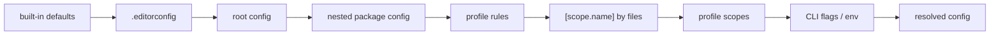

# SR-CONFIG — the configuration file: one file, three homes, every key validated, every value traceable

## §1 — For humans

**The decision in one line.** Configuration is **one TOML document** that lives in **one of three homes**: `codelaw.toml`, `[tool.codelaw]` in `pyproject.toml`, or `"codelaw"` in `package.json`. Every key is validated against a shipped JSON Schema, and `codelaw config --print` shows the final value of every key **and where it came from**.

```toml
#:schema ./node_modules/codelaw/codelaw.schema.json
extends   = ["codelaw:js/recommended", "codelaw:ts/recommended", "codelaw:py/recommended"]
languages = ["javascript", "jsx", "typescript", "tsx", "python", "json", "yaml", "toml", "css", "scss", "html", "markdown"]
include   = ["src/**", "packages/*/src/**"]
exclude   = ["dist/**", "**/*.generated.*"]

[rules]                       # severity and options per rule
"py/no-print" = "off"

[scope.components]            # a named group of files
files = ["src/components/**/*.tsx"]
rules = { "js/exports-at-end" = "off" }

[scope.utils]                 # one limit for every *.utils.* file
files = ["**/*.utils.ts", "**/*.utils.tsx", "**/*.utils.js", "**/*.utils.jsx"]
rules = { "js/max-lines" = { options = { max = 50 } } }

[scope.tests]                 # extends the preset's `tests` scope: its files stay
rules = { "js/max-lines" = { options = { max = 400 } } }

[scope.scripts]               # a group that never fails the run
files = ["scripts/**"]
remap = { error = "warn" }

[profile.local.rules]         # warn on a laptop …
"js/no-console" = "warn"
[profile.ci.rules]            # … fail in CI (CI=true)
"js/no-console" = "error"

[format]   # SR-FORMATTER      [lint]     # SR-LINTER
[graph]    # SR-PROJECT-GRAPH [baseline] # SR-BASELINE
[adapters] # SR-LINTER        [agents]   # SR-AGENT-SURFACES
[cache]    # SR-CACHE        [files]    # SR-ARCHITECTURE (discovery, encoding, size)
[daemon]   # SR-ARCHITECTURE  [lsp]      # SR-ARCHITECTURE
[fix]      # SR-ARCHITECTURE  [markdown] # SR-CONFIG (its one key is L3's)
[deprecation] # SR-BASELINE (the policy of a symbol marked deprecated in code)
[exceptions]  # SR-BASELINE (dated exceptions: require_expiry, warn_days)
[deps]        # SR-RULE-PACKS (the deps pack: its rules, snapshot, advisory sources and agent setting)
[css]         # SR-PROJECT-GRAPH (CSS Modules: which stylesheets, and the bundler's class-name mapping)
[coverage]    # SR-PROJECT-GRAPH (the test rules of new code; [coverage.ignore] is the old spelling of [codelawignore])
[codelawignore] # SR-BASELINE (what every `.codelawignore` line must carry, and a line's defaults)
[spell]       # SR-SPELL (the spell pack's locale, accepted words and words file)
[todo]        # SR-CONFIG (what a TODO-style comment must carry: decision 11a)
[tests]       # SR-CONFIG (`[tests.skip]`: what a skipped test must carry: decision 11a)
[reviews]     # SR-AGENT-SURFACES (the codelaw-rules-from-reviews skill's platform and thresholds; validated, read by no engine code)
[codeowners]  # SR-RULE-PACKS (CODEOWNERS coverage: the file's path, patterns that need no owner)
[flags]       # SR-PROJECT-GRAPH (feature-flag expiry: accessors, SDK presets, inline markers, warn_days)
[packs]       # SR-PACK-LOOKUP (where rule packs are found: order, node_modules, venv)
[providers]   # SR-RULE-PACKS (what a run does when a provider gives no table; each provider's settings: decision 19)
[commits]     # SR-CONFIG (what a commit message must look like: decision 11b)
[branches]    # SR-CONFIG (what a branch name must look like: decision 11b)
[pr]          # SR-CONFIG (a pull request's size and description: decision 11b)
[targets]     # SR-CONFIG (the oldest Python and browsers the code supports, an input to fixes: decision 11f)
```



<details>
<summary><b>ASCII twin</b></summary>

```text
   defaults --> .editorconfig --> root config --> nested package config --> profile rules
            --> [scope.name] --> profile scopes --> flags/env --> resolved
```

</details>

---

## §2 — For agents

### Context

Configuration keys were scattered across six records. The decider asked for one record that owns the file itself: where it lives, how it's found, what's valid, and in what order values apply.

### Decision

1. **Three homes, one format.**
   - The homes, in priority order: `codelaw.toml`, then `[tool.codelaw]` in `pyproject.toml`, then the `"codelaw"` key in `package.json`.
   - The JSON form has the same keys as the TOML.
   - If a folder has more than one home, `codelaw.toml` wins, and codelaw warns that the others are ignored.
   - A `pyproject.toml` or `package.json` is a home only if it configures codelaw. One that doesn't parse is a config error only if its text mentions `codelaw`; otherwise it is not a home, so a broken fixture file never stops a run.
2. **Finding it:** walk up from each file to the nearest folder with a home.
   - **Monorepos:** the topmost config is the root. A nested config (for example in `packages/web/`) **inherits** the root and overrides it, unless it sets `root = true`, which makes that folder a separate project with its own graph and baseline ([SR-ARCHITECTURE](0108_architecture.md) decision 17).
   - **Globs** in `include`, `exclude` and every `[scope.<name>]` are relative to the directory of the config file that declares them ([SR-ARCHITECTURE](0108_architecture.md) decision 11).
   - **Root-only keys:** `extends`, `rules_dir`, `preview`, `allow_pack_fixers`, `[files]`, `[cache]`, `[fix]`, `[lint]`, `[markdown]`, `[daemon]`, `[lsp]`, `[profile]`, `[deps]`, `[css]`, `[coverage]`, `[spell]`, `[reviews]`, `[todo]`, `[tests]`, `[codeowners]`, `[flags]` and `[packs]` belong to the root config, so a project has one rule set and one cache. A nested config that sets one is a load error naming the root config.
   - **A nested `root = true` project** is checked by running codelaw in its folder; a run from the parent skips its files and says so.
3. **Sections and owners.** The top-level keys belong to this record:
   - `extends`, `languages`, `include`, `exclude`, `rules_dir`;
   - `[rules]` and `scope`, the named scopes of decision 3a, with a scope's `remap` (decision 11);
   - `profile`, the named profiles of decision 10;
   - the deprecated spellings `[[overrides]]` and `[profiles]`, below.

   **3a. Scopes: `[scope.<name>]`, a named group of files.** (W-59, the decider, 2026-10-26: "overrides is not the right terminology … then we will go with scope".)
   - A scope holds `files` (globs), `exclude`, `rules` (the shape of `[rules]`) and `remap` (decision 11). Its name is `[a-z0-9_-]+`; `default` is reserved; both are load errors (exit 2). The table is singular — `[scope.utils]`, `[profile.ci]` — as in Cargo's `[profile.*]`.
   - **A preset may ship scopes** ([SR-RULE-PACKS](0101_rule-packs.md) decision 3): `js/recommended` ships `tests`, `stories` and `config`, `py/recommended` ships `tests`. A scope of the project with the same name **extends** it: the project's `files` and `exclude` replace the preset's when it writes them and are inherited when it does not, and `rules` and `remap` merge per rule and per key, the project's value winning. The merged scope keeps the preset's place in the order.
   - A scope with no `files` and no preset scope of its name is a load error. Scopes apply in the order of decision 4: the presets' in `extends` order, then each config's in file order (a `pyproject.toml` or `package.json` home is read sorted by name).
   - **Deprecated, for one minor release:** each `[[overrides]]` entry loads as `scope.override-<n>` and `[profiles.<name>]` loads as `[profile.<name>]`, each with one warning naming the new spelling; the aliases go in the next minor release ([CHANGELOG](../docs/CHANGELOG.md)).
   - `root`, `requires`;
   - `preview` and `allow_pack_fixers`, whose meaning is [SR-RULE-PACKS](0101_rule-packs.md) decisions 9 and 12;
   - `[markdown]`, whose one key `lint_code_blocks` is [L3](0005_LAW-3-languages.md) decision 8's.

   Sizes are bytes or a string such as `"1 MiB"` or `"512MB"`; durations are seconds or a string such as `"5s"` or `"500ms"`; a number of days (`[deps]`'s ages) is an integer or a string such as `"7d"` or `"2w"`.

   `extends` takes first-party presets as `codelaw:<namespace>/<preset>`, resolved from the installed rule pack, and team packs as `npm:`, `pypi:` or `path:` ([SR-RULE-PACKS](0101_rule-packs.md) decisions 4 and 11). One preset has no namespace: `codelaw:tests` is the engine's own and turns on the test rules of new code ([SR-PROJECT-GRAPH](0103_project-graph.md) decision 9); no pack resolves it.

   Each `[section]` belongs to the record named beside it in §1, and that record states its keys. A record adding a key adds it to the schema in the same change. `[adapters]`, `[agents]`, `[daemon]`, `[lsp]`, `[deprecation]`, `[exceptions]`, `[deps]`, `[css]`, `[coverage]`, `[spell]`, `[todo]`, `[tests]`, `[reviews]`, `[codeowners]`, `[flags]`, `[packs]` and `[providers]` are validated by the loader like `[fix]` and `[lint]` — `[reviews]` only that: no engine code reads it, a skill does ([SR-AGENT-SURFACES](0102_agent-surfaces.md) decision 10; W-133, 2026-10-30); `[format]`, `[graph]` and `[baseline]` are still read as tables. **`[packs]` names folders** (W-155, 2026-10-30): `node_modules` and `venv`, relative to the root config's folder; a set folder that is missing is a load error naming it ([SR-PACK-LOOKUP](0118_pack-lookup.md) decisions 6–7); the loader parses and checks the section in `crates/codelaw-config/src/packs.rs`, and `config --print` traces its keys and the places they resolve to (SR-PACK-LOOKUP decision 8). **One key names a file the loader reads:** `[spell] words_file` (default `.codelaw/spell/words.txt`, relative to the root config's folder; W-112, 2026-10-28): its words join `[spell] words`, a set path that is missing is a load error naming it, and a missing default is none ([SR-SPELL](0116_spell.md) decision 7).
4. **Precedence, last wins:**
   1. Built-in defaults.
   2. `.editorconfig` (formatter keys only).
   3. Root config.
   4. Nested config.
   5. The profile's `rules` (decision 10).
   6. `[scope.<name>]`: the presets' scopes first, then the project's, in file order (decision 3a).
   7. The profile's `scope`, in file order.
   8. Environment (`CODELAW_AS_OF`, `CODELAW_CACHE_DIR`, `CODELAW_LOG`, `CODELAW_PROFILE`, `CI`).
   9. Command-line flags.

   Rule sources resolve as in [SR-RULE-PACKS](0101_rule-packs.md) decision 14.
5. **Validation is strict.**
   - An unknown key, a wrong type or an unknown rule id stops the run with exit 2, naming the file, the key and the nearest valid key ("did you mean `line_width`?").
   - **A renamed rule id is not unknown for one minor release** (W-128): `RENAMED_RULES` in `crates/codelaw-config` maps it to its new id — today `data/outdated-dependency` → `deps/outdated` and `data/stale-deps-snapshot` → `deps/stale-snapshot` — in `[rules]`, every scope and every profile; the setting applies to the new id, and a warning names the file, both ids and the pack the rule is now in.
   - `requires = ">=0.4"` refuses to run with an older codelaw.
6. **The schema ships with codelaw.** `codelaw.schema.json` is in the npm package and available as `codelaw config --schema`, so TOML and JSON editors offer completion and validation.
   - **Where editors find it (W-157, 2026-10-31):** `init` writes `#:schema` as `codelaw.toml`'s first line (decision 8); the VS Code extension registers the schema for `codelaw.toml` with Even Better TOML ([SR-EDITOR](0114_editor.md) decision 4); and codelaw's own language server completes and checks the file from the schema and the installed packs ([SR-EDITOR](0114_editor.md) decision 9). The PyPI wheel holds no schema and its install path names the Python version, so a PyPI-installed codelaw points at the schema of its own release tag: `https://raw.githubusercontent.com/arpitarya/codelaw/v<version>/crates/codelaw-config/codelaw.schema.json` (`codelaw_config::schema_url`). The editor fetches it; the engine never does ([L5](0007_LAW-5-no-model-in-the-engine.md)).
   - **A config as typed:** `find_config_with(start, file, text)` is `find_config` with one file's text as the editor holds it, unsaved — the same loader, so the editor's errors are the run's.
7. **Traceable.** `codelaw config --print [--for <file>]` prints the resolved configuration for a file, with the source of each value (default, `.editorconfig`, file:line, scope name, env or flag); `codelaw config --scopes` lists every scope with its files and source, in precedence order.
8. **Creating it.**
   - `codelaw init` writes a minimal `codelaw.toml`: the `#:schema` line of decision 6 — `./node_modules/codelaw/codelaw.schema.json` when codelaw comes from npm, the release tag's URL when it comes from PyPI (W-157) — then `extends` with the `recommended` presets of the rule packs it installs for the languages it detects ([SR-RULE-PACKS](0101_rule-packs.md) decision 6), and nothing else; with `--agents`, also the `[agents]` section naming them ([SR-AGENT-SURFACES](0102_agent-surfaces.md) decision 6).
   - `codelaw format --import-config` converts Prettier, Ruff or Black configs ([SR-FORMATTER](0105_formatter.md) decision 5).
   - `codelaw migrate eslint|prettier|biome|ruff|stylelint` writes the whole file from another tool's config: `extends`, `[rules]`, a `[scope.<tool>-<n>]` per files group, `[format]` and the tool's ignore alias, with a report of every setting that did not map ([SR-CLI-MCP](0115_cli-and-mcp.md) decision 15). Into an existing `codelaw.toml` it adds only what that file does not set.
9. **Deterministic ([L5](0007_LAW-5-no-model-in-the-engine.md)):** the resolved config is a pure function of the files, environment and flags. Its hash is part of every cache key ([SR-CACHE](0109_cache.md)), the words of [SR-SPELL](0116_spell.md)'s `[spell] words_file` included (W-112).
10. **Profiles: warn on a laptop, fail in CI.**
    - `[profile.<name>]` holds `rules` and `scope`, the same shapes as the top-level `[rules]` and `[scope.<name>]`; a `[profile.<name>.scope.<scope>]` without `files` takes the files of the scope of that name. Root config only.
    - **Which profile:** `--profile <name>`, else `CODELAW_PROFILE`, else `ci` when `CI` is set and is not `""`, `false` (any case) or `0`, else `local`. A name the config does not define is a usage error (exit 2), except `ci` and `local`, which may be absent and then change nothing.
    - **Per surface:** the CLI as above. `codelaw hook` and the MCP server default to `ci` in place of the `CI` check, so an agent gets CI's verdict; the language server and `check --watch` / `fix --watch` (the person at the keyboard, [SR-CLI-MCP](0115_cli-and-mcp.md) decision 2) default to `local`, the latter shown as `profile local (--watch default)`. Each still honours `--profile` (where it has flags) and `CODELAW_PROFILE`.
    - **Visible:** when the config defines any profile, `text` and `agent` output open with `profile ci (CI=true)` — the name and its source — and `json` carries `profile: { name, source }`. `config --print` lists `profile` with its source.
    - **L5:** `CI` and `CODELAW_PROFILE` are inputs like every other variable of decision 4; the profile is part of the resolved config, so of every cache key (decision 9) — a warm `hook` (`ci`) and an editor (`local`) never share a verdict.
    - A pipeline that does not set `CI` runs `local`; it passes `--profile ci`.
11. **`remap`: a glob that never errors, or never warns.**
    - Any `[scope.<name>]`, top level or a profile's, may carry `remap`: keys `error`, `warn`, `info`; values `error`, `warn`, `info` or `off`. `remap = { error = "warn" }` never fails the run; `{ error = "off", warn = "off", info = "off" }` is silent; `{ warn = "error" }` admits no warnings.
    - It applies **last**: after the rule's severity and after the baseline's outcome ([SR-BASELINE](0104_baseline-and-deprecations.md) decision 2), so an expired baseline entry in a `{ error = "warn" }` glob is a warning.
    - It **never remaps `codelaw/*`** diagnostics — config errors, a stale baseline, an unknown suppression, a rule failure — which cannot be hidden.
    - Two matching scopes: the later wins per key, in decision 4's order, as for `rules`.

11a. **`[todo]` and `[tests.skip]`: what a marker and a skipped test must carry** (W-131, the decider, 2026-10-29: *"the to-do needs a ticket and a date … I want the ticket and the date configurable, whether I want it as mandatory thing or not"*; *"skipped test need a reason and expiry"*). Both are root-only tables and the rules read them as their options (the rule's own options win). The rules are `js/todo-marker`, `py/todo-marker`, `css/todo-marker`, `scss/todo-marker`, `html/todo-marker`, `yaml/todo-marker`, `toml/todo-marker`, `md/todo-marker`, `js/no-focused-tests`, `js/skipped-test` and `py/skipped-test` ([SR-RULE-PACKS](0101_rule-packs.md)); each is in the opt-in preset `<namespace>/markers`, in no default preset, since a repo with bare TODOs gets them all at once (the baseline is for that).
    - **`[todo]`:** `[todo] tags` (the words that open a marker; default `["TODO", "FIXME", "HACK"]`; each is letters, digits and `_`), `[todo] require_ticket` (default `true`), `[todo] require_date` (default `false`), `[todo] ticket_pattern` (a regular expression a whole ticket must match; default `[A-Z][A-Z0-9]+-\d+`) and `[todo] warn_days` (default `14`).
    - **The syntax:** a tag at the start of a comment line (so a sentence that mentions a TODO is not a marker), then `(`ticket, date`)` in either order and either optional unless required, then an optional `:` and text: `TODO(ABC-123, 2027-01-31): text`. Any other item in the parentheses (an owner's name) is ignored. The comments are the language's own: `//` and `/* */` in JS, TS and SCSS, `/* */` in CSS, `#` in Python, YAML and TOML, `<!-- -->` in HTML and, as the only comment Markdown has, in Markdown (a TODO in prose is prose and is not checked).
    - **A date that is written is always enforced,** whether `require_date` is set or not: it is **expired** from the as-of date on, an error, and a warning for the `warn_days` before it, on the semantics of [SR-BASELINE](0104_baseline-and-deprecations.md) decision 9 (the first day it no longer holds). A date-shaped item that is not a calendar day is reported. The as-of date is `--as-of`, `CODELAW_AS_OF`, else `HEAD`'s commit date, never the clock ([L5](0007_LAW-5-no-model-in-the-engine.md)); with none, only the missing and the malformed are reported, and a cached result is reused only on the same date.
    - **`[tests.skip]`:** `tests.skip.require_reason` (default `true`), `tests.skip.require_expiry` (default `true`), `tests.skip.require_ticket` (default `false`), `tests.skip.ticket_pattern` and `tests.skip.warn_days` (as in `[todo]`). The reason is the framework's own argument where it has one (`reason=` of pytest's `skip`, `skipif` and `xfail`, the reason argument of `unittest.skip`, `skipIf` and `skipUnless`, Playwright's `test.skip(condition, "reason")`), else the text of a `SKIP(ticket, date): reason` comment on the line directly above the test (above its decorators, in Python) or at the end of its first line; the expiry and the ticket are always from that comment. An expired or expiring skip is reported at the skipped test, on the semantics above.
    - **Focused tests** are an error with a `suggest` fix and no table: `.only` on `describe`, `it`, `test`, `context`, `suite`, `specify` or `bench` (also `test.describe.only` and `it.only.each(…)`), `fit`, `fdescribe` and `ftest`; the fix drops the focus.
    - **Load errors (exit 2):** an unknown key, a `tags` entry that is not one word, a `ticket_pattern` that is not a regular expression, a `warn_days` that is not a non-negative integer. Every other finding is `manual`: the ticket, the date and the reason are facts only the author knows.

11b. **`[commits]`, `[branches]` and `[pr]`: pull-request hygiene** (W-146, the decider, 2026-10-30, voice: *"Pull request hygiene is something I would go for."* · *"want the commit convention to be configurable."* · on the keys below: *"All this looks good."* · on Conventional Commits and a 400-line warning as the defaults: *"Yes."*). Root-only tables; the four engine rules `git/commit-message`, `git/branch-name`, `git/pr-size` and `git/pr-description` ([SR-RULE-PACKS](0101_rule-packs.md) decision 1) read them, and each rule's own options in `[rules]` win over its table key by key (`git/pr-size`'s and `git/pr-description`'s over `[pr]`). Where the rules run and what they read is [SR-ARCHITECTURE](0108_architecture.md) decision 14; the hooks are [SR-CLI-MCP](0115_cli-and-mcp.md) decision 11 and [SR-AGENT-SURFACES](0102_agent-surfaces.md) decision 9.
    - **`[commits]`:** `[commits] preset` — `conventional` (the default: `<type>(<scope>)!: <subject>`), `angular` (the same form, Angular's eight types), `gitmoji` (a `:code:` or emoji, a space, the subject), `custom` (the subject line must match `[commits] pattern`, which it then requires) or `off`; `[commits] types` (default `feat, fix, docs, refactor, test, chore, perf, ci, build`; Angular's `build, ci, docs, feat, fix, perf, refactor, test` under `angular`); `[commits] scopes` (empty is any); `[commits] require_scope` (`false`); `[commits] subject_max` (`72`, counted over the whole subject line; `0` is off); `[commits] subject_case` (`lower`, the default, `sentence` or `any`: the first letter after the type); `[commits] require_body` (`false`); `[commits] breaking` (`["!", "BREAKING CHANGE:"]`: without `!` in it, a `!` in the subject line is a finding). The second line must be blank.
    - **`commits.ticket`:** `required` (`false`), `pattern` (`[A-Z]+-[0-9]+`), `place` — `footer` (the default: any line after the subject), `subject` or `either`. **`commits.skip`:** `merges`, `reverts` (`Revert "…"`), `fixups` (`fixup!`, `squash!`, `amend!`) — each `true` — and `authors` (`["dependabot[bot]", "renovate[bot]"]`, matched against the author's name or email).
    - **`[branches]`:** `[branches] pattern` (a regular expression the whole name must match; empty — the default — leaves branch names unchecked), `[branches] max_length` (`60`), `[branches] protected` (globs never checked: `main`, `develop`, `release/*`), `[branches] skip_authors` (as in `[commits.skip]`, against `HEAD`'s author). **`branches.ticket`:** `required`, `pattern` (as above), `match_commits` (every judged commit of the range names the branch's ticket). The rule runs once a pattern is set, a ticket is required or `match_commits` is on.
    - **`[pr]`:** `[pr] max_lines` (`400`; added plus deleted lines from the merge base, `0` is off), `[pr] exclude` (globs not counted: `**/*.lock`, `**/package-lock.json`, `**/pnpm-lock.yaml`, `**/generated/**`; a `**/` glob matches at the top too), `[pr] title_pattern`, `[pr] require_ticket` (in the title or the description, by the `[commits.ticket]` pattern) and `[pr] template_sections` (Markdown headings, any level, case ignored, each of which must be present and hold text other than an HTML comment). `git/pr-description` runs once one of the last three is set.
    - **The agent's defaults** (W-146 DoD, said here as the decider asked): ticket checks off, branch names unchecked until a pattern is set, the description unchecked until a pattern, a ticket or a section is asked for. The decider's: Conventional Commits on, a 400-line size warning.
    - **Severities:** `git/commit-message`, `git/branch-name` and `git/pr-description` are `error`, `git/pr-size` is `warn`; each is set or turned `off` in `[rules]` like any rule. Every finding is `manual` ([L4](0006_LAW-4-every-rule-has-a-fix.md)): a message, a branch or a description is never rewritten for the author. The finding names what it judged, each problem, and — where one can be derived — a corrected subject line or a branch name that passes.
    - **Load errors (exit 2):** an unknown key, a `preset`, `subject_case` or `place` out of its list, `custom` without `pattern`, a type holding a space or one of `():!`, a pattern that is not a regular expression, a glob that is not a glob, `match_commits` under `[commits.ticket]` or `place` under `[branches.ticket]`.
    - **Shared through a preset** (W-146, 2026-10-30). A preset's `[rules]` may set the four `git/*` rules though no pack holds them: a severity, and `options` holding the table's keys (`"git/commit-message" = { severity = "warn", options = { types = ["feat", "fix"], ticket = { required = true } } }`; `git/pr-size` and `git/pr-description` take `[pr]`'s). They are the lowest layer: the presets', in `extends` order, then the root config's table, then the project's own `[rules]` options and severity — each key by key, a sub-table (`ticket`, `skip`) one level down. A pack preset that names another rule outside its pack is still a load error. **Which presets:** only the ones `extends` applies — the `codelaw:` ones today; an `npm:`, `pypi:` or `path:` entry turns on its pack's rules and applies none of its presets ([SR-RULE-PACKS](0101_rule-packs.md) decision 11), so a team pack carries these settings once the decider rules how a team preset is named ([B-070](../work/BACKLOG.md)).

11c. **A rule turned `"off"` may say why** (W-158, the decider, 2026-11-05, voice: *"Go with the recommendation."*). A rule entry that sets `severity = "off"` — in `[rules]` or in a `[scope.<name>]` — may carry `reason = "<text>"`: `"py/no-print" = { severity = "off", reason = "CLI tool: print is the output" }`. `[rules] require_reason` (default `false`) makes the reason mandatory for every such entry, as `.codelawignore` and the inline comment already demand ([SR-BASELINE](0104_baseline-and-deprecations.md)). The default leaves every existing config valid. With it on, each such entry in the project's own config files (`[rules]`, a scope, a profile; a preset's entries are the preset's) is a `codelaw/off-without-reason` finding (`error`, `manual`, exception `Authored`) on the entry's line, in `check` and `fix`. `reason` on an entry that is not `"off"`, `require_reason` anywhere but the top-level `[rules]` or set to other than true or false, and `require_reason` in a nested config are exit 2. `config --print` prints `rules.require_reason` and `rules."<id>".reason` with the entry that set it; `codelaw.schema.json` has both keys. Built: yes (W-158 step 4, 2026-11-05; `crates/codelaw-cli/tests/config_reason.rs`).

11d. **A rule entry may lower the rule's fix** ([SR-LAW-4](0006_LAW-4-every-rule-has-a-fix.md) decision 16, the decider, 2026-10-30; built by W-156, 2026-11-05). A rule entry's `fix` — in `[rules]`, a `[scope.<name>]`'s `rules`, a `[profile.<name>.rules]` or a preset's — takes `auto`, `suggest` or `manual` at or below the rule's own rung: `"py/unused-import" = { severity = "error", fix = "suggest" }`. Another value is exit 2 with its "did you mean"; a rung above the rule's own is exit 2 naming the rule and its rung. Layers apply in decision 4's order, the last that names `fix` winning, never above the rule's rung. Lowered to `suggest`, the finding's edit is a diff `codelaw fix` (without `--unsafe`), save and the agent hook do not apply; lowered to `manual`, the finding carries no edit and its step is the edit spelt out ("replace `a` with `b`"). `config --print` prints `rules."<id>".fix` with the entry that set it; `rules --why` prints `fix: <rung> (lowered from <own> by <entry>)`, and `set_by` names the `fix`. `codelaw.schema.json` has the key; the editor completes the rule's rung and below (W-157).

11e. **A rule entry may say whether the rule's `auto` fix runs on save and from the agent hook** (W-163, the decider, 2026-11-05: the proposal accepted as presented with its two calls, picking *"Own table (Recommended)"* and *"Target-gated (Recommended)"*; [`save-behaviour-and-targets.md`](../work/proposals/save-behaviour-and-targets.md) §1). A rule entry's `on_edit` — in `[rules]`, a `[scope.<name>]`'s `rules` or a `[profile.<name>.rules]` — is `true` or `false`: `"py/unused-import" = { on_edit = true }`. `[fix] on_edit = false` sets it for every rule, below the per-rule entries (`[fix]` is [SR-ARCHITECTURE](0108_architecture.md)'s; its build adds the key there). Precedence, lowest first: the rule's own default ([SR-RULE-FORMAT](0112_rule-format.md) decision 2b) < `[fix] on_edit` < `[rules]` < scope < profile. Both directions are allowed — unlike `fix` (decision 11d), only the fix's timing changes, never what it proves. A fix that edits several files is `false` whatever the entry says ([SR-LAW-4](0006_LAW-4-every-rule-has-a-fix.md) decisions 10 and 12). `config --print` and `rules --why` show the value and the line that set it. Built: yes (W-166 step 1, 2026-11-05): `RuleSetting::Full.on_edit`, `RuleConfig.on_edit` (the last layer naming it wins), `[fix] on_edit`; `Project::on_edit` resolves it with its source; `config --print` prints `fix.on_edit` and `rules."<id>".on_edit` where it is not the default `true`, `rules --why` an `on edit:` line and `set_by`'s `on_edit = …`; `crates/codelaw-cli/tests/on_edit.rs`. A multi-file fix is never applied on save or by the hook, whatever the entry says: built (W-162, 2026-11-08), `FixOptions.on_edit` skips the multi-file pass and the per-file loop never offers one.

11f. **`[targets]`: the versions a project supports, an input to fixes** (W-163, the decider, 2026-11-05, as decision 11e; [`save-behaviour-and-targets.md`](../work/proposals/save-behaviour-and-targets.md) §2). This record owns the section; §1's map and the schema gain it when it is built. Two keys, `python` and `browsers`, each also allowed as `targets.python` / `targets.browsers` in a rule entry and in a `[scope.<name>]`.
   - **Python**, highest first: a rule entry's `targets.python`; a scope's; `[targets] python = "3.10"`; the **lower bound** of `project.requires-python` in the nearest `pyproject.toml` above the file (`>=3.10`, `~=3.10`, `>3.9`, `==3.11.*` give one; `<4` or `*` gives none), read with the parser `[deps.runtime]` already uses; otherwise unknown. `.python-version` is not a source. `codelaw migrate` copies Ruff's `target-version` into `[targets] python`.
   - **Browsers:** explicit minimums only — `browsers = ["chrome >= 111", "firefox >= 113", "safari >= 16.4"]`, names from the closed set `chrome`, `edge`, `firefox`, `safari`, `ios_saf`, `samsung`. A `browserslist` in `package.json` or a `.browserslistrc` counts only when every query is `<browser> >= <version>`; any other query leaves the target unknown, and `config --print` says why. No caniuse or MDN data is read: both stay refused under [L2](0004_LAW-2-foss-dependencies.md); the feature versions come from codelaw's own cited table ([SR-RULE-FORMAT](0112_rule-format.md) decision 2c).
   - **Unknown target:** a target-gated fix is `suggest`, never `auto` ([SR-LAW-4](0006_LAW-4-every-rule-has-a-fix.md) decision 3), and the finding names the line that would make it `auto`.
   - `config --print` and `rules --why` show each resolved target and its source. Built: yes (W-166 step 2, 2026-11-05): `RawTargets` in `[targets]`, `RawScope.targets` and `RuleSetting::Full.targets`, validated at load (exit 2); `Config::python_target` / `browsers_target` for the config's sources, `Project::python_target` / `browsers_target` (`crates/codelaw-engine/src/targets.rs`) for `pyproject.toml` and `browserslist`, the lower bound from `codelaw_native::deps::pep440::lower_bound` (the PEP 440 parser the `deps` rules use); the file's targets in its cache key; `config --print` prints `targets.python` and `targets.browsers`; `codelaw migrate ruff` writes `target-version` as `[targets] python`; `crates/codelaw-cli/tests/targets.rs`.

11g. **`multi_file`: whether a fix may edit several files, and how** (W-162, the decider, 2026-11-05). `[fix] multi_file` and a rule entry's `multi_file` (in `[rules]`, a scope or a profile, as decision 11d) take `"auto"` (the default), `"suggest"` or `"off"`; the rule entry wins. What each value does, and the five safeguards no setting changes, are [SR-MULTI-FILE-FIXES](0119_multi-file-fixes.md) decision 3. Built: yes (W-162, 2026-11-08): `[fix] multi_file` (W-166 step 0) and `RuleSetting::Full.multi_file` load and are in `codelaw.schema.json`; `Project::multi_file` resolves the last rule entry naming it, then `[fix] multi_file`, then `auto`, with its source; a finding whose fix edits another file is made `suggest` or `manual` (`restructure`) there (`lint.rs`); `config --print` prints `fix.multi_file`, `rules --why` a `multi-file:` line and `set_by`'s `multi_file = …`; `crates/codelaw-cli/tests/multi_file.rs`.

### Consequences

- **Three homes mean three parsers,** and one well-tested resolution order.
- **Strict validation breaks old configs on a key rename,** so renames ship with a deprecation alias for one minor release.

### Alternatives considered

- **JavaScript config files** (`codelaw.config.js`): rejected. They need Node to read (breaking [L6](0008_LAW-6-python-and-node-packages.md) completeness), and executable config isn't deterministic.
- **YAML config:** rejected. TOML is already the Python standard and is easier to read.
- **Lenient validation** (warn on unknown keys): rejected. Typos silently disable rules.

### Reference (required)

- [SR-RULE-PACKS](0101_rule-packs.md) decisions 4 and 14: pack resolution and rule-source precedence.
- [SR-FORMATTER](0105_formatter.md) decision 5: the `[format]` keys.
- [Taplo `#:schema` directive](https://taplo.tamasfe.dev/configuration/directives.html): schema-driven TOML completion.

### Veto condition

**Reopen this decision if:** a key is accepted that no record defines, or `config --print` can't name a value's source; or a team runs CI without `CI` set and ships a `console.log` (decision 10).

**How to check it:** the schema test, `cargo test -p codelaw-config --test schema`: every key in `codelaw.schema.json` is defined in exactly one record, every record-defined key is in the schema, and the schema and the loader accept the same keys. It compiles the schema with `boon` (MIT OR Apache-2.0), a dev-dependency only, taken in for this test and SR-CLI-MCP's SARIF check.

---

## References

*Every source this record cites, gathered in one place. An archived document is never listed here.*

**Records** — [SR-RULE-PACKS](0101_rule-packs.md) · [SR-FORMATTER](0105_formatter.md) · [SR-CACHE](0109_cache.md)

**Project docs** — [`docs/DESIGN.md`](../docs/DESIGN.md)
