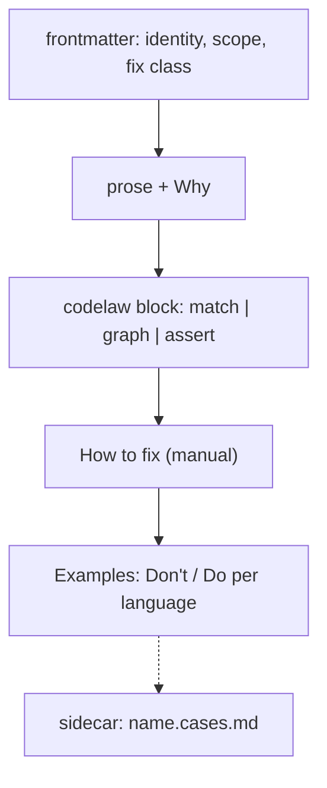

# SR-RULE-FORMAT — the rule-file template: one Markdown file, four parts, a fixed frontmatter schema

## §1 — For humans

**The decision in one line.** A rule is **one Markdown file**, `<namespace>/<name>.md`, with **four parts in fixed order**: frontmatter, prose, a `codelaw` block, and examples. Edge cases go in a `<name>.cases.md` sidecar. codelaw lints its own rule files against this template.

````markdown
---
id: <namespace>/<name>                 # required; matches the path
title: <one line>                      # required
languages: [typescript, tsx]           # required; L3 names
scope: file                            # file | project        (default file)
files: ["src/**/*.{ts,tsx}"]           # optional glob filter
exclude: ["**/*.d.ts"]                 # optional
severity: error                        # error | warn | info   (default error)
fix: auto                              # required: auto | suggest | manual  (L4)
fix_reason: "<why not auto>"           # required unless fix: auto
fix_skill: codelaw-fix                 # optional; the skill that carries a manual fix (L4 decision 10)
stability: stable                      # stable | preview      (default preview)
host: html                             # optional: only inside regions embedded in this host
invariant: exports-unchanged           # optional; checked by codelaw test
options: { internal: { type: "string[]", default: [] } }   # optional, typed
ported_from: [eslint/no-dupe-keys]     # optional; the source rules this one reimplements
security: { cwe: [79], owasp: ["A05:2025"], severity: high }   # optional; required in sec-* (decision 2a)
tags: [modules]
since: 0.1.0
---

One paragraph: what the rule requires.

**Why:** the reason, in one or two sentences.

```codelaw
match: …            # scope: file  → an ast-grep rule
# type: { $X: … }   # beside match:, TypeScript only → a type question (SR-TYPES)
# graph: …          # scope: project → a graph query (SR-PROJECT-GRAPH)
# target/assert: …  # structured files → path assertions
# native: <id>      # first-party packs only → a Rust implementation in the engine
message: "…$NAME…"
fix: [ … ]          # edit primitives, or { external: "…" }
```

## How to fix
1. …                # required when fix: manual

## Examples
### TypeScript
#### Don't
```ts
…
```
#### Do
```ts
…
```
````



<details>
<summary><b>ASCII twin</b></summary>

```text
   frontmatter --> prose + Why --> codelaw block --> How to fix (manual) --> Examples (Don't/Do per language)
                                                                              :
                                                                   sidecar  name.cases.md
```

</details>

---

## §2 — For agents

### Context

The decider asked for a record of the rule-file template. The format so far existed only as examples in chat, the design doc and SR-RULE-PACKS.

### Decision

1. **Path and id.** The file is `<rules_dir>/<namespace>/<name>.md`, and its `id` must equal `<namespace>/<name>`. First-party namespaces (`js`, `ts`, `react`, `node`, `stencil`, `py`, `json`, `yaml`, `toml`, `md`, `data`, `css`, `scss`, `css-modules`, `html`, `tanstack-query`, `redux-toolkit`, `sec-js`, `sec-ts`, `sec-html`, `sec-py`, `spell`, `deps`, `next`, `django`, `fastapi`, `airflow`, `numpy`, `pandas`, `testing`, `tailwind`, `graph`, `format`, `git`, `codelaw`) are reserved for the first-party rule packs and the engine (no rule file is `git/*`, but a pack's preset may set a `git/*` engine rule, the loader's one exception to a preset naming only its pack's rules: [SR-RULE-PACKS](0101_rule-packs.md) decision 1) ([SR-RULE-PACKS](0101_rule-packs.md)); each language or library namespace belongs to exactly one of the twenty-six packs (SR-RULE-PACKS decision 4: `ts` to `rules-ts`, `react` to `rules-react`, `node` to `rules-node`, `stencil` to `rules-stencil` since 2026-10-24; `tanstack-query` to `rules-tanstack-query` and `redux-toolkit` to `rules-redux-toolkit` by the decider's W-32 ruling; `sec-js`, `sec-ts`, `sec-html` and `sec-py` to the four security packs by his ruling of 2026-10-25, W-53; `scss` to `rules-scss` and `css-modules` to `rules-css-modules` by his ruling of 2026-10-26, W-62 and W-63; `spell` to `rules-spell` by his ruling of 2026-10-27, W-103; `deps` to `rules-deps` by his ruling of 2026-10-29, W-128; `next` to `rules-nextjs` by his ruling of 2026-10-30 on W-144, and `django`, `fastapi`, `airflow`, `numpy`, `pandas` to the packs of the same names by his ruling of 2026-10-30 on W-138, built by W-139; `testing` to `rules-testing` by his ruling of 2026-10-30 on W-144, the namespace W-139's call). The engine's own rules have no rule file; `crates/codelaw-rules`' `ENGINE_RULES` table gives each one's title, severity, fix class and steps, so `explain` and `--rule` know them. `format/` holds two: `format/unformatted` (`warn`, `auto`) and `format/failed` (`info`, `manual`) ([SR-FORMATTER](0105_formatter.md) decisions 1 and 4). `graph/no-deprecated-usage` (`error`, `manual`) and `codelaw/stale-baseline` (`error`, `manual`: `codelaw baseline prune` or `codelaw fix` lowers the entry) are [SR-BASELINE](0104_baseline-and-deprecations.md)'s, and so are the four dated-exception rules of its decision 9: `codelaw/expiring-exception` (`warn`), `codelaw/expired-exception`, `codelaw/exception-without-expiry` and `codelaw/exception-author` (`error`), all `manual`. `graph/untested-function`, `graph/function-coverage` (`error`, `manual`: a test needs judgment) and `codelaw/stale-coverage` (`warn`, `manual`) are [SR-PROJECT-GRAPH](0103_project-graph.md) decision 9's; `codelaw/incomplete-ignore` (`error`, `manual`) and `codelaw/stale-ignore` (`warn`, `auto`: `codelaw fix` removes the line) are SR-BASELINE decision 12's. `git/` holds the four pull-request hygiene rules of [SR-CONFIG](0110_config.md) decision 11b (W-146), all `manual`: `git/commit-message`, `git/branch-name` and `git/pr-description` (`error`) and `git/pr-size` (`warn`).
2. **Frontmatter schema** is §1's template, every field typed.
   - **Required:** `id`, `title`, `languages`, `fix`, plus `fix_reason` unless `fix: auto` ([L4](0006_LAW-4-every-rule-has-a-fix.md)).
   - **`ported_from:`** (optional) lists `<tool>/<rule>` ids, for example `[eslint/no-dupe-keys, ruff/F601]`: the source rules this one reimplements ([SR-RULE-PACKS](0101_rule-packs.md) decision 7). `codelaw-migrate` maps existing configs through it ([SR-AGENT-SURFACES](0102_agent-surfaces.md)). **A project rule may carry it too** (W-140, 2026-10-30): the `codelaw-port-rule` skill sets it on the rules it ports into `.codelaw/rules/`, so the next request for the same source rule finds the port, and `codelaw rules --format json` and MCP `list_rules` show it on each card ([SR-RULE-AUTHORING](0113_rule-authoring.md) decision 2). It changes nothing about how the rule runs; the id is never checked against the source tool.
   - **Unknown fields are a load error.**
   - **`options:`** declares each option's type and default; a config value for one — in `[rules]`, a `[scope.<name>]` or any `[profile.<name>]`, not only the profile in use ([SR-CONFIG](0110_config.md) decision 10) — is checked against it at load, so a typo fails on a laptop as it would in CI.
   - **Option types:** `string`, `string[]`, `number`, `number[]`, `integer`, `boolean`, `object`, and `call[]` (W-73, the decider's ruling of 2026-10-26). A `call[]` item is a callee path (`"DOMPurify.sanitize"`, `"*.createHTML"` for any receiver) or `{ name, module }`, where `module` is a module or a list of them; any other shape is a load error. A path segment is a name, `*` (any one segment) or `*<suffix>` (one segment ending in the suffix: `"*Schema.parse"` is `postSchema.parse` and `userSchema.parse`, not `JSON.parse`; W-73, 2026-10-27). A path whose root is `*` or `*<suffix>` holds whatever the root is bound to, so it takes no `module`.
   - **A `call[]` option has a mode.** Declaring `<opt>: { type: "call[]", … }` also declares `<opt>_mode: extend | replace` (default `extend`): a project's list is added to the rule's default, or, with `replace`, used instead of it. So a project can say *only our wrapper counts*, and a direct `DOMPurify.sanitize` at the sink is then reported.
2a. **`security:`** (optional; W-53, the decider's ruling of 2026-10-25) maps a rule to the security catalogues Veracode, Black Duck, Xray and OWASP speak in: `security: { cwe: [<n>…], owasp: ["Ann:2025"…], severity: high | medium | low }`.
   - `cwe` lists CWE ids (integers from 1); `owasp` lists OWASP Top 10 categories with their edition, `A01:2025` … `A10:2025`; at least one of the two is named. `severity` is required. Any other key, or a value of the wrong shape, is a load error.
   - **A rule in a security pack's namespace (`sec-js`, `sec-ts`, `sec-html`, `sec-py`) must carry it**; any other rule may.
   - **What it drives:** text and agent output print the CWE after the rule id (`sec-js/no-child-process-shell (CWE-78)`); `rules --tag cwe:<n>`, `--tag owasp:<category>` and `--tag security` select by it, `rules --security-coverage` prints the OWASP × rule matrix, and SARIF carries `tags` and `security-severity` ([SR-CLI-MCP](0115_cli-and-mcp.md) decisions 1 and 4). `severity` maps to SARIF's `security-severity` score as high `8.0`, medium `5.0`, low `2.0` — the bands GitHub code scanning ranks as high, medium and low.
   - It says nothing about how the rule runs: a security rule's `severity:` (`error`, `warn`, `info`) and its preset still decide that.
   - **The fix ladder's keys ([SR-LAW-4](0006_LAW-4-every-rule-has-a-fix.md), W-156, 2026-10-31).** `fix_exception:` — `value`, `restructure`, `authored` or `security` — is required on a `fix: manual` rule (decision 5) and allowed on any other, for its findings that drop to `manual`. `fix_pending: "<rung>[; needs <capability>]"` stands in for it on a `manual` rule the 2026-10-30 review proposed to move up (`auto`, `auto-subset`, `suggest`, `suggest-choices`), until the move lands — or, for a rule waiting on an engine capability, past W-156's close while its `needs <capability> (W-nn)` names an open item ([L4](0006_LAW-4-every-rule-has-a-fix.md) decision 5, 2026-11-05); the two exclude each other, and `fix_pending:` on a rule that is not `manual` is a load error. The engine's own rules carry their exception in `engine_fix_exception` beside `ENGINE_RULES` (decision 15), a test failing any `manual` one without.

2b. **`on_edit:`** (optional, boolean, default `true`; W-163, the decider, 2026-11-05, accepting [`save-behaviour-and-targets.md`](../work/proposals/save-behaviour-and-targets.md) §1 as presented). `on_edit: false` keeps the rule's `auto` fix off save and the per-edit agent hook; `codelaw fix`, pre-commit and CI's `fix --check` still apply it ([SR-LAW-4](0006_LAW-4-every-rule-has-a-fix.md) decision 12). A rule sets it when its edit deletes something a person or agent adds on purpose while still working — an unused binding, unreachable code, a focused test, a debugging aid, a placeholder being filled in — and `fix_reason:` says so in one line. The defaults: the 14 `auto` rules the proposal's §1.3 lists start `false`; **a move to `auto` in those kinds sets `on_edit: false` in the same change**; every other rule stays `true`. A fix that edits several files is `false` whatever the key says. A project overrides it per rule ([SR-CONFIG](0110_config.md) decision 11e). `on_edit: false` without `fix_reason:` is a load error. Built: yes (W-166 step 1, 2026-11-05): `RuleFile.on_edit`; the 14 rules carry `on_edit: false` and their `fix_reason:`.
2c. **`fix_target:`** (optional; W-163, the decider, 2026-11-05, picking *"Own table (Recommended)"* and *"Target-gated (Recommended)"*; the proposal's §2–3). `fix_target: { python: "3.10" }`, or `{ browsers: <feature id> }` for a CSS rule, names the version a fix is safe from: the rule's `auto_when` holds only when the resolved target ([SR-CONFIG](0110_config.md) decision 11f) meets it, and with no target the finding is `suggest`, its note naming the line that would make it `auto`.
   - **Python:** the twelve rules of the proposal's §2.1, among them `py/lru-cache-with-maxsize-none` (3.9) and `py/lru-cache-without-parameters` (3.8), `auto` today and now target-gated — no assumed floor, unlike Ruff's 3.9.
   - **Browsers:** the feature versions come from **codelaw's own table**, shipped as its own data package, `@codelaw/data-browsers` / `codelaw-data-browsers` ([L6](0008_LAW-6-python-and-node-packages.md) decision 15), kept current by a weekly CI check — one row per feature the nine CSS rules rewrite, the first unprefixed version per browser, each row citing its source (a browser's release notes or the spec), with the NOTICE [SR-RULE-PACKS](0101_rule-packs.md)'s data-table rule asks for. About 250 rows, written starting with the features the pinned corpus finds; a feature with no row, or a project without the package, stays `suggest`. caniuse (CC-BY-4.0) and MDN's `browser-compat-data` (CC0) stay refused under [L2](0004_LAW-2-foss-dependencies.md).
   - **Polyfills** are not a `fix_target:`: `js/no-unnecessary-polyfills` is a native rule that reads the data package `@codelaw/data-polyfills` / `codelaw-data-polyfills` through `FileContext::data_table` ([L6](0008_LAW-6-python-and-node-packages.md) decision 15), loaded lazily and only for a rule that asks; the engine records the table's version in the rule's cache question, so a refreshed table re-judges the files.
   - `fix_target:` names one target; on a `manual` rule it is a load error. Built: yes for the key and Python (W-166 step 2, 2026-11-05): `RuleFile.fix_target` (`FixTarget`), the gate in `lint.rs` (an `auto` finding below or without its target is `suggest`, its note `fix-target: …` naming the line that would make it `auto`), `rules --why`'s `fix target:` line; `py/lru-cache-with-maxsize-none` (3.9) and `py/lru-cache-without-parameters` (3.8) carry it. The other ten of §2.1 are `suggest` today and take `fix_target:` as they move to `auto` (W-156). Browsers: built (W-166 step 3): a feature id may hold `$FIXED`, the finding's text with its edits applied, lowercased (`css-property:$FIXED`); eight CSS rules are `fix: auto` with `fix_target: { browsers: … }` — the four vendor-prefix rules, `css/property-no-deprecated`, `css/color-function-notation`, `css/alpha-value-notation`, `css/color-function-alias-notation` — and `css/media-feature-name-no-vendor-prefix` stays `manual` (its fix converts the value). The table starts with 7 cited rows (`appearance`, `backdrop-filter`, `clip-path`, `mask`, `mask-image`, `mask-size`, `mask-origin`), each browser only where a vendor source confirms it; every other feature stays `suggest` until it has a row (B-080).

3. **The `codelaw` block takes exactly one of four forms:**
   - `match:` (an ast-grep rule with relational clauses and the semantic-model predicates of [SR-ARCHITECTURE](0108_architecture.md) decision 15a; `scope: file`);
   - `graph:` ([SR-PROJECT-GRAPH](0103_project-graph.md) decision 6; `scope: project`);
   - `target:` + `assert:` (path assertions on JSON, YAML or TOML);
   - `native: <id>` (a Rust implementation in the engine, [SR-ARCHITECTURE](0108_architecture.md) decision 15b; accepted only in first-party packs and in an ejected copy of one of their rules).

   Then `message:` (with `$CAPTURE` interpolation) and `fix:` (edit primitives, conditional `when`/`else` branches, or `{ external: "<command>" }`, whose stdin/stdout contract is [SR-ARCHITECTURE](0108_architecture.md) decision 18).
3a. **What goes with `match:`.** Only beside `match:`: ast-grep's own `constraints:`, `utils:` and `transform:` (decision 3b), `where:`, the semantic-model predicates, and `type:`, the type questions (decision 3f).
   - **`where:` maps a capture to a predicate.** The key is a capture (`$NAME`) or the matched node itself (`$$MATCH`); a key `match:` doesn't capture is a load error, and so is a list capture (`$$$NAME`), since a predicate is about one node. Only JavaScript, TypeScript and Python have a semantic model, so `where:` in a rule for any other language is a load error rather than a rule that silently matches nothing.
   - **The predicates:** `unused`; `undeclared` (optionally `{ globals: [<name>…], tables: [<data table>…] }`); `shadowed` (optionally `{ builtins: true }`); `reassigned`; `imported-from` (a module, a list of modules, or `{ module, name }`); `write` (assigned to here); `declaration` (declares a name); `redeclared` (declares a name its scope already declared); `binding` (names a symbol declared as one of the given kinds: `var`, `let`, `const`, `function`, `class`, `param`, `import`, `catch-param`, `interface`, `type-alias`, `enum`, `namespace`, `type-param`, `variable`); `builtin` (one of the language's own globals, undeclared in the file); `from_source` (below).
   - **`from_source: { sources: [<path>…], tables: [<data table>…] }`** (or a list of sources; W-53) holds when the captured node is a **request source** — a dotted access path such as `req.query` or `request.args`, matched as a prefix (`req.query.next`, `req.query["next"]`, and a method called on it, `request.args.get("next")`) — or is built from one by `+`, `%`, `||`, `??`, `or`, `?:`, a template literal, an f-string or `"…".format(…)`, or is a local name bound to one **in the same function**: by a declaration, an assignment or a destructuring (`const { next } = req.query`), followed through up to four such bindings, flow-insensitively (any binding in the function counts, wherever it is). A data table for it is a JSON list of paths, or an object whose keys are paths (`data/sources/<framework>.json`); a source that is not a dotted path is a load error.
   - **`from_source` is not taint analysis.** It never follows a call (a value passed through any function, a sanitizer or not, stops being a source), a return value, a parameter, a closure's outer variable or another file; a name bound in an enclosing function does not count. A rule that uses it says so on its page, and cross-function flow waits on a deeper analysis than the per-file semantic model (`crates/codelaw-match/src/source.rs`).
   - **`calls: <option>`** (W-73) holds when the captured node is a call whose callee is one of the entries of that rule's `call[]` option, after its mode is applied; naming an option the rule does not declare as `call[]` is a load error. A `{ name, module }` entry holds only when the callee's root binding is **imported from that module** and names the entry's export, through an alias (`import { sanitizeHtml as clean }`) or a namespace or default import (`import DOMPurify from "dompurify"`), in JavaScript, TypeScript and Python alike (`from app.security import clean_html`). A bare name holds only when the callee's root is **undeclared in the file** (a global, as a `<script>`-loaded `DOMPurify` is): a local function that happens to share the name does not count. Like `from_source`, it does not follow a value through a variable: `const c = clean(x)` then `c` at the sink is not a call. An instance made by calling what the module exports (`const DOMPurify = createDOMPurify(window)`, `createDOMPurify` imported from the entry's module) counts under the name the project gave it. A `calls` entry for a capture the matched branch did not bind (a rule whose `any:` binds `$V` in some branches only) is skipped, since that branch has no value to check.
   - **`in: <option>`** (W-139, 2026-11-05) holds when the captured node's text — a string's contents, without its quotes — is one of the values of that rule's `string[]` option, as the project resolved it (the rule's default when the project sets none). Naming an option that is not `string[]` is a load error. An `in` entry for a capture the matched branch did not bind is skipped, as `calls` is. It lets a rule check a name against a list the project chooses: the matchers, locators or roles it restricts.
   - **`function_calls: <option>`** (W-73, 2026-10-27) holds when the captured node is a function, or sits in one, and that function or any function enclosing it contains a call to one of the entries of that rule's `call[]` option — anywhere in its body, nested callbacks included, before or after the node. A call is matched exactly as `calls` matches one, and the same load errors apply. A node in no function does not hold. It is the validator test of a rule like `sec-ts/no-unchecked-cast-of-input`: *this function checks its input somewhere*. It does not follow a call: a validator run by a helper the function calls, or by another function, does not count.
   - **Combining them:** a list means all of them; `not`, `all` and `any` take predicates.
   - **Node kinds across languages:** a rule object whose `kind` a grammar doesn't have matches nothing in that grammar, so one rule can span JavaScript and TypeScript. A `kind` that none of the rule's grammars has is a load error.
3b. **Interpolation.** A message or template replaces `$NAME` with the capture's text, `$$$NAME` with the source a multi-capture spans, and `$$MATCH` with the matched text. A single capture may carry text filters written right after it (W-139, 2026-10-31): `$NAME|trim` drops leading and trailing whitespace and `$NAME|lower-first` lowers its first character; they chain (`$T|trim|lower-first`), and a `|` followed by anything else is plain text. **Computed edits (W-162, 2026-11-05; [`fix-capabilities.md`](../work/proposals/fix-capabilities.md) §2.1 tiers 1 and 2).** Two ways to compute new text from the captures, cheapest first:
   - **`transform:`**, ast-grep's own, beside `match:`: each key is a new capture computed from another by `replace` (a regular expression and its `by`), `substring` (`startChar`/`endChar`, negative from the end) or `convert` (`toCase`: camelCase, snake_case, kebab-case, upper, lower, …). A transformed capture has text and no span: a template reads it as `$NAME`, a step's `target:` cannot name it. An invalid transformation is a load error.
   - **A closed set of filters**, each a pure function in `crates/codelaw-match/src/filters.rs`: `|trim`, `|lower-first`, `|upper-first`, `|lower`, `|upper`; `|map(k:v, …)` (the value for the entry whose key is the whole text; `\` escapes `,`, `:` and `)`); `|number(strip-zero-fraction | group-digits | decimal)` on a number literal; `|escape(template | js-string | css-ident)`; `|unescape-octal` (each octal escape of a string literal as `\u00XX`); `|count(<text>)`; `|nearest(a, b, …)` (the one entry within two edits of the text, and nearer than every other; a quoted string keeps its quotes); `|arrow-body` (an object literal wrapped in parentheses, to be an arrow's body); `|style-object` (a quoted CSS declaration list as a React style object; refuses quotes and `!important`). A filter may follow `$$MATCH` and a transformed capture too.
   - **A filter that can't produce a value refuses**: `|map` with no entry for the text, `|number` on a literal it doesn't rewrite. In a fix template that step's fix is not offered (the finding carries `fix-unavailable` and drops a rung, [L4](0006_LAW-4-every-rule-has-a-fix.md) decision 2); nothing is half-written. In a message the capture is shown unfiltered.
   - **An operator token** is captured with ast-grep's `$$NAME`, which binds an unnamed node (`has: { field: operator, pattern: $$OP }`), and read as `$OP`.
   - **Built: yes (W-162 change 1, 2026-11-05)** — `BlockKind::Match.transform`, `Match.transformed`, `try_interpolate` (the strict form `crates/codelaw-fix` uses); 19 `js/*` rules moved with them (`eqeqeq`, `operator-assignment`, `no-zero-fractions`, `prefer-query-selector`, …). Tier 3: `edit-text` built (W-162 change 2, decision 3c; eight `js/jsdoc-*` rules moved); `unwrap-block` and `move` built (W-162 change 3; `js/no-else-return`, `js/no-inline-comments`, and `js/no-useless-spread` by a template); `merge-into`, `move: { after }`, `line: true` inserts, the filters `|nearest`, `|arrow-body` and `|style-object`, and the first native fix (`js/prefer-template`, `crates/codelaw-native/src/rewrites.rs`) built (W-162 change 5, 2026-11-07): the 40 rules filed under computed edits moved (6 to `auto`, 28 to `suggest`) or re-judged `manual` (6). `$OPTION.<name>` is the value of one of the rule's options as the project resolved it; a list is joined with `, ` and a `call[]` item shows its `name` (W-73).
3c. **The edit primitives.** `fix:` is a template that replaces the match, or a list of primitives, each acting on the match or on a capture (`target:`):
   - `replace`, `insert-before`, `insert-after`; with `line: true` an insert is a line of its own, above the line the target starts on or below the line it ends on, at the indentation of the line the target starts on (W-162, built 2026-11-07);
   - `remove`: takes a separating comma with the node, and the whole line when the node is alone on it;
   - `strip-export-keyword`;
   - `collect-into-block`: `block` with `$$$NAMES`, `type_block` with `$$$TYPE_NAMES`, and `position`; computed once over every match in the file, so each diagnostic carries the whole edit set;
   - `move-to`: `end-of-file`, `start-of-file` or `after-imports`;
   - `rename-symbol-local`: renames a symbol and its references in the file, and is refused for an exported symbol;
   - `rename-symbol: { target, to, scope: binding }` (W-162, built 2026-11-07): the one binding the target names, with the references that resolve to it; refused for an exported symbol, when `to` is already a name in the file, and when a declaration or reference is a shorthand property. In any template, `$FRESH(<base>)` is the first of `base`, `base2`, … that no word of the file spells and that is not a global; an `edit-text` `pattern` may name a capture, `$NAME`, matched as its literal text;
   - `ensure-import: { module, name?, as? }` (W-162, built 2026-11-07): nothing when the file already imports the name; else it joins the file's import of the module, or a new import goes after the last one (after a docstring or the directives when there is none). `name: default` with `as` is a default import; in Python no `name` is `import module`. Refused when the name it binds is already a name in the file. A `target` only gates the step, which is skipped when the match did not bind it;
   - `edit-text: { target?, pattern, replace }` (W-162, built 2026-11-05/07): a regular-expression edit *inside* the target's text, so a fix can change part of one node — a comment, a string — and leave the rest byte for byte. Every match of `pattern` becomes `replace`, whose `$1` and `${name}` name the pattern's groups (a capture's `$NAME` and its filters are read first). Consecutive `edit-text` steps on one target run in order, each on the text the one before left, and give one edit: the bytes that changed. A `pattern` that is not a regular expression is a load error; a fix none of whose patterns occurs is not offered;
   - `unwrap-block: { target, within? }` (W-162, built 2026-11-07): `within` (the block itself by default) and the blank space before it become the braced block's statements, each on its own line at the indentation of the line `within` starts on, comments kept, blank lines at either end dropped. Refused when a string or template in the block spans lines (re-indenting would change its text). `no-else-return` gives it the `else` clause. A Python `block` has no braces: its lines from the one after `within` starts are its body, comments kept (W-162 change 7);
   - `move: { target?, before | after }` (W-162, built 2026-11-07): the target leaves its place, with the blank space before it, and is written on a line of its own above the line `before` starts on, at that line's indentation, or below the line `after` ends on. A target alone on its lines takes them and the blank lines above it, which are written between it and its new neighbour; a `;` the grammar keeps apart goes with it. Refused when the target holds its destination;
   - `merge-into: { target?, into, unique? }` (W-162, built 2026-11-07): the items of the list `target` (arguments, `{ … }` specifiers, array elements) are written into the list `into` after its last item; with `unique`, an item `into` already holds is left out. A `remove` step takes the target away;
   - `sort-keys` and `ensure-key` (for `target:` rules) and `when`/`else` branches; a `target:` rule's `replace` and `remove` act on its target (decision 3e).
   - **A step on a capture the matched branch did not bind is skipped** (W-139, 2026-10-31), as a `calls:` entry is (decision 3a): a rule whose `any:` binds `$A` in one branch and `$B` in another gives each branch its own `replace`, `remove` or `insert-*` steps — one rule maps each alias to its own replacement. A fix none of whose steps applies is not offered.
3d. **YAML 1.2.** The frontmatter and the `codelaw` block are read as YAML 1.2, as ast-grep reads its rules: `on`, `n` and `yes` are strings. A key written twice in one mapping is a load error.
3e. **`target:` + `assert:` rules** (W-12; `crates/codelaw-match` `data`, `target` and `schema`, `crates/codelaw-fix` `structured`). They read the **data tree** of a JSON, YAML or TOML file: its values, each with the span it was written at, built from the syntax tree already parsed. YAML is read as YAML 1.2, an alias as its anchor's value and a `<<` key as a merge; TOML dates and times are strings. A rule for any other language is a load error. The rule runs once per file, not per node; inside another file's region (front matter, a code block) it runs only when its `host:` names that file's language.
   - **`target:`** is a path or a list of them: keys separated by `.` (`compilerOptions.strict`), a quoted key (`"a.b"`, `["a.b"]`), an index (`steps[0]`) and `*` or `[*]` for every member or item. `$` is the document's root. Each YAML document is checked on its own. A path that stops at a missing key, with only keys after it, is still a target, so `present: true` can fail there. A place two paths reach is checked once.
   - **`assert:`** is a map of checks, all of which must hold: `present` (`true`/`false`), `type` (a JSON type name or a list; an integer is a number), `equals`, `one-of`, `matches` (a regular expression, on strings), `sorted` (`true`, or `{ first: [<key>…] }` to put those keys first; object keys, or an array whose items are all strings, by code point), `schema: <data table>` (below), `path: { <path>: <assertion> }` (below the target, or from the root with `$.`), and `not`, `all`, `any`. Every check but `present: true` holds where the value is missing. An unknown check is a load error.
   - **`schema:`** validates against a JSON Schema (draft-07) in the pack's `data/`. Nothing is fetched ([L5](0007_LAW-5-no-model-in-the-engine.md)): a `$ref` to another file accepts any value. Three departures, each toward fewer false reports: `oneOf` holds when at least one branch does; a `pattern` the `regex` crate can't compile (look-around, back-references) accepts; a YAML key with no value isn't checked. `format` is an annotation, as draft-07 allows. Each schema error is its own diagnostic, at the key or value it is about.
   - **Where it reports:** the key of the member the target is, else the value's first character; for a missing key, its deepest existing parent.
   - **`message:`** interpolates `$PATH` (`jobs.build.steps[0]`), `$KEY` (the last key), `$VALUE` (the value as written) and `$ERROR` (a schema's reason).
   - **`fix:`** is a list of steps: `sort-keys` (takes `sorted:`'s argument), `ensure-key: { key?, value }` (gives the target, or the key path below it, that value: written in with any missing parents where absent, replaced where different), `replace: <template>`, `remove` (the target with its key and separator), and `when: <assertion>` with `then:` and/or `else:` steps. The steps run in order, each on the text the one before left, so `[ensure-key, sort-keys]` sorts the key it wrote; a step with nothing to do (a sort already in order, a value already equal) is skipped, and nothing after `remove` may act on the target. The fix is one edit. `external` is not a `target:` fix.
   - **What a fix keeps:** every byte outside its edit; a line item moves with the comment lines directly above it at its indentation; a bracketed container with a comment between its items is not sorted (the comment would be left behind), and the diagnostic is `manual` with the reason in its note.
   - **Verified before it is offered,** beyond decision 5 of [SR-ARCHITECTURE](0108_architecture.md): the file has no more syntax errors than before, the assertion now holds at the target, and the data outside the paths the steps changed is equal (a sort only reorders). A fix that fails any of these is not offered.
3f. **`type:` — the type questions** (W-104, 2026-10-27; [SR-TYPES](0117_types.md); built by W-105, 2026-10-28: `crates/codelaw-match/src/types.rs`, the loader's checks in `crates/codelaw-rules`). Beside `match:` only, `type:` maps a capture to a question about its TypeScript type, answered by the project's own TypeScript ([L3](0005_LAW-3-languages.md) decision 9). The match holds only when every question holds.
   - **The key is a capture** (`$NAME`) or `$$MATCH`, as in `where:`; a key `match:` doesn't capture, or a list capture, is a load error. A clause on a capture the matched branch of an `any:` did not bind is skipped, as `calls:` is: that branch has no node to ask about.
   - **The value is a question from [SR-TYPES](0117_types.md) decision 4's fixed vocabulary**, or `not`, `all` and `any` over them (a list means `all`); a name outside it is a load error. A rule cannot write its own question: a new one is an amendment of SR-TYPES.
   - **TypeScript only:** a `type:` rule's `languages:` names only `typescript` and `tsx`; any other is a load error.
   - **A type rule is still declarative data** (decision 9): its `message:` and `fix:` are this record's, and codelaw's fix engine builds the fix ([L4](0006_LAW-4-every-rule-has-a-fix.md)). It carries `ported_from: [typescript-eslint/<rule>]` when it reimplements one (SR-TYPES decision 10).
   - **When no type program answers** (no Node, no TypeScript ≥ 7.1, a cold hook): the rule does not run, and the report says so in a note; it never reports a guess (SR-TYPES decisions 6 and 8).
   - **Fix forms of a `match:` block (W-156).** `fix: { choices: [{ label, default?, fix }] }` — two or more labelled edits, at most one `default: true`, each `fix` a template or primitive list — is a `fix: suggest` rule's labelled alternatives (L4 decision 4); a label is a few words without `)`. `auto_when:`, an ast-grep rule object (with the block's `utils`), says where an `auto` rule's findings stay `auto`: a match outside it is reported as `suggest` (L4 decision 2), and `auto_when:` on a rule that is not `auto` is a load error. A native rule gives the same two per finding through `NativeRule::rung_of` and `choices_of`.

   - **A config entry's `fix` (W-156, 2026-11-05).** The rule set refuses a rule entry whose `fix` is above the rule's own `fix:` ([SR-CONFIG](0110_config.md) decision 11d), an engine rule's too; a lower one becomes the rule's `RuleConfig.fix` for the files the entry covers.

4. **Body sections, in this order:**
   1. One summary paragraph.
   2. `**Why:**`
   3. The `codelaw` block.
   4. `## How to fix` (required for `manual`; optional otherwise).
   5. `## Examples`.

   Any other section is allowed after `## Examples` and ignored by the engine.
5. **Examples.** Under `## Examples` there's one `### <Language>` per declared language, each with at least one `#### Don't` and one `#### Do`, and an optional `#### Fixed` when the fixed output differs from the Do. Multi-file examples use a `files` fence (`// path` sections; [SR-PROJECT-GRAPH](0103_project-graph.md) decision 6).
   A choice's expected output is a `#### Fixed (<label>)` block naming one of the rule's choices (a native rule's labelled blocks name its choices); `codelaw test` applies each choice to each `Don't` and compares it with the block of that label (L4 decision 11). A label no choice has is a load error.
   - **A fence's info string is `<tag> [path=<file>] [options=<json>]`.** With `path=`, the example is checked as that file, so the rule's `files:` and `exclude:` apply. Without it the file is `example.<ext>` and they don't. With `options=`, the example runs with those options over the rule's defaults: compact JSON with no spaces (`js options={"max":3}`), an object whose keys the rule declares; anything else is a load error. A rule with a threshold needs it, since no Don't can exceed 300 lines (W-58, 2026-10-26). The same info string works on a case's input fence.
6. **The sidecar `<name>.cases.md`** holds edge cases. Each `### case: <title>` has an input fence, an `expect` fence (`line:col rule-id` lines, or `(none)`) and an optional `fixed` fence ([SR-RULE-AUTHORING](0113_rule-authoring.md) decision 4).
7. **Self-check.** `codelaw rules lint` validates every rule file against this template (the schema, the section order, an example for each language, the id matching the path). It runs inside `codelaw test` and on every first-party pack rule in CI.
8. **Scaffold.** `codelaw new-rule <id> --lang <list> [--scope project] [--fix manual]` writes this template with every required field filled and empty examples. The id's namespace and name are each one plain path segment (letters, digits, `-`, `_`, `.`, not starting with `.`), so the file always lands inside the rules folder.
9. **Determinism ([L5](0007_LAW-5-no-model-in-the-engine.md)).** A rule file is data. A `native:` rule names engine code; it doesn't carry it. Nothing in a rule file executes, except an `external` fixer, which runs only under [SR-RULE-PACKS](0101_rule-packs.md) decision 12's rules.

### Consequences

- **Authors write more than a bare pattern;** the examples and steps are what make a rule readable by agents and testable.
- **A strict schema means template changes need a migration** (`codelaw rules migrate`) when fields are renamed.
- **2026-11-08 (W-172):** a rule's examples and cases are read from its file when first asked for, not held for every loaded rule.

### Alternatives considered

- **YAML-only rules (ast-grep style):** rejected. No place for prose, why, steps or examples that agents read.
- **Rules as code (ESLint style):** rejected. Not readable by agents, not portable across npm and PyPI, and not deterministic data.
- **Tests in a separate folder:** rejected for the core examples (they document the rule); kept for edge cases as the sidecar.

### Reference (required)

- [ast-grep rule configuration](https://ast-grep.github.io/reference/rule.html): the `match` grammar.
- [L4](0006_LAW-4-every-rule-has-a-fix.md): fix classes and `fix_skill`.
- [SR-RULE-PACKS](0101_rule-packs.md): where rule files come from.

### Veto condition

**Reopen this decision if:** a rule file loads that violates decision 2–5, or `codelaw new-rule` writes a file that `codelaw rules lint` rejects.

**How to check it:** `codelaw rules lint` over `rules/**` and a freshly scaffolded rule (`W-20`).

---

## References

*Every source this record cites, gathered in one place. An archived document is never listed here.*

**Records** — [SR-RULE-PACKS](0101_rule-packs.md) · [SR-PROJECT-GRAPH](0103_project-graph.md) · [SR-RULE-AUTHORING](0113_rule-authoring.md) · [SR-AGENT-SURFACES](0102_agent-surfaces.md) · [SR-ARCHITECTURE](0108_architecture.md) · [SR-TYPES](0117_types.md)

**Project docs** — [`docs/DESIGN.md`](../docs/DESIGN.md)
