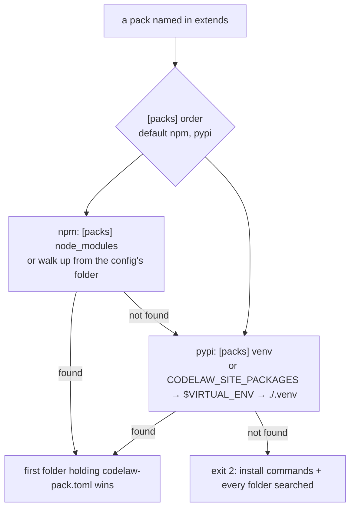

# SR-PACK-LOOKUP: where the engine finds a rule pack

## §1 — For humans

**The decision in one line.** Each pack is looked up on its own: first in
`node_modules`, then in the Python environment. The Python step tries the
launcher's paths, then `$VIRTUAL_ENV`, then the project's own `.venv`, and
**keeps going** until one holds the pack. A `[packs]` section in
`codelaw.toml` replaces any of these defaults with fixed folders.

Until this record, the Python step took the *first* of those three that was
set and never looked further. An editor started from another project's shell
inherited that project's `VIRTUAL_ENV`, so the engine searched the wrong venv
and stopped with "pack missing", even though the pack sat in this project's
`.venv`. Where the engine binary is installed plays no part. The extension only
starts the binary; the engine finds the packs.

```toml
[packs]                         # optional; every key replaces its default
order        = ["npm", "pypi"]  # default: npm first
node_modules = ["node_modules"] # default: walk up from the config's folder
venv         = ".venv"          # default: launcher paths, $VIRTUAL_ENV, ./.venv
```



<details>
<summary><b>ASCII twin</b> — the same diagram, for terminals and diffs</summary>

```text
 a pack named in extends
          |
   [packs] order (default: npm, pypi)
          |
   npm:  [packs] node_modules, else node_modules/ walking up from the config's folder
          |  found -> use it
          v  not found
   pypi: [packs] venv, else CODELAW_SITE_PACKAGES -> $VIRTUAL_ENV -> ./.venv
          |  found -> use it
          v  not found
   exit 2: the install commands + every folder searched
```

</details>

---

## §2 — For agents

### Context

`PackSearch::new` in `crates/codelaw-rules/src/pack.rs` chose one Python
source: `CODELAW_SITE_PACKAGES`, *else* `$VIRTUAL_ENV`, *else* `.venv/` at
the project root. In codelaw-playground (2026-10-30), VS Code was started from
a shell with the codelaw repo's venv active. The extension starts the server
with `spawn(path, ["lsp", "--stdio"], { cwd })` and no `env`
(`packaging/vscode/src/extension.ts`), so the server inherited that
`VIRTUAL_ENV`. `rules-python` was only in the playground's `.venv`, and the run
stopped. The workaround was a wrapper script set as `codelaw.path`. The decider
asked for the fallback, for this lookup in a record of its own, and for both
places to be settable in the TOML file.

### Decision

1. **One pack at a time.** Every pack a run needs (named in `extends`, or by a
   preset's `extends`) is looked up on its own. One run may load some packs
   from `node_modules` and others from a venv.
2. **Registries in order.** The default is `npm`, then `pypi`. A first-party
   pack is looked for only on the registries it is published on
   ([SR-RULE-PACKS](0101_rule-packs.md) §1). The first folder that holds the
   pack's `codelaw-pack.toml` wins; the two copies of one version are identical
   (SR-RULE-PACKS decision 3).
3. **npm places, by default:** `<dir>/node_modules/<package>` for the config
   file's folder and then every parent folder up to the filesystem root.
4. **Python places, by default.** The engine joins these lists, drops
   duplicates and searches them in order:
   - a. each path in `CODELAW_SITE_PACKAGES`, which the Python launcher sets,
     split with the OS path-list separator;
   - b. the site-packages folders of `$VIRTUAL_ENV`;
   - c. the site-packages folders of `.venv/` in the root config's folder.

   A variable that is unset or empty adds nothing. **The engine searches all
   three, not just the first one that is set.**
5. **A venv's site-packages folders** are every `lib/python*/site-packages`
   that exists, sorted by name, then `Lib/site-packages` (Windows). A PyPI pack
   is `<site-packages>/codelaw_rules_<name>/`: the distribution name,
   lower-cased, with `-` and `.` turned into `_`.
6. **`[packs]`: a root-only section of three optional keys.** A key that is
   set **replaces** its default; it is never added in front of it (the
   decider's ruling, 2026-10-30).

   | key | value | default | when set |
   |---|---|---|---|
   | `[packs] order` | an array of `"npm"` and `"pypi"`: one or both, no repeats | `["npm", "pypi"]` | the registries searched, in that order; a registry left out is not searched |
   | `[packs] node_modules` | an array of folders | decision 3's walk-up | exactly these folders, in order; no walk-up |
   | `[packs] venv` | one folder | decision 4's a–c | only this venv's site-packages; `CODELAW_SITE_PACKAGES` and `$VIRTUAL_ENV` are ignored |

   Relative paths resolve against the root config's folder
   ([SR-CONFIG](0110_config.md)). Absolute paths are allowed, and no `~` or
   variable is expanded.
7. **Strict validation** ([SR-CONFIG](0110_config.md)). Each of these is a
   load error (exit 2) that names the key: an unknown key, a wrong type, an
   empty `order`, an unknown or repeated registry, a set `node_modules` folder
   or `venv` that does not exist, and a `venv` with no site-packages folder.
   `[packs]` may not appear in a nested config, a profile or a preset.
8. **Every place is traceable.**
   - `codelaw config --print` lists the resolved places in order, each with its
     source: `[packs] …`, `CODELAW_SITE_PACKAGES`, `VIRTUAL_ENV`, `.venv` or
     the walk-up.
   - `codelaw rules --why <id>` and the JSON output name the folder a pack was
     loaded from, beside its name and version.
   - The missing-pack error (SR-RULE-PACKS decision 4) also lists every folder
     the engine searched.
9. **One lookup for every caller.** The CLI, LSP, MCP server and `codelaw
   migrate` build their places with one function in `codelaw-rules`. No caller
   reads `VIRTUAL_ENV` or `CODELAW_SITE_PACKAGES` itself. The skills-package
   lookup in `codelaw-agents` uses decision 4's chain for its Python step and
   keeps its own places around it.
10. **The editor needs no setting.** The language server inherits the editor's
    environment ([SR-EDITOR](0114_editor.md)). Decision 4c makes an inherited
    foreign `VIRTUAL_ENV` harmless when this project's `.venv` has the pack,
    and `[packs] venv` takes the environment out of the lookup entirely. The
    extension gets no `codelaw.env` setting.

### Consequences

- **What changes for projects:** a project whose `$VIRTUAL_ENV` lacks a pack
  that its `.venv` holds now loads instead of exiting 2. The only behaviour that
  changes is that error turning into a run. A pack in both still loads from
  `$VIRTUAL_ENV`.
- **Pinning:** with `venv` set, the CLI, the editor, CI and an agent's shell
  all load the same packs, whatever shell started them.
- **The playground's workaround goes:** its `.vscode/codelaw.sh` and its
  `codelaw.path` line can be deleted once a release carries this record.
- **Built** (W-155, 2026-10-31): the lookup is `PackSearch` and
  `python_places` in `crates/codelaw-rules/src/search.rs`, which this record
  owns; `[packs]` is parsed and checked in `crates/codelaw-config/src/packs.rs`
  (with a venv's site-packages folders, decision 5), which it describes. The
  two variables are read once, by `PackEnv::from_env` (or `from_vars` in a
  test). `config --print` lists packs.npm[n] and packs.pypi[n];
  `rules --why` names `pack_dir`; `rules --format json` lists `packs[]` with
  `dir`.

### Alternatives considered

- **A `codelaw.env` setting in the VS Code extension:** rejected. It fixes one
  editor, but not the CLI, other editors or an agent's shell, and the engine is
  the part that guessed wrong.
- **TOML paths put in front of the defaults:** rejected by the decider
  (2026-10-30). A stray `VIRTUAL_ENV` could still steer a run; with replace,
  the lookup is predictable.
- **Keeping the lookup in SR-RULE-PACKS decision 4:** rejected by the decider
  (2026-10-30), who wanted it in a record of its own. Decision 4 keeps the
  preset names, the namespace map and the missing-pack error, and links here
  for the places.
- **`venv` as a list:** not now. One venv per project is the only case seen.
- **A wrapper script in every consumer** (what the playground did): this is a
  workaround, not a design. Every consumer would need one.

### Reference (required)

- `crates/codelaw-rules/src/search.rs`: `PackSearch::new`, `python_places`,
  `find_npm`, `find_pypi`, `searched`: the lookup. (Before this record it was
  `PackSearch` in `crates/codelaw-rules/src/pack.rs`, which took only the
  first Python source that was set.)
- `crates/codelaw-engine/src/lib.rs` `Project::from_config`,
  `crates/codelaw-cli/src/migrate.rs` and `crates/codelaw-agents/src/package.rs`
  `candidates`: the callers.
- `packaging/vscode/src/extension.ts`: the server is spawned with no `env`.

### Veto condition

**Reopen this decision if:** a pack loads from a folder that `codelaw config
--print` does not list, or any code outside the one lookup function reads
`VIRTUAL_ENV` or `CODELAW_SITE_PACKAGES` to find a pack.

**How to check it:** `grep -rn 'VIRTUAL_ENV\|CODELAW_SITE_PACKAGES' crates --include=*.rs | grep -v '/tests/'`
should list only the lookup function and the code that reads the two variables
once at startup. On a project, the folders in `codelaw rules --format json`
must all appear in `codelaw config --print`.

---

## References

*Every source this record cites, gathered in one place. An archived document
is never listed here.*

**Records** — [SR-RULE-PACKS](0101_rule-packs.md) · [SR-CONFIG](0110_config.md) · [SR-EDITOR](0114_editor.md) · [SR-RULE-FORMAT](0112_rule-format.md)

**Code**

- [`crates/codelaw-rules/src/search.rs`](../crates/codelaw-rules/src/search.rs)
- [`crates/codelaw-config/src/packs.rs`](../crates/codelaw-config/src/packs.rs)
- [`crates/codelaw-engine/src/lib.rs`](../crates/codelaw-engine/src/lib.rs)
- [`crates/codelaw-cli/src/migrate.rs`](../crates/codelaw-cli/src/migrate.rs)
- [`crates/codelaw-agents/src/package.rs`](../crates/codelaw-agents/src/package.rs)
- [`packaging/vscode/src/extension.ts`](../packaging/vscode/src/extension.ts)

**Project docs**

- [`archive/open/W-155-pack-lookup.md`](../archive/open/W-155-pack-lookup.md) (the closed item, named not cited)
