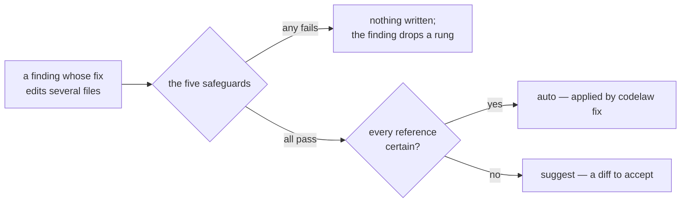

# SR-MULTI-FILE-FIXES: a fix may edit several files

## §1 — For humans

Some findings can only be fixed in more than one place:

- A CSS class renamed to the team's convention must change in every page and
  script that uses it.
- An export renamed must change in every file that imports it.
- A package imported but not declared must be added to `package.json`.

Done by hand, these are the edits an agent most often gets wrong: it misses
one file.

**Ruled by Arpit, 2026-11-05:** allowed (*"Allow multi-file (Recommended)"*),
then, by voice, in its own record and configurable: *"Create an SR for
this."* · *"and make it configurable"* · *"it does and that's all"*.

The five safeguards are what keep a multi-file fix from breaking the build,
so they are never configurable. The settings decide only whether the fix is
offered, and whether it may be applied automatically.



<details>
<summary><b>ASCII twin</b></summary>

```text
  finding (fix edits N files) --> five safeguards --any fails--> nothing written, a rung lower
                                        | all pass
                                        v
                         every reference certain? --yes--> auto (codelaw fix only)
                                        | no
                                        v
                                     suggest (a diff to accept)
```

</details>

---

## §2 — For agents

### Context

A `TextEdit` carries no path, so every fix lived in its own file. 22 rules
could not climb the fix ladder without editing other files
([the design](../work/proposals/fix-capabilities.md) §2.2b):

- renames of CSS classes, ids, custom properties, keyframes, layers,
  containers and custom media;
- SCSS variables, mixins and placeholders, and CSS-module classes;
- Stencil tags, `js/new-cap`, the React hook-prefix rules,
  `jsx-pascal-case`, `js/no-default-export`, `spell/known-typo-key` and
  `html/valid-id`;
- and the two `node/no-extraneous-*` rules, which add a dependency to
  `package.json`.

### Decision

1. **A fix may edit several files.** A fix is a list of edit sets, each
   naming its file by its project-relative path, plus file-level operations
   (`strip-bom`). Every output carries the path:
   - JSON and MCP keep the finding's own file's edits in the finding's `fix` object, under `edits`, and
     group the others by `path` under that object's `files` (each with its `edits`, and
     `strip_bom` when the fix removes the file's byte-order mark); a choice
     carries its own `files`;
   - SARIF uses `artifactChanges`;
   - LSP uses a `WorkspaceEdit`;
   - the text and agent lines say how many files the fix edits.
2. **The five safeguards.** Every multi-file fix passes all five, every
   time, and none is configurable:
   1. **Every file still parses.** If any edited file gains a syntax error,
      the whole fix is refused. [L4](0006_LAW-4-every-rule-has-a-fix.md)
      decisions 9 and 10 hold in every file: a second run changes nothing,
      the rule no longer fires, and bytes outside the edits are identical.
   2. **Nothing is left dangling.** The project graph
      ([SR-PROJECT-GRAPH](0103_project-graph.md)) is rebuilt over the edited
      files. If an import, class, id or other reference that resolved before
      now resolves to nothing, the fix is refused.
   3. **All or nothing.** Every file is written, or none is. Each goes to a
      temporary file first and is then renamed into place, and any failure
      restores every file already renamed.
   4. **Automatic only when it is certain.** The fix is `auto` only when
      every use it edits is resolved statically: SCSS members through
      `@use`, or an export whose importers are all static (no module marked
      `dynamic`, SR-PROJECT-GRAPH decision 4). One use the graph only
      guesses at, such as a class token inside a string, makes the whole fix
      `suggest`.
   5. **Never in the background.** A multi-file fix is never applied on save
      or by an agent hook (L4 decision 12). It is applied by `codelaw fix`
      (`fix --unsafe` for a `suggest` one), by a pre-commit run of it, by
      choosing it as a quick fix in the editor, or by an agent accepting it
      through MCP.

   A refused fix leaves every file untouched, and the finding drops a rung
   (L4 decision 2).
3. **The settings.** One key, `multi_file`, takes `"auto"`, `"suggest"` or
   `"off"` ([SR-CONFIG](0110_config.md) decision 11g):
   - **For the project:** `[fix] multi_file`. The default is `"auto"`.
   - **Per rule:** `multi_file` in the rule's entry, in `[rules]`, a
     `[scope.<name>]` or a `[profile.<name>.rules]`, as `fix` is (SR-CONFIG
     decision 11d). The rule entry wins over the project key.
   - **`"suggest"`** keeps every multi-file fix a diff to accept, even when
     safeguard 4 would allow `auto`.
   - **`"off"`** offers no multi-file fix. The finding is `manual` with
     exception `restructure`, and its steps are the edits the fix would have
     made.
   - **No setting raises a fix.** `"auto"` is a fix's best case, still bound
     by safeguard 4.
   - `codelaw config --print` and `rules --why` show the setting in force and
     the line that set it.
4. **The cache.** A finding with a multi-file fix is keyed on the content
   hashes of every file the fix reads or edits, as `scope: project` rules
   are ([SR-CACHE](0109_cache.md)).
5. **No network, no model** ([L5](0007_LAW-5-no-model-in-the-engine.md)).
   Every fact a multi-file fix uses comes from the project's own files,
   through the graph.

### Consequences

- **Built: yes** (W-162, 2026-11-08):
  - the edit model: `FileEdit { path, edits, strip_bom }` on `Diagnostic.files`
    and `FixChoice.files` (`codelaw-core`); a native rule writes it into its
    finding's edits with `in_files` and `choice_in_files` (`codelaw-native`);
  - the pass: `codelaw fix` applies multi-file fixes after every file's own,
    one at a time (`crates/codelaw-engine/src/multi_file.rs`); safeguard 1 is
    the per-file parse count plus "the finding is gone and no rule fires in
    an edited file that did not fire there before"; safeguard 2 is
    `codelaw_graph::dangling`, compared before and after: an unresolved
    relative import, a named or default import a project module does not
    export, an undefined CSS Module class and a markup or script class token
    no stylesheet defines. Ids and custom properties are not graph facts:
    their renames are found file by file and are always `suggest`;
    safeguard 3 is `codelaw_fix::write_all_or_nothing` (temporary files,
    then renames; a failed rename restores every file already renamed);
    safeguard 5: the pass never runs with `on_edit`, and the per-file loop
    never offers such a fix;
  - a refused fix leaves every file as it was and its finding is `manual`,
    its note `fix-refused: <why>`;
  - outputs: JSON and MCP list the other files under the `fix` object's `files`, SARIF one `artifactChanges` entry per
    file, the text and agent lines `edits N files`, the hook's line names the
    other files' edits and says it never applies them, the editor's quick fix
    one `WorkspaceEdit` over every file (offered only while each other file's
    open text is its disk text); "fix all" on save never carries one;
  - the cost (L8): a rule reads other files only for a finding that offers
    a fix, each file once per checked file, through a read cache checked by
    size and modification time (8 MB, `crates/codelaw-engine/src/files.rs`);
    past 4,000 candidate files no rename is offered; the pass runs, and
    builds the graph, only when a finding offers a multi-file fix; a class
    token counts as dangling only when it named a class before the fix
    (`codelaw_graph::introduced`);
  - the rule tester applies them in its virtual repo, so a rule's
    multi-file `files` examples prove them;
  - `crates/codelaw-cli/tests/multi_file.rs`, `crates/codelaw-lsp/tests/server.rs`
    (`a_multi_file_fix_is_one_workspace_edit_over_every_file`) and the writer's
    tests in `crates/codelaw-fix/src/tests.rs`.
- L4 decisions 9, 10 and 12 point here; single-file fixes are unchanged.
- **The rules moved** (W-162, 2026-11-08; each proven by `codelaw test`,
  multi-file examples included):
  - renames in several files, `suggest`: `css/selector-class-pattern`,
    `-id-pattern`, `custom-property-pattern`, `keyframes-name-pattern`,
    `layer-name-pattern`, `container-name-pattern`, `custom-media-pattern`,
    `scss/percent-placeholder-pattern`, `css-modules/class-naming`,
    `js/new-cap`, `react/jsx-pascal-case`, `js/no-default-export`;
  - `auto` where every use is resolved, else `suggest`:
    `scss/dollar-variable-pattern` and `at-mixin-pattern` (users through
    `@use`), `react/hook-prefix` and `no-unnecessary-use-prefix` (nothing
    imports it);
  - read other files, edit this one: `js/no-default-import`, `js/no-undef`
    and `react/jsx-no-undef` (`suggest`, choices), `node/no-missing-import`
    and `-require` (`suggest`), `css-modules/no-undefined-class`
    (`suggest`), `py/no-star-import`, `nested-star-import` and
    `star-import-usage` (`auto` with one star import);
  - another file only: `node/no-extraneous-import` and `-require`
    (`suggest`, choices `dependencies` / `devDependencies`, at the version
    installed);
  - a file-level operation: `html/no-utf8-bom` (`auto`, `strip_bom`);
  - a move in one file, no longer waiting: `py/module-import-not-at-top`
    (`suggest`);
  - re-judged `manual`: `html/valid-id`, `stencil/tag-prefix`,
    `stencil/ban-prefix`, `data/codeowners-coverage` (`value`);
    `scss/at-extend-no-missing-placeholder`, `spell/known-typo-key`,
    `ts/triple-slash-reference` (`restructure`).
- In a project with `multi_file = "off"`, a fix that edits another file is
  `manual`, `restructure`.

### Alternatives considered

- **Single-file fixes only:** rejected 2026-11-05. The 22 rules would stay
  `manual` `restructure`, and every rename would be done by hand.
- **Configurable safeguards:** rejected. They are what make the fix safe to
  offer at all.
- **Multi-file fixes on save:** rejected. They rewrite files nobody has
  open.

### Reference (required)

- [`work/proposals/fix-capabilities.md`](../work/proposals/fix-capabilities.md)
  §2.2b and §5: the design, and the question put.
- `crates/codelaw-core/src/diagnostic.rs` (`TextEdit`): the edit that gains a
  path.

### Veto condition

**Reopen this decision if:** a multi-file fix writes some of its files and
not others, or leaves a reference unresolved that resolved before it.

**How to check it:** `cargo test -p codelaw-cli --test multi_file` and
`cargo test -p codelaw-fix` (the writer's all-or-nothing tests).

---

## References

*Every source this record cites, gathered in one place. An archived document is never listed here.*

**Records** — [SR-LAW-4](0006_LAW-4-every-rule-has-a-fix.md) · [SR-LAW-5](0007_LAW-5-no-model-in-the-engine.md) · [SR-PROJECT-GRAPH](0103_project-graph.md) · [SR-CONFIG](0110_config.md) · [SR-CACHE](0109_cache.md)

**Code** — `crates/codelaw-core/src/diagnostic.rs` · `crates/codelaw-engine/src/multi_file.rs` · `crates/codelaw-fix/src/transaction.rs` · `crates/codelaw-graph/src/dangling.rs` · `crates/codelaw-native/src/multi_file.rs`

**Project docs** — [`work/proposals/fix-capabilities.md`](../work/proposals/fix-capabilities.md)
