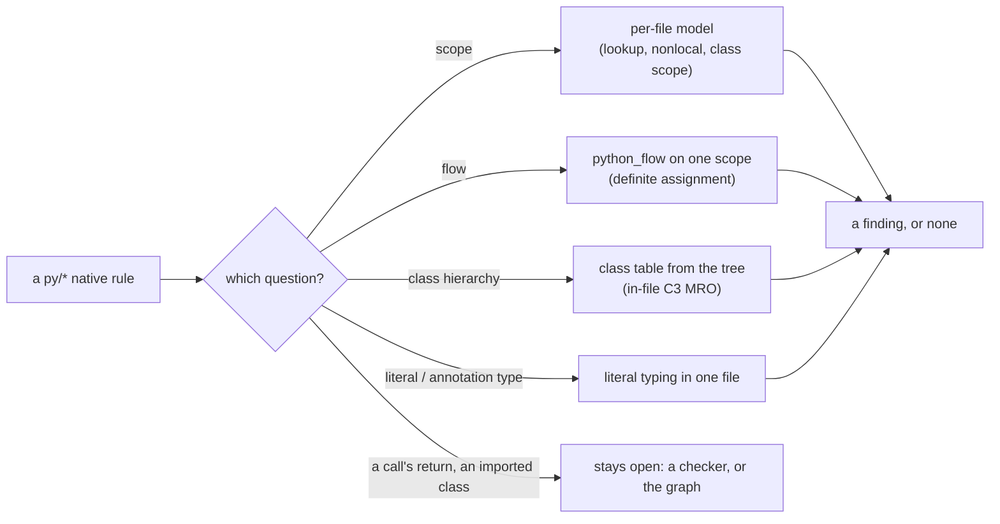

# SR-PY-INFERENCE — Python rules that need more than syntax: four lazy layers over the per-file model, no type checker

## §1 — For humans

**The decision in one line.** [SR-TYPES](0117_types.md) gives TypeScript rules a type program. Python has none, and codelaw ships none. The Python rules that need more than syntax are answered in **four layers, cheapest first, each built only when a rule that needs it is on**: questions about *scope* (answered by the per-file model), about *flow* (is this name bound on every path to this read), about an *in-file class hierarchy*, and about the type of a *literal or an annotated name*. A row that needs what only a real type checker knows stays unbuilt, with its exact question written down.

**Why not a checker.** A Python type checker is a large dependency, not the project's own tool the way a project's TypeScript is, and [L11](0013_LAW-11-dependencies.md) lets no dependency in without the decider. The four layers answer, honestly and with a stated narrowness, more than half of the 38 rows the first Python round could not write; the rest wait on one ruling (decision 8).



<details>
<summary><b>ASCII twin</b></summary>

```text
   py/* native rule --> scope? ---------> per-file model            --\
                    --> flow? ----------> python_flow (one scope)    ---+--> finding
                    --> hierarchy? -----> class table, in-file MRO   ---|
                    --> literal type? --> literal typing, one file   --/
                    --> a call's return, an imported class --> stays open (decision 8)
```

</details>

---

## §2 — For agents

### Context

[SR-TYPES](0117_types.md) asks a TypeScript the project already has. Python offers no such thing: the per-file model of [SR-ARCHITECTURE](0108_architecture.md) decision 15a knows which binding a name resolves to, not what a value is, which class derives from which, what a call returns, or whether a name is bound on this path. Round one of the Ruff and Pylint port ([W-139](../work/open/W-139-rule-parity-build.md)) therefore left 38 rows unwritten rather than fake them from syntax, and filed them as [W-174](../work/open/W-174-python-inference.md), each with its question. Upstream behaviour is Ruff 0.16.9 (source and fixtures, MIT) and Pylint 4.1.3 (behaviour from its functional tests only, never its code; [L2](0004_LAW-2-foss-dependencies.md)).

### Decision

1. **Scope.** Python rules in the `python` pack whose question is none of syntax, the model's name resolution, or an adapter's. They are native rules ([SR-ARCHITECTURE](0108_architecture.md) decision 15b), `stability: preview` and in no preset until corpus counts and promotion say otherwise ([SR-RULE-AUTHORING](0113_rule-authoring.md)).
2. **Four layers, each answering one question group; a rule uses the cheapest that answers its question.**

   | group | layer | where | what it knows |
   |---|---|---|---|
   | scope facts | queries on the per-file model | `codelaw-semantic` `SemanticModel::lookup`, `nonlocal_bound`, `scope_starting_at` | which binding a name read at a byte offset finds (own scope only before that offset, enclosing functions and the module whole, class scopes skipped); whether an enclosing function binds a `nonlocal` name; the scope of a `def` or `class` |
   | flow | `codelaw_semantic::python_flow`, a pass over **one** module or function | `crates/codelaw-semantic/src/py_flow.rs` | for each read of a name the scope binds: bound on every path, on some paths (and whether an `if` or a possibly-empty loop made the difference), or on none |
   | class hierarchy | a class table the rule builds from the tree | `crates/codelaw-native/src/py_classes.rs` | the classes of **this file**, their bases by name, their methods and decorators, the C3 linearization over them; a base the file imports is opaque |
   | value type | literal typing | `crates/codelaw-native/src/py_values.rs` | the type a literal, a `dict()`/`set()` call, a comprehension or an annotation (`dict[...]`, `set[...]`) gives a name bound once in its scope |

3. **The flow pass (`python_flow`).** It walks the statements of the scope in execution order. It keeps, per name, *bound*, *bound on some paths* or *absent*; branches of `if`/`elif`/`match` join; a loop is walked twice (the second from the join of entry and the first walk's end); a `try` handler starts from the names the body binds with a chance the binding never ran (a name whose first binding is a literal assignment that opens the body is safe); `return`, `raise`, `break`, `continue`, `sys.exit()` and a call to a function this file annotates `NoReturn` or `Never` end a path. A condition `a and (b := f())` binds `b` where it held. A later `if` with the same condition text as the one that bound a name is not reported (the two agree). Nested functions, lambdas, class bodies and comprehension bodies are evaluated elsewhere and not read; a scope with a wildcard import is not analysed; a module-level read of a builtin before the module binds it finds the builtin. It decides no condition's value: `if FALSE:` is a branch like any other, which is where it parts from Pylint's inference, and each rule's page says so.
4. **The class table.** Built by the rule from the file's `class_definition` nodes the first time a class rule fires on the file. Bases are looked up by name among the file's module-level classes; a base the file imports, a call, or a subscript makes the class's ancestry *open*, and a rule that needs the whole ancestry skips it. Cross-file bases resolve through the project graph ([SR-PROJECT-GRAPH](0103_project-graph.md)): not built; the rows that need them stay open (decision 7).
5. **Cost ([L8](0010_LAW-8-performance-budgets.md)).** Nothing here runs unless a rule that needs it is on. The model gains **methods only** — no field is filled while building it, so `check_cold_10k` is unchanged when none of these rules is on. The flow pass runs per scope when one of the three rules that read it fires on that scope; a rule that needs the class table builds it from the tree on that file. The rules are `preview`, so no default run turns them on. The first measured cost is recorded in [W-139](../work/open/W-139-rule-parity-build.md) once the corpus has run.
6. **No dependency.** The layers use `tree-sitter` and the per-file model already in the workspace. No type checker, no stub package, no network ([L5](0007_LAW-5-no-model-in-the-engine.md)).
7. **The rows, by layer.** Built (W-174): scope facts — `nonlocal-without-binding` (PLE0117), `builtin-attribute-shadowing` (A003), `missing-f-string-syntax` (RUF027), `used-dummy-variable` (RUF052), `unused-private-member`; flow — `used-before-assignment`, `possibly-used-before-assignment`, `undefined-loop-variable`, `possibly-unused-variable`, `looping-through-iterator`, `contextmanager-generator-missing-cleanup`; class hierarchy, in-file — the rows listed in W-174's item; value type — the rows listed there. **Left, with the question each needs:** a class from another file (`arguments-differ` and the other override rows against a base the file imports; `abstract-class-instantiated` and `super-init-not-called` for an imported base) — *what are this class's bases' methods*, which the project graph's class facts would answer; a call's return or a receiver's type (`ASYNC212` on a client that is not built in the same scope, `boolean-datetime`, `redefined-variable-type`, `invalid-format-index`, `missing-format-attribute`, `not-async-context-manager`, `non-iterator-returned`) — *what does this expression evaluate to*; a rule whose dedupe with an existing rule is unclear is linked, not duplicated.
8. **The question for the decider.** Should Python rows that need a call's return or an imported class's shape be answered by **the project's own type checker, found and asked like the project's TypeScript** ([SR-TYPES](0117_types.md) decision 5: codelaw installs and pins nothing, so [L11](0013_LAW-11-dependencies.md) decision 2 reads it as no dependency)? That means choosing which one (`ty`, pyright, mypy), a versioned protocol, and the CLI/LSP surface it needs; it would be its own work item and its own record, and nothing here assumes it. Until the decider rules, those rows stay open.

### Consequences

- 33 of the 38 rows have an answer in a layer; each rule page states what it does not read, so a finding is never more than the page says.
- Flow rules are heuristic where Pylint infers (a constant `if` condition, an iterator assigned through a helper): they under-report there and, in `try`/`except`, report the common real bug (a name bound only in the `try` body read in the handler).
- The class table's in-file limit is the main gap: until the project graph carries class facts, a class whose base is imported is invisible to the override rows. Naming that fact is the next step of this record.

### Alternatives considered

- **Embed or call a Python type checker now:** rejected without the decider (decision 8, [L11](0013_LAW-11-dependencies.md)).
- **Extend the model's build to record attribute accesses, flow and class bases for every Python file:** rejected — it would add to `check_cold_10k` for every run, rules or not ([L8](0010_LAW-8-performance-budgets.md)).
- **Port Pylint's astroid inference:** rejected — it is Pylint's code ([L2](0004_LAW-2-foss-dependencies.md)) and a type program in all but name.
- **Fake the rows from syntax (a name read before an assignment in text order):** rejected by W-139's own hazard — a rule that needs flow waits for flow.

### Reference (required)

- [`crates/codelaw-semantic/src/py_flow.rs`](../crates/codelaw-semantic/src/py_flow.rs) and [`crates/codelaw-native/src/py_flow.rs`](../crates/codelaw-native/src/py_flow.rs): the pass and the rules that read it; `cargo test -p codelaw-native` and `codelaw test packs/python` hold their cases.
- [`work/open/W-174-python-inference.md`](../work/open/W-174-python-inference.md): the 38 rows, each with its question, and what each slice built.

### Veto condition

**Reopen this decision if:** a layer runs without a rule that needs it being on; a rule of these layers is `stable` without the corpus counts and promotion that [SR-RULE-AUTHORING](0113_rule-authoring.md) asks; or a type checker, stub package or network call enters the engine for them.

**How to check it:** `grep -L 'stability: preview' packs/python/rules/py/{used-before-assignment,nonlocal-without-binding,looping-through-iterator}.md` prints nothing; `cargo tree -p codelaw-semantic -e normal` lists no type checker; `codelaw bench` `check_cold_10k` is unchanged with the pack's default presets (the rules are in none).

---

## References

*Every source this record cites, gathered in one place. An archived document is never listed here.*

**Records** — [SR-TYPES](0117_types.md) · [SR-ARCHITECTURE](0108_architecture.md) · [SR-PROJECT-GRAPH](0103_project-graph.md) · [SR-RULE-AUTHORING](0113_rule-authoring.md) · [SR-LAW-2](0004_LAW-2-foss-dependencies.md) · [SR-LAW-5](0007_LAW-5-no-model-in-the-engine.md) · [SR-LAW-8](0010_LAW-8-performance-budgets.md) · [SR-LAW-11](0013_LAW-11-dependencies.md)

**Code**

- [`crates/codelaw-semantic/src/py_flow.rs`](../crates/codelaw-semantic/src/py_flow.rs)
- [`crates/codelaw-native/src/py_scope.rs`](../crates/codelaw-native/src/py_scope.rs) · [`py_flow.rs`](../crates/codelaw-native/src/py_flow.rs) · [`py_classes.rs`](../crates/codelaw-native/src/py_classes.rs) · [`py_values.rs`](../crates/codelaw-native/src/py_values.rs)

**Project docs**

- [`work/open/W-174-python-inference.md`](../work/open/W-174-python-inference.md) · [`work/open/W-139-rule-parity-build.md`](../work/open/W-139-rule-parity-build.md)
