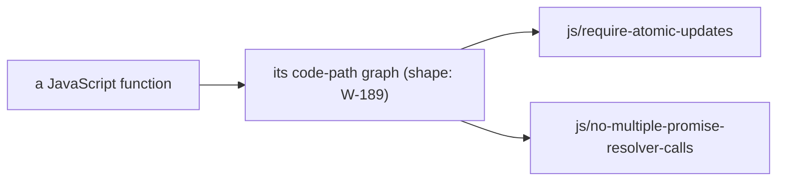

# SR-CODE-PATH-GRAPH — a code-path graph for JavaScript: proposed, its shape open

## §1 — For humans

**A code-path graph maps the routes through one function**: where control can
go at an `await`, around a loop, into a `catch`. Two JavaScript rules need
one — `js/require-atomic-updates` (a value read before an `await` and written
after it) and `js/no-multiple-promise-resolver-calls` (`resolve` or `reject`
reached twice). codelaw has no such graph for JavaScript yet.

**This record is proposed, not accepted.** It names the graph so it has one
home from the start. The research item W-189 proposes its shape; the decider
picks one, and this record then states it.



<details>
<summary><b>ASCII twin</b> — the same diagram, for terminals and diffs</summary>

```text
   a JavaScript function --> its code-path graph (shape: W-189)
                                 |--> js/require-atomic-updates
                                 '--> js/no-multiple-promise-resolver-calls
```

</details>

---

## §2 — For agents

### Context

The per-file semantic model answers which binding a name resolves to; it says
nothing about order of execution. Python has a flow pass for definite
assignment (SR-PY-INFERENCE); JavaScript has none. Two ported rows wait on one.

### Decision

1. **The graph is named, not designed.** Its shape — per function or across
   calls, what an edge carries, when it is built — is the decider's pick from
   W-189's proposal; this record is accepted with that pick.
2. **Nothing is built on it before then.** The two rows above wait on it.
3. **It is built only when a rule that needs it is on** (L8), and gives the
   same answer with or without an agent (L5).

### Consequences

- W-189 owes the proposal; W-191 places this record under SR-PROJECT-GRAPH's
  overview of the graphs.

### Alternatives considered

- **No record until the design is picked** — rejected by the decider
  (2026-11-09): the graph gets its record now.

### Reference (required)

- [`crates/codelaw-semantic/src/py_flow.rs`](../crates/codelaw-semantic/src/py_flow.rs) — the nearest thing codelaw has: a flow pass over one Python scope.
- [`work/open/W-189-js-code-path-graph-research.md`](../work/open/W-189-js-code-path-graph-research.md) — the research.

### Veto condition

**Reopen this decision if:** a rule is built on a JavaScript code-path graph while this record is still `proposed`.

**How to check it:** `grep -rl 'require-atomic-updates\|no-multiple-promise-resolver-calls' packs/js/rules` prints nothing while `status: proposed`.

---

## References

*Every source this record cites, gathered in one place. An archived document is never listed here.*

**Records** — [SR-PY-INFERENCE](0120_python-inference.md) · [SR-PROJECT-GRAPH](0103_project-graph.md)

**Code**

- [`crates/codelaw-semantic/src/py_flow.rs`](../crates/codelaw-semantic/src/py_flow.rs)

**Project docs**

- [`work/open/W-189-js-code-path-graph-research.md`](../work/open/W-189-js-code-path-graph-research.md) · [`work/open/W-191-graph-records.md`](../work/open/W-191-graph-records.md)
