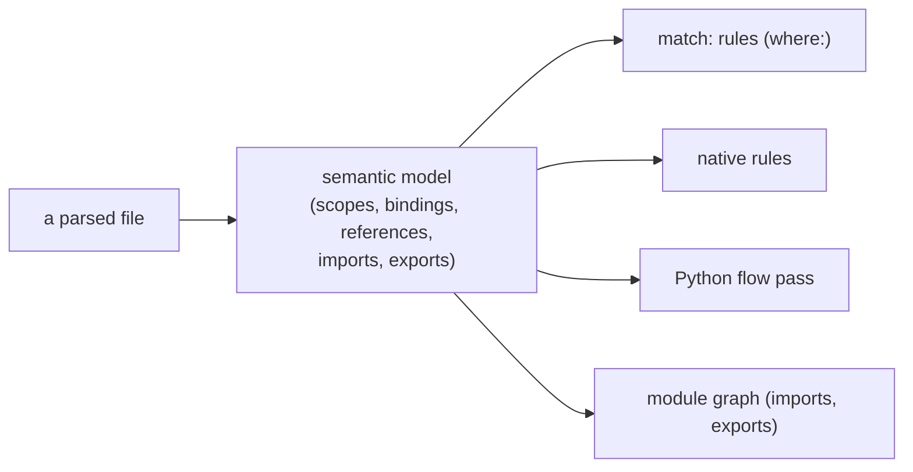

# SR-SEMANTIC-MODEL — the per-file semantic model: scopes, bindings, references, imports and exports for JS/TS and Python, no type information

## §1 — For humans

**The decision in one line.** For JavaScript, TypeScript (JSX and TSX included) and Python, a file can get a **semantic model**: its scopes, the bindings each declares, the references that resolve to them, and its imports and exports. It is built **once, from the syntax tree already parsed, and only when an active rule needs it**. It knows which binding a name finds, never what a value *is* ([L3](0005_LAW-3-languages.md)).

**Who reads it.** A `match:` rule through the predicates of [SR-RULE-FORMAT](0112_rule-format.md), a native rule directly ([SR-ARCHITECTURE](0108_architecture.md) decision 15b), the Python flow pass ([SR-PY-FLOW](0124_python-flow.md)), and the module graph, which links the imports and exports the model already computed ([SR-MODULE-GRAPH](0122_module-graph.md)). [SR-PROJECT-GRAPH](0103_project-graph.md) shows it beside the other graphs.



<details>
<summary><b>ASCII twin</b> — the same diagram, for terminals and diffs</summary>

```text
   parsed file --> semantic model --> match: rules (where:)
                                  --> native rules
                                  --> Python flow pass
                                  --> module graph (imports, exports)
```

</details>

---

## §2 — For agents

### Context

A pattern sees one node and its neighbours; "is this name used", "does this identifier refer to the import above" and "is this binding reassigned" need scopes. The approach is `oxc_semantic` (MIT) for JS/TS and Ruff's semantic model (MIT) for Python. This record was decision 15a of [SR-ARCHITECTURE](0108_architecture.md) until W-191 moved it.

### Decision

1. **What it holds.** For JS/TS (JSX and TSX included) and Python, each file gets scopes, bindings, references, imports and exports.
2. **How it is built.** From the same syntax tree, in one pass after parsing (crate `codelaw-semantic`), and only when at least one active rule needs it.
3. **How rules use it.** `match:` rules query it through the predicates of [SR-RULE-FORMAT](0112_rule-format.md) decision 3a, written under `where:`; native rules read it directly.
4. **Shared with the graph.** Its imports and exports are the per-file facts the module graph links, so they are computed once ([SR-MODULE-GRAPH](0122_module-graph.md)).
5. **Python specifics** (W-17). PEP 695 type parameters live in an annotation scope around their `def`, `class` or `type` statement — annotations, bases, the body and methods see them, defaults and the enclosing scope don't. An `__all__` the model can read (lists, tuples, `+`, `+=`, `.extend()`, `.append()` of string literals) is the export list; one with any other part (`sub.__all__`, a call) is unknowable, and every public module-level name, imports included, counts as exported — a deliberate false negative over a false `unused-import`. The model keeps what it read — `SemanticModel::py_all` (the literal names, `None` without an `__all__`) and `py_all_dynamic` — for the module graph's Python queries (SR-MODULE-GRAPH decision 12, W-185).
6. **JS/TS specifics** (W-17). `export { Name }` exports every namespace of the name (a value and a type merged under one name); enum members are declared in the enum's own scope and never unused; the head of `NS.T` in a type is a type reference.
7. **No type information** ([L3](0005_LAW-3-languages.md)). The model answers which binding a name resolves to, not what a value is, which class derives from which, or what a call returns; the rows that need more are [SR-PY-INFERENCE](0120_python-inference.md)'s or [SR-TYPES](0117_types.md)'s.
8. **Cached** with the file's results ([SR-CACHE](0109_cache.md)).
9. **Where the approach comes from.** `oxc_semantic` (MIT) for JS/TS and Ruff's semantic model (MIT) for Python. Taking either as a dependency needs its own record ([L11](0013_LAW-11-dependencies.md)).

### Consequences

- **The model is in the hot path** for every JS/TS and Python file that a scope-aware rule touches; it is built lazily and measured by `check_warm_10k` ([L8](0010_LAW-8-performance-budgets.md)).
- It is the floor under three records: the module graph links its imports and exports, the Python flow pass reads one of its scopes, and the Python inference layers ask it their scope questions.

### Alternatives considered

- **A type program for every language:** rejected — [L3](0005_LAW-3-languages.md); TypeScript's is [SR-TYPES](0117_types.md)'s, asked only where the project has one.
- **Take `oxc_semantic` as a dependency:** not done; it needs its own record ([L11](0013_LAW-11-dependencies.md)).

### Reference (required)

- [`oxc_semantic`](https://docs.rs/oxc_semantic) and [Ruff's semantic model](https://github.com/astral-sh/ruff/tree/main/crates/ruff_python_semantic): the approaches this ports.
- [`crates/codelaw-semantic/src/lib.rs`](../crates/codelaw-semantic/src/lib.rs): `build` and `supports`; `model.rs` holds the queries.

### Veto condition

**Reopen this decision if:** the model is built for a file that no active rule needs it for, or a type checker, stub package or network call enters `codelaw-semantic`.

**How to check it:** `cargo tree -p codelaw-semantic -e normal` lists no type checker, and `codelaw bench` `check_cold_10k` is unchanged with the pack's default presets.

---

## References

*Every source this record cites, gathered in one place. An archived document is never listed here.*

**Records** — [SR-PROJECT-GRAPH](0103_project-graph.md) · [SR-MODULE-GRAPH](0122_module-graph.md) · [SR-PY-FLOW](0124_python-flow.md) · [SR-PY-INFERENCE](0120_python-inference.md) · [SR-ARCHITECTURE](0108_architecture.md) · [SR-RULE-FORMAT](0112_rule-format.md) · [SR-CACHE](0109_cache.md) · [SR-TYPES](0117_types.md) · [SR-LAW-3](0005_LAW-3-languages.md) · [SR-LAW-8](0010_LAW-8-performance-budgets.md) · [SR-LAW-11](0013_LAW-11-dependencies.md)

**Code**

- [`crates/codelaw-semantic/src/lib.rs`](../crates/codelaw-semantic/src/lib.rs)

**External** — [`oxc_semantic`](https://docs.rs/oxc_semantic) · [Ruff's semantic model](https://github.com/astral-sh/ruff/tree/main/crates/ruff_python_semantic)
