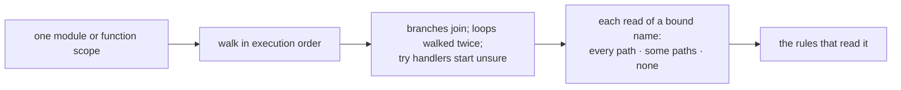

# SR-PY-FLOW — the Python flow pass: is a name bound on every path to a read, over one scope

## §1 — For humans

**The decision in one line.** A Python rule that asks "is this name assigned on every path that reaches this read?" is answered by a **flow pass over one module or one function**: it walks the statements in the order they run and keeps, per name, *bound*, *bound on some paths* or *absent*. It runs only when a rule that reads it is on, and it never decides a condition's value — `if FALSE:` is a branch like any other, which is where it parts from Pylint's inference.

**Where it sits.** It is the second of the four layers of [SR-PY-INFERENCE](0120_python-inference.md), on top of the per-file model of [SR-SEMANTIC-MODEL](0123_semantic-model.md); [SR-PROJECT-GRAPH](0103_project-graph.md) shows it beside the other graphs. JavaScript has no such pass: [SR-CODE-PATH-GRAPH](0121_code-path-graph.md) names the graph two JavaScript rows wait on.



<details>
<summary><b>ASCII twin</b> — the same diagram, for terminals and diffs</summary>

```text
   one scope --> walk in execution order --> join branches, loops twice, try handlers unsure
             --> per read: every path | some paths | none --> the rules that read it
```

</details>

---

## §2 — For agents

### Context

[SR-PY-INFERENCE](0120_python-inference.md) answers the Python rules that need more than syntax in layers; one question group is flow — is this name bound on every path to this read — which the per-file model ([SR-SEMANTIC-MODEL](0123_semantic-model.md)) cannot answer because it knows scopes, not order of execution. Pylint's `used-before-assignment` family asks it. This record holds the pass; SR-PY-INFERENCE holds the layers around it.

### Decision

1. **Where it lives.** `codelaw_semantic::python_flow`, a pass over **one** module or function, in `crates/codelaw-semantic/src/py_flow.rs`. For each read of a name the scope binds, it reports bound on every path, on some paths (and whether an `if` or a possibly-empty loop made the difference), or on none.
2. **How it walks.** It walks the statements of the scope in execution order. It keeps, per name, *bound*, *bound on some paths* or *absent*; branches of `if`/`elif`/`match` join; a loop is walked twice (the second from the join of entry and the first walk's end); a `try` handler starts from the names the body binds with a chance the binding never ran (a name whose first binding is a literal assignment that opens the body is safe); `return`, `raise`, `break`, `continue`, `sys.exit()` and a call to a function this file annotates `NoReturn` or `Never` end a path. A condition `a and (b := f())` binds `b` where it held. A later `if` with the same condition text as the one that bound a name is not reported (the two agree). Nested functions, lambdas, class bodies and comprehension bodies are evaluated elsewhere and not read; a scope with a wildcard import is not analysed; a module-level read of a builtin before the module binds it finds the builtin.
3. **It decides no condition's value.** `if FALSE:` is a branch like any other, which is where it parts from Pylint's inference, and each rule's page says so.
4. **Cost** ([L8](0010_LAW-8-performance-budgets.md)). It runs per scope when one of the rules that read it fires on that scope; nothing runs it otherwise, and the model it reads gains no field for it ([SR-PY-INFERENCE](0120_python-inference.md) decision 5).
5. **No dependency.** It uses `tree-sitter` and the per-file model already in the workspace — no type checker, no network ([L5](0007_LAW-5-no-model-in-the-engine.md)).
6. **The rules that read it** are SR-PY-INFERENCE's rows (its decision 7): `used-before-assignment`, `possibly-used-before-assignment`, `undefined-loop-variable`, `possibly-unused-variable`, `looping-through-iterator`, `contextmanager-generator-missing-cleanup`, in `crates/codelaw-native/src/py_flow.rs`.

### Consequences

- Flow rules are heuristic where Pylint infers (a constant `if` condition, an iterator assigned through a helper): they under-report there and, in `try`/`except`, report the common real bug (a name bound only in the `try` body read in the handler).
- A fact the pass reads that is not in one file — what a call never returns, an imported function's annotation — is not known to it; only this file's own `NoReturn` annotations count.

### Alternatives considered

- **Port Pylint's astroid inference:** rejected — it is Pylint's code ([L2](0004_LAW-2-foss-dependencies.md)) and a type program in all but name ([SR-PY-INFERENCE](0120_python-inference.md)).
- **A name read before an assignment in text order, as a syntax check:** rejected by W-139's own hazard — a rule that needs flow waits for flow.

### Reference (required)

- [`crates/codelaw-semantic/src/py_flow.rs`](../crates/codelaw-semantic/src/py_flow.rs): the pass; `cargo test -p codelaw-semantic` holds its cases.
- [`crates/codelaw-native/src/py_flow.rs`](../crates/codelaw-native/src/py_flow.rs): the rules that read it.

### Veto condition

**Reopen this decision if:** the pass runs on a scope no rule that reads it fired on, or it starts deciding a condition's value, or a type checker, stub package or network call enters it.

**How to check it:** `cargo tree -p codelaw-semantic -e normal` lists no type checker; `grep -n 'fn analyze' crates/codelaw-semantic/src/py_flow.rs` shows the pass takes a scope and a `FlowConfig`, not a condition evaluator; `codelaw bench` `check_cold_10k` is unchanged with the pack's default presets.

---

## References

*Every source this record cites, gathered in one place. An archived document is never listed here.*

**Records** — [SR-PY-INFERENCE](0120_python-inference.md) · [SR-SEMANTIC-MODEL](0123_semantic-model.md) · [SR-PROJECT-GRAPH](0103_project-graph.md) · [SR-CODE-PATH-GRAPH](0121_code-path-graph.md) · [SR-LAW-2](0004_LAW-2-foss-dependencies.md) · [SR-LAW-5](0007_LAW-5-no-model-in-the-engine.md) · [SR-LAW-8](0010_LAW-8-performance-budgets.md)

**Code**

- [`crates/codelaw-semantic/src/py_flow.rs`](../crates/codelaw-semantic/src/py_flow.rs) · [`crates/codelaw-native/src/py_flow.rs`](../crates/codelaw-native/src/py_flow.rs)
